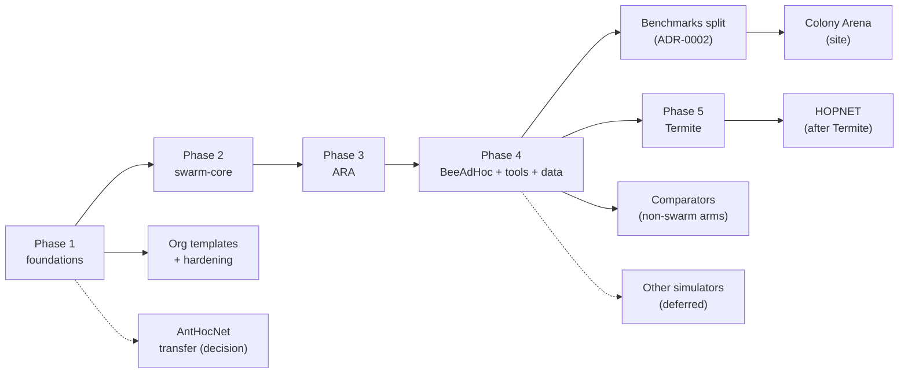
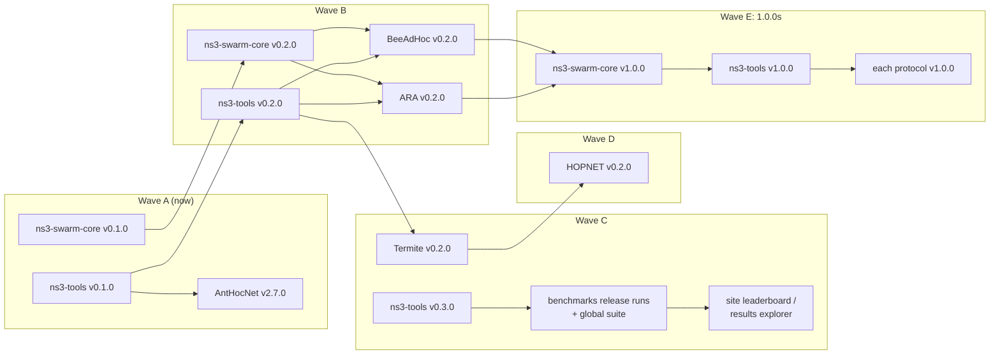

# swarm-routing roadmap

The plan for the whole org: what each phase delivers, what has to be true
before it counts as done, and what we deliberately do not do. It mirrors
[AntHocNet's `docs/roadmap.md`](https://github.com/swarm-routing/AntHocNet/blob/main/docs/roadmap.md)
(ladder, exit criteria, non-goals), the source repository's roadmap, which
keeps governing AntHocNet itself.

**How it is kept.** This file is the plan; issues are the work. Each phase has
one epic in the repository that owns it, its tasks are sub-issues (across
repositories where needed), and live status is the org's GitHub Project board
(views by phase, repository and priority). A phase moves to *done* here in the
PR that closes its epic. Changing a phase's scope or exit criteria is a PR to
this file, like any other decision. [Epics](#epics) below lists every epic of
every public repository with its status, generated from the issues by
`tools/epics/epics.py` (the same list is in each repository's README).
Whoever opens, closes or re-scopes an epic, or changes one of its sub-issues,
refreshes it in that PR or the next one (CONTRIBUTING, "Epics are the public
plan"); the weekly `epics` workflow only reports drift.

## Direction beyond ns-3 (proposed 2026-11-12)

Proposed after a review of every repository and open issue on 2026-11-12, and
not decided yet: the issues marked *decision* below wait on the maintainer.
This section becomes the frame of this file when
[.github#261](https://github.com/swarm-routing/.github/issues/261) rewrites it
by tracks; until then the phases below stay as they are.

**The goal.** A swarm-protocol environment built on ns-3 whose protocols also
run on other simulators and as software installed on Raspberry Pis and other
Linux computers, tested there with the same scenes, and a protocol of the org's
own if the tests say one is needed.

**Decided on 2026-11-12 (the maintainer, on the issues named):**
- **swarm-core is required for every protocol, AntHocNet included**
  ([ns3-swarm-core#14](https://github.com/swarm-routing/ns3-swarm-core/issues/14)).
  AntHocNet's `core/` and ns-3 adapter move onto it before swarm-core's
  `v1.0.0`, so the freeze covers every protocol.
- **The host contract is swarm-core `2.0.0`**
  ([.github#253](https://github.com/swarm-routing/.github/issues/253), item 4).
  `v1.0.0` freezes the ns-3 API as it is. Support for other simulators, Linux
  daemons, emulation and Raspberry Pi follows on the 2.0.0 line, one epic per
  target.
- **Priorities ([.github#262](https://github.com/swarm-routing/.github/issues/262))**,
  the `model:*` labels as Claude Pro suggestions
  ([.github#280](https://github.com/swarm-routing/.github/issues/280)), outside
  PRs ([.github#288](https://github.com/swarm-routing/.github/issues/288)), the
  test ladder ([.github#268](https://github.com/swarm-routing/.github/issues/268)),
  the fitness tests ([.github#269](https://github.com/swarm-routing/.github/issues/269))
  and routing security ([.github#273](https://github.com/swarm-routing/.github/issues/273)):
  as recommended on each issue.

| Track | What | Epic | Decisions it waits on |
|---|---|---|---|
| **A** Protocols on ns-3 | the phases and the [release train](#the-release-train) below, unchanged | each repository's epic | none |
| **B** Portable runtime | one host contract for every `core/`, a standalone discrete-event host, a Linux daemon, installable packages, a Raspberry Pi testbed; another simulator last ([Later: other simulators](#later-other-simulators-deferred)) | [.github#250](https://github.com/swarm-routing/.github/issues/250) | [.github#253](https://github.com/swarm-routing/.github/issues/253) (order of hosts, where the code lives, licence, timing, who owns each adapter), [.github#268](https://github.com/swarm-routing/.github/issues/268) (the scenes and their tolerances) |
| **C** Research | security under one epic; network families under one owner; AntHocNet or a protocol of our own, decided by tests; the remaining swarm protocols' verdicts | [.github#272](https://github.com/swarm-routing/.github/issues/272); [ns3-tools#43](https://github.com/swarm-routing/ns3-tools/issues/43) ([.github#275](https://github.com/swarm-routing/.github/issues/275)); [.github#252](https://github.com/swarm-routing/.github/issues/252); [.github#54](https://github.com/swarm-routing/.github/issues/54) | [.github#273](https://github.com/swarm-routing/.github/issues/273) (threat model), [.github#269](https://github.com/swarm-routing/.github/issues/269) (the deciding tests and the naming rule), [.github#264](https://github.com/swarm-routing/.github/issues/264) (gates for a protocol with no paper) |
| **I** Infrastructure | templates, hardening, CI time, images, releases, skills, the AI files; it rides along with any release and gates none, except the items [Releases](#releases) names as gates (today the release workflow's `increment` input, .github#211, for wave E) | [.github#6](https://github.com/swarm-routing/.github/issues/6), [#14](https://github.com/swarm-routing/.github/issues/14), [#150](https://github.com/swarm-routing/.github/issues/150), [#141](https://github.com/swarm-routing/.github/issues/141), [#216](https://github.com/swarm-routing/.github/issues/216) | [.github#262](https://github.com/swarm-routing/.github/issues/262) (priorities, the infrastructure share), [.github#280](https://github.com/swarm-routing/.github/issues/280) (the `model:*` labels) |

**One test ladder.** Nine named scenes with stated expectations (RT-1 to RT-9,
[.github#268](https://github.com/swarm-routing/.github/issues/268)) are run on
every rung and judged by one checker: `core/` unit tests, ns-3 (the reference,
and the only rung whose numbers are published), a standalone discrete-event
host, another simulator, the Linux daemon in network namespaces, emulation,
and real computers. A host is written to pass them; results off ns-3 stay
qualitative.

**Tests decide the protocol.** AntHocNet is the pathfinder for track B. Seven
deployment-fitness tests ([.github#269](https://github.com/swarm-routing/.github/issues/269)),
most runnable on ns-3 today, decide whether it is installed under its own name
or whether its failures become the requirements of a new protocol, which needs
a new name as soon as a mechanism its paper lacks is on by default.

**The clean-up that goes with it** is
[.github#251](https://github.com/swarm-routing/.github/issues/251): this file
by tracks, duplicated and finished issues, stale handoffs, decisions as a
queue. Making the agent files shorter and the org's state readable by a new
session is under [.github#141](https://github.com/swarm-routing/.github/issues/141)
([#277](https://github.com/swarm-routing/.github/issues/277),
[#278](https://github.com/swarm-routing/.github/issues/278),
[#281](https://github.com/swarm-routing/.github/issues/281)).

## The ladder

| Phase | Owner repo · epic | Delivers | Status |
|---|---|---|---|
| 1 Foundations | `.github`, `ns3-containers` | org defaults, labels, reusable CI, licence gate; `ns3-dev` images; issue migration | done |
| 1+ Org templates | [.github#6](https://github.com/swarm-routing/.github/issues/6) | `tools/org-sync` + `templates/`: AGENTS/CLAUDE org sections, badges, SECURITY.md, licence files, ADR template, per-repo Makefiles with the same target names; the `org-repo` skill ([skills](https://github.com/swarm-routing/skills)) | tool and skills merged; every public repo has adopted it except AntHocNet ([AntHocNet#855](https://github.com/swarm-routing/AntHocNet/issues/855), open; its prerequisite #860 closed 2026-11-09) and `.github` itself; each adopter enables the `swarm-routing` plugin and the Agent skills section ([.github#79](https://github.com/swarm-routing/.github/issues/79)); keeping the AI files' facts correct is epic [.github#141](https://github.com/swarm-routing/.github/issues/141) (decided 2026-11-10, planned) |
| 1+ Hardening | [.github#14](https://github.com/swarm-routing/.github/issues/14) | Scorecard, rulesets, merge policy, CI hygiene in every repo (from AntHocNet#328 and its children) | open; the order is on [.github#35](https://github.com/swarm-routing/.github/issues/35); the admin decisions were made 2026-11-09 ([.github#81](https://github.com/swarm-routing/.github/issues/81)) and wait on the settings; CI time (every job under its budget, the shared runners' queue) is epic [.github#150](https://github.com/swarm-routing/.github/issues/150) (planned) |
| 2 swarm-core | [ns3-swarm-core#6](https://github.com/swarm-routing/ns3-swarm-core/issues/6) | the shared `swarm-core` contrib module | skeleton (#7), the primitives in `core/` (#8, ns3-swarm-core#27) and the ns-3 glue in `model/` (#9, ns3-swarm-core#30; `kSwarmCoreApiVersion` 2) merged 2026-11-10, CI green on `main`; the third exit criterion is met: ARA's `ns3/` module (ARA#40, merged 2026-11-10) and BeeAdHoc's (BeeAdHoc#48, merged 2026-11-11) build green against `@main`; the epic closes with the release `v0.1.0` (ns3-swarm-core#38, wave A of the [release train](#the-release-train)); open sub-issues #2, #3, #4, #14, #15 and #33 (a lifetime for `DedupHistory`, which ARA's history needs) |
| 3 ARA | [ARA#3](https://github.com/swarm-routing/ARA/issues/3) | first protocol on swarm-core, through the three gates | version decided (ARA#15: ARA 2002); fidelity sheet merged (ARA#4 closed; ARA#25, #26, #28); `core/` started on swarm-core's primitives ([ARA#33](https://github.com/swarm-routing/ARA/pull/33): FANT/BANT route discovery, trails, evaporation, retries, 14 tests; the `core` check required by ARA#34); the ns-3 module `ara` on `SwarmRoutingBase` green on `main` against swarm-core `@main` (ARA#40, merged 2026-11-10); `v0.1.0` released 2026-11-11 (ungated); next, the gated `v0.2.0` ([its ladder](https://github.com/swarm-routing/ARA/blob/main/docs/roadmap.md)): the rest of [ARA#5](https://github.com/swarm-routing/ARA/issues/5) (duplicate errors, route-failure backtracking), the pipeline and anchor (ARA#36) |
| 4 BeeAdHoc | [BeeAdHoc#3](https://github.com/swarm-routing/BeeAdHoc/issues/3) | second protocol | reference version decided (BeeAdHoc#16: PG 460's Linux module); fidelity sheet merged and its readings settled (BeeAdHoc#13, #4 closed; the scout-TTL reading decided on #5); `core/` started ([BeeAdHoc#37](https://github.com/swarm-routing/BeeAdHoc/pull/37): scouts and forager arrays, 13 tests; the `core` check required by BeeAdHoc#38); the ns-3 module `beeadhoc` green on `main` against swarm-core `@main` (BeeAdHoc#48, merged 2026-11-11); `v0.1.0` released 2026-11-11 (ungated); next, the gated `v0.2.0` ([its ladder](https://github.com/swarm-routing/BeeAdHoc/blob/main/docs/roadmap.md)): [BeeAdHoc#36](https://github.com/swarm-routing/BeeAdHoc/issues/36) (the data path, swarms, link failure) and the pipeline and anchor (BeeAdHoc#41); open: #5 and #27 (review against GECCO 2005 once the paper is in hand) |
| 4 Tools | [ns3-tools#2](https://github.com/swarm-routing/ns3-tools/issues/2), [ns3-tools#7](https://github.com/swarm-routing/ns3-tools/issues/7) | the comparison harness, probes, arenas, `ns3-tool` CLI | harness + readers moved (ns3-tools#13); reader fixes (#14), strict warnings (#31), `scenario_check` (#28) and CI gates on the reader (#6) closed 2026-11-10; the multi-protocol campaign runner `ns3-campaign` (#66) and its change-test plans (ns3-tools#82) merged; `v0.1.0` shipped on 2026-11-11 (#26; ns3-tools#105, the refused tag push that first held it, waits only to be closed), wave A of the [release train](#the-release-train); the `ns3-tool` CLI (#39), probes (#40) and AntHocNet's switch-over (#29) open ([its ladder](https://github.com/swarm-routing/ns3-tools/blob/main/docs/roadmap.md)) |
| 4 Comparators | [ns3-tools#15](https://github.com/swarm-routing/ns3-tools/issues/15) | non-swarm comparator arms (secure, learned, DTN), each its own module under `ns3-tools/ns3/arms/`; swarm-based variants with their protocol (BeeAdHoc#9, ARA#9, ARA#10) | migrated; gates pending (each arm needs its three before a number counts) |
| 4 Data | [benchmarks#3](https://github.com/swarm-routing/benchmarks/issues/3) | dataset layout, manifest schema, validator | **done** (benchmarks#3 closed 2026-11-10; benchmarks#16, #17): CI validates every run's manifest and refuses edits to merged runs (`runs.yml`); first run recorded, `runs/2026-11-10-anthocnet-aodv-smoke` (benchmarks#21, a pipeline smoke that predates ADR-0002); next the legacy import (benchmarks#7) |
| 4 Benchmarks split | [.github#156](https://github.com/swarm-routing/.github/issues/156) | each protocol repo benchmarks its own changes (paired change tests, anchors included) through `reusable-benchmark-cell.yml` with a pinned `source_sha` and `ns3-campaign`; `benchmarks` records released versions only, a run started by a protocol release, a new supported ns-3 release or a tool release that changes what is measured; a global suite plus specialized suites, and a generated overview the site's leaderboard (site#12) reads | decided 2026-11-10 ([benchmarks ADR-0002](https://github.com/swarm-routing/benchmarks/blob/main/docs/adr/0002-benchmarks-records-released-versions.md), benchmarks#26); merged: the reusable cell ([.github#158](https://github.com/swarm-routing/.github/pull/158), for #157), `ns3-campaign` change-test plans ([ns3-tools#82](https://github.com/swarm-routing/ns3-tools/pull/82), for ns3-tools#81), AntHocNet's cells on it (AntHocNet#908, for #905); open: each protocol's pipeline, now that ARA's and BeeAdHoc's `ns3/` exist (ARA#36, BeeAdHoc#41; then Termite#31, HOPNET#28), release runs (benchmarks#24), suites (#23), the overview (#25), the ns-3 sender (ns3-containers#93) |
| Site | [swarm-routing.github.io#3](https://github.com/swarm-routing/swarm-routing.github.io/issues/3) | Colony Arena: multi-protocol site and leaderboard | served from `main`, AntHocNet's game, docs and API moved (cutover 2026-11-08); the leaderboard (site#12) reads the overview `benchmarks` generates (benchmarks#25, ADR-0002); the second protocol (site#13) needs a second `core/` at a pinned ref (ARA's and BeeAdHoc's first slices merged 2026-11-10); polish epic site#27 |
| Transfer | [.github#2](https://github.com/swarm-routing/.github/issues/2) | AntHocNet moves into the org, or stays | **done**: [swarm-routing/AntHocNet](https://github.com/swarm-routing/AntHocNet), CI green after the move (AntHocNet#854); missed releases are archived on Zenodo by the daily `zenodo` workflow (.github#66); left: the links ([.github#63](https://github.com/swarm-routing/.github/issues/63)) and the org template (AntHocNet#855), tracked on the handoff [AntHocNet#856](https://github.com/swarm-routing/AntHocNet/issues/856) |
| 5 Termite | [Termite#3](https://github.com/swarm-routing/Termite/issues/3) (was .github#51) | Termite as a standalone protocol: its own repo, fidelity sheet, anchor-miss analysis, `core/` on swarm-core, the three gates | version decided (ch. 4, Termite#4); fidelity sheet merged (Termite#21, #23–#26; #4 stays open on its last criterion); anchor-miss pre-registration accepted 2026-11-10 ([Termite#5](https://github.com/swarm-routing/Termite/issues/5), its runs to come); `core/` started ([Termite#28](https://github.com/swarm-routing/Termite/pull/28): the ch. 4 data path, 16 tests; the `core` check required by Termite#29); next in [Termite#6](https://github.com/swarm-routing/Termite/issues/6): the route request, then `ns3/` |
| 5+ HOPNET | [HOPNET#3](https://github.com/swarm-routing/HOPNET/issues/3) (was .github#52) | HOPNET (ants + zone routing) in its own repo; the thesis's fidelity sheet first | scheduled after Termite (maintainer decision 2026-11-10, [on HOPNET#3](https://github.com/swarm-routing/HOPNET/issues/3)); fidelity sheet merged (HOPNET#4 closed) and the #5 pre-registration accepted 2026-11-10; `core/` started ([HOPNET#25](https://github.com/swarm-routing/HOPNET/pull/25): the intra-zone half; `core-test`/`core-format` required by HOPNET#26); next in [HOPNET#5](https://github.com/swarm-routing/HOPNET/issues/5): the inter-zone half of `core/`; `ns3/` follows ARA's (see [Non-goals](#non-goals)) |
| Later: other simulators | [.github#48](https://github.com/swarm-routing/.github/issues/48) | `<sim>-containers` and `<sim>-tools` repos for OMNeT++/INET, Veins and CORE/EMANE, built like `ns3-containers` / `ns3-tools` | deferred: ns-3 first; proposed 2026-11-12 as the last step of the portable runtime ([.github#250](https://github.com/swarm-routing/.github/issues/250)), the order to be decided in [.github#253](https://github.com/swarm-routing/.github/issues/253) |

## Where to start

Each workstream has a **handoff issue** written for a session with no chat history, a person's or an AI agent's: the goal and what "done" means, the state, the next steps in order, the commands, the pitfalls already hit, and the decisions that wait on the maintainer. Pick one, attach the repositories it names, and work its steps in order. Close it when its goal is met. A session that stops with work in flight updates it or opens a new one (each repository's `CLAUDE.md`, "Handoffs are always a ticket"). The live list is every open issue labelled [`handoff`](https://github.com/search?q=org%3Aswarm-routing+label%3Ahandoff+state%3Aopen&type=issues).

| Workstream | Handoff | First tickets, in order | Can start now? |
|---|---|---|---|
| Phase 2: swarm-core's exit | none open ([ns3-swarm-core#18](https://github.com/swarm-routing/ns3-swarm-core/issues/18) closed; #8, #9 and the downstream build done) | the release `v0.1.0` (ns3-swarm-core#38), then `v0.2.0`'s #40, #33, #43, #46 ([its ladder](https://github.com/swarm-routing/ns3-swarm-core/blob/main/docs/roadmap.md)) | yes |
| ARA: the gated `v0.2.0` | none open ([ARA#14](https://github.com/swarm-routing/ARA/issues/14) closed) | the rest of ARA#5, #41, #36 (pipeline + anchor), #51 ([its ladder](https://github.com/swarm-routing/ARA/blob/main/docs/roadmap.md)) | yes |
| BeeAdHoc: the gated `v0.2.0` | [BeeAdHoc#14](https://github.com/swarm-routing/BeeAdHoc/issues/14) (written before code; #13, #4, #8 and the `ns3/` module, #48, done) | BeeAdHoc#36, #47, #41 (pipeline + anchor; decision on #4) ([its ladder](https://github.com/swarm-routing/BeeAdHoc/blob/main/docs/roadmap.md)); #5 and #27 need the papers | yes |
| Termite: `core/`, then `ns3/` | [Termite#7](https://github.com/swarm-routing/Termite/issues/7) (written before code; the fidelity sheet merged, #5 accepted) | Termite#6's next slices, then `ns3/`; #5's runs | yes |
| Data: legacy import | [benchmarks#9](https://github.com/swarm-routing/benchmarks/issues/9) (#3 and #5 done) | benchmarks#7 | yes |
| Tools: one harness, AntHocNet's switch-over | [ns3-tools#41](https://github.com/swarm-routing/ns3-tools/issues/41) | ns3-tools#26 (the release; #14, #31, #28 and #6 done), #39, then #29 | yes (#29 opens after `ns3-tools v0.1.0` is tagged, decision 2026-11-09) |
| Images: trust `latest` | [ns3-containers#62](https://github.com/swarm-routing/ns3-containers/issues/62) | ns3-containers#55, #44, #43, #17, #13 | yes (#27 scoped to the supported release, 2026-11-09) |
| Site: self-verifying deploys, polish | [swarm-routing.github.io#39](https://github.com/swarm-routing/swarm-routing.github.io/issues/39) | site#28, #30, #31, #29, #17, #18 | yes |
| Org: templates and gates everywhere | [.github#64](https://github.com/swarm-routing/.github/issues/64) | .github#63, #55, #26 (#29 done); the AI files (epic .github#141) and CI time (epic .github#150) | yes |
| AntHocNet after the move | [AntHocNet#856](https://github.com/swarm-routing/AntHocNet/issues/856) | AntHocNet#460, #855, the hardening P2s #789 and #840 (#786, #787 done) | with the maintainer's go-ahead per PR |
| Benchmarks: each repo's pipeline, releases in `benchmarks` | none yet (epic [.github#156](https://github.com/swarm-routing/.github/issues/156)) | AntHocNet#905, #867; benchmarks#24, #23, #25; ns3-containers#93; each protocol's pipeline once its `ns3/` exists | yes |

The order that matters across them: swarm-core's primitives and glue (ns3-swarm-core#8, #9) came before any protocol `core/` (maintainer decision 2026-11-10: a protocol's simulator-free `core/` may start once they have merged); they merged on 2026-11-10, and the first `core/` slice of each protocol followed the same day (ARA#33, BeeAdHoc#37, Termite#28, HOPNET#25). The dataset format (benchmarks#3) is done. ARA's `ns3/` module on `SwarmRoutingBase` went green against swarm-core `main` (ARA#40, 2026-11-10), meeting phase 2's last exit criterion, and BeeAdHoc's followed (BeeAdHoc#48, 2026-11-11); the other protocols' ns-3 modules may now start (same decision). All four protocols released an ungated `v0.1.0` on 2026-11-11. From here the order is the [release train](#the-release-train): with its module, each protocol's own benchmark pipeline (.github#156) runs its anchor for its gated `v0.2.0`. The site's leaderboard (site#12) follows the generated overview (benchmarks#25), and the second protocol (site#13) a second `core/`. HOPNET is scheduled after Termite (maintainer decision 2026-11-10, [on HOPNET#3](https://github.com/swarm-routing/HOPNET/issues/3)) and has no handoff yet; its inter-zone `core/` (HOPNET#5) may proceed, and its ns-3 module follows ARA's.

The 2026-11-09 review of every open ticket against this plan, with the answers to "did the migration finish, can protocol code start, are the images, tools, skills and pipelines ready", and the decisions taken that day, is [.github#81](https://github.com/swarm-routing/.github/issues/81).

## Releases

**Every releasing repository keeps a release ladder** (maintainer decision
2026-11-11, "adopt the release ladder and replace the phase-targets rule"),
modelled on [AntHocNet's `docs/roadmap.md`](https://github.com/swarm-routing/AntHocNet/blob/main/docs/roadmap.md)
and kept in the repository's own `docs/roadmap.md`: themed minor releases
`vX.Y.0`, each with a table of exit criteria; a mermaid "what blocks what"; an
infrastructure track that rides along with any release, labelled but never
gating one; and deliberate non-goals. Only the issues a release actually gates
carry its `release:vX.Y.Z` label (CONTRIBUTING, Labels). A major version is
reserved for a breaking change, and **`1.0.0` is a stability promise**,
green on the release ns-3 supports. For a protocol: the `core/` API and wire
format frozen, paper-faithful with every deviation documented in its fidelity
sheet, and the three gates passed (CONTRIBUTING invariant 6). For a shared
component, which has no paper of its own: its public contract frozen with a
deprecation policy (`ns3-swarm-core`: `kSwarmCoreApiVersion`, with two gated
protocols on it unchanged; `ns3-tools`: marker contract v2 and the CLI), and
the protocols that consume it green. This replaces the earlier per-phase
release targets: this file keeps the phases and the cross-repo
[release train](#the-release-train) below, and each repository's ladder says
what its next release holds.

The rules that still hold (decided 2026-11-09,
[.github#81](https://github.com/swarm-routing/.github/issues/81), and for the
protocols 2026-11-10):

- **Every org repository releases through the reusable release workflow**,
  `reusable-release.yml`
  ([.github#20](https://github.com/swarm-routing/.github/issues/20): Commitizen
  bump from Conventional-Commit history, `SHA256SUMS`, SLSA provenance as
  `*.intoto.jsonl`, a CycloneDX SBOM, the verify commands in the release
  notes, and a dry run; how a repository adopts it is in
  [CONTRIBUTING](CONTRIBUTING.md#cutting-a-release)). A copy of AntHocNet's
  `release.yml` in a protocol repo is not a substitute: the copies would
  drift.
- **A first release is `v0.1.0`**, bumped from there by Commitizen. A release
  of a citable repository is archived on Zenodo under that repository's
  concept DOI ([.github#45](https://github.com/swarm-routing/.github/issues/45), the daily `zenodo` workflow).
- **A protocol's `v0.1.0` is ungated** (maintainer decision 2026-11-10). ARA,
  BeeAdHoc, Termite and HOPNET released `v0.1.0` on 2026-11-11 from what was
  on `main` (release workflows ARA#45, BeeAdHoc#49, Termite#36, HOPNET#35).
  Such a release has **not** cleared the three gates, and its notes and
  README say so; the gates are the next release's, `v0.2.0` "gated". An
  ungated release does not enter the `benchmarks` global suite, which holds
  released protocols that cleared their gates
  ([benchmarks ADR-0002](https://github.com/swarm-routing/benchmarks/blob/main/docs/adr/0002-benchmarks-records-released-versions.md)
  decision 3; benchmarks#23).

Each protocol's ladder has the same three rungs: **`v0.2.0` "gated"** (module
green, the `swarm-core` router observer adopted, its own benchmark pipeline,
the anchor verdict recorded as PASS or a written infeasibility verdict, the
fidelity sheet's open items settled), **`v0.3.0` "reviewed"** (the
paper-review issues, performance follow-ups, default-off A/Bs) and
**`v1.0.0`** (wire format and `core/` API frozen; the released version's run
recorded in the `benchmarks` global suite).

| Repository | Ladder | Next release |
|---|---|---|
| ns3-swarm-core | [docs/roadmap.md](https://github.com/swarm-routing/ns3-swarm-core/blob/main/docs/roadmap.md) | `v0.1.0` "the shared module" (ns3-swarm-core#38) |
| ns3-tools | [docs/roadmap.md](https://github.com/swarm-routing/ns3-tools/blob/main/docs/roadmap.md) | `v0.2.0` (ns3-tools#81 first); `v0.1.0` "harness packaged" shipped on 2026-11-11 |
| AntHocNet | [docs/roadmap.md](https://github.com/swarm-routing/AntHocNet/blob/main/docs/roadmap.md) (its own ladder, v2.1.0 → v3.3.0) | `v2.7.0`, after the ns3-tools#29 switch-over |
| ARA | [docs/roadmap.md](https://github.com/swarm-routing/ARA/blob/main/docs/roadmap.md) | `v0.2.0` "gated" (`v0.1.0` released 2026-11-11) |
| BeeAdHoc | [docs/roadmap.md](https://github.com/swarm-routing/BeeAdHoc/blob/main/docs/roadmap.md) | `v0.2.0` "gated" (`v0.1.0` released 2026-11-11) |
| Termite | [docs/roadmap.md](https://github.com/swarm-routing/Termite/blob/main/docs/roadmap.md) | `v0.2.0` "gated" (`v0.1.0` released 2026-11-11) |
| HOPNET | [docs/roadmap.md](https://github.com/swarm-routing/HOPNET/blob/main/docs/roadmap.md) | `v0.2.0` "gated" (`v0.1.0` released 2026-11-11), after Termite's |

**No version ladder** for the repositories whose output is not a versioned
artifact; their milestones are tied to the waves below and written here only:
`benchmarks` (immutable runs, each started by a release: benchmarks#24, #23,
#25, #7, #33), `ns3-containers` (tags per ns-3 release and profile, each
image tested by digest before its tag moves; ns3-containers#35, the AODV
livelock that pins the anchors to ns-3.48, then #44 and #43), the site
(deploys from `main`; site#28, epic site#27, and after wave C site#12, #13,
#55, #56, #57), and `skills` and `.github` (the infrastructure track; their
gating item is the release workflow's `increment` input for wave E,
.github#211).

### The release train

Releases across repositories move in waves: a wave starts when the releases
it depends on are out.

| Wave | Releases | Gated by |
|---|---|---|
| A (now) | `ns3-tools v0.1.0` and `ns3-swarm-core v0.1.0` (both shipped 2026-11-11), AntHocNet `v2.7.0` | ns3-tools: its release workflow (ns3-tools#26), shipped; ns3-swarm-core#38 (phase 2's exit criteria all hold); AntHocNet: the switch-over to the released harness (ns3-tools#29) |
| B | `ns3-tools v0.2.0`, `ns3-swarm-core v0.2.0`, then `ARA v0.2.0` and `BeeAdHoc v0.2.0` (the first gated protocol releases) | ns3-tools v0.2.0: a protocol pipeline runs a paired campaign end to end (every protocol pipeline needs it); ns3-swarm-core v0.2.0: the adapter complete, additive and byte-identical, every consumer green; each protocol's own pipeline and anchor (ARA#36, BeeAdHoc#41) |
| C | `Termite v0.2.0`; `ns3-tools v0.3.0` (marker contract v2, the `benchmarks` schema in step, benchmarks#33), then the `benchmarks` release runs and global suite (benchmarks#24, #23), then the site's leaderboard and results explorer (site#12) | Termite: its module, pipeline and anchor (Termite#37, #31; the pre-registered runs of Termite#5); ns3-tools v0.3.0: readers refuse unknown contracts, outputs byte-identical apart from new fields |
| D | `HOPNET v0.2.0` | after Termite's; the anchor against AntHocNet through ns3-tools (HOPNET#28; HOPNET golden rule 12) passes or ships as a written infeasibility verdict |
| E | `1.0.0`s: `ns3-swarm-core` first, then `ns3-tools`, then each protocol after its `v0.3.0` review | swarm-core: every protocol on it, AntHocNet included (ns3-swarm-core#14), the gated ones with no API change; the host contract waits for `2.0.0` (.github#253); ns3-tools: contract v2 and the CLI frozen; a protocol: its `v0.3.0` review; all of them: the release workflow's `increment` input, so a major can be released ([.github#211](https://github.com/swarm-routing/.github/issues/211)) |

### After 1.0

These lines come after the 1.0.0 releases (wave E). Each is a theme, not a date. **None of them gates any release before 1.0**: their issues carry no `release:` label until the repository that owns them adds them to its own ladder. Every arm in them clears the three gates (a fidelity sheet from its paper, the per-PR delivery smoke, and an anchor reproducing the paper's own trend) before a number counts (CONTRIBUTING invariant 6).

| Line | Theme | Issues |
|---|---|---|
| **1.1** | **Comparators**: protocols we did not design, under identical conditions (epic [ns3-tools#15](https://github.com/swarm-routing/ns3-tools/issues/15)) | secure arms SAODV, SEAD, TAODV and the crypto cost model they share: [ns3-tools#16](https://github.com/swarm-routing/ns3-tools/issues/16)–[#19](https://github.com/swarm-routing/ns3-tools/issues/19); the multi-agent DRL arm [ns3-tools#20](https://github.com/swarm-routing/ns3-tools/issues/20), gated (disjoint training and test seeds, a held-out family, the training budget reported); the DTN arm for the disaster family [ns3-tools#21](https://github.com/swarm-routing/ns3-tools/issues/21); AntHocNet's vendored AOMDV and GPSR promoted to `ns3/arms/` ([ns3-tools#34](https://github.com/swarm-routing/ns3-tools/issues/34)–[#36](https://github.com/swarm-routing/ns3-tools/issues/36)) |
| **1.2** | **Network families**: the ns-3 pieces new network types need, for every arm (epic [ns3-tools#43](https://github.com/swarm-routing/ns3-tools/issues/43)) | substrates [ns3-tools#44](https://github.com/swarm-routing/ns3-tools/issues/44)–[#53](https://github.com/swarm-routing/ns3-tools/issues/53); the tactical narrowband cell [ns3-tools#24](https://github.com/swarm-routing/ns3-tools/issues/24). The public-safety fallback cell ([ns3-tools#48](https://github.com/swarm-routing/ns3-tools/issues/48)) needs `lte` and `buildings` in the images first ([ns3-containers#63](https://github.com/swarm-routing/ns3-containers/issues/63)). One owner, one list of families and verdicts before substrates are proposed in [.github#275](https://github.com/swarm-routing/.github/issues/275) |
| **2.0** | **Security**: attacks every arm can face, and the secure swarm variants | protocol-agnostic adversary nodes (wormhole, rushing, Sybil) [ns3-tools#37](https://github.com/swarm-routing/ns3-tools/issues/37); the secure ARA variants [ARA#9](https://github.com/swarm-routing/ARA/issues/9) (trust-weighted ACO) and [ARA#10](https://github.com/swarm-routing/ARA/issues/10) (ACO + watchdog); BeeSec / BeeAIS [BeeAdHoc#9](https://github.com/swarm-routing/BeeAdHoc/issues/9). Alongside AntHocNet's secured profile and wider threat model ([AntHocNet#302](https://github.com/swarm-routing/AntHocNet/issues/302), [AntHocNet#564](https://github.com/swarm-routing/AntHocNet/issues/564)) and the site's campaign chapters on it ([swarm-routing.github.io#21](https://github.com/swarm-routing/swarm-routing.github.io/issues/21)–[#23](https://github.com/swarm-routing/swarm-routing.github.io/issues/23)). One owning epic and the order of work are proposed in [.github#272](https://github.com/swarm-routing/.github/issues/272); its first step is the decision [.github#273](https://github.com/swarm-routing/.github/issues/273) |
| **Later** | **More swarm protocols, other simulators** | the remaining swarm MANET protocols, each a repository, a skip or a fold into an existing one by the verdicts of [.github#54](https://github.com/swarm-routing/.github/issues/54); other simulators (OMNeT++/INET, Veins, CORE/EMANE), deferred until their trigger fires ([.github#48](https://github.com/swarm-routing/.github/issues/48)) |

A 2.0 here is a theme name. A repository bumps its major version only for a breaking change, and an additive security arm is a minor release in the repository that ships it.

## Epics

<!-- epics:begin -->
<!-- Generated by swarm-routing/.github tools/epics/epics.py from the issues labelled `epic`; edit the issues, then re-run it. -->

Every epic of every public repository, open first. A status is derived from the issue: an open epic is **Planned** (no sub-issue closed) or **In progress** (at least one closed); it is **Done** or **Dropped** only once the epic itself is closed (as completed or as not planned). Each repository's README carries its own list.

### [.github](https://github.com/swarm-routing/.github)

| Epic | Status | Sub-issues closed |
|------|--------|-------------------|
| [#6](https://github.com/swarm-routing/.github/issues/6) org repo template — security policy, README badges and community files, applied and kept in sync by a tool and a skill | In progress | 15 / 28 |
| [#14](https://github.com/swarm-routing/.github/issues/14) Repository hardening for every org repo: Scorecard, rulesets, merge policy, CI hygiene | In progress | 5 / 18 |
| [#50](https://github.com/swarm-routing/.github/issues/50) One repository per swarm protocol: create the missing ones (Termite, HOPNET) | In progress | 2 / 3 |
| [#107](https://github.com/swarm-routing/.github/issues/107) ns-3 images: every protocol release and campaign builds on ns3-containers | In progress | 6 / 7 |
| [#141](https://github.com/swarm-routing/.github/issues/141) AI files stay correct: automated review of AGENTS.md and CLAUDE.md in every repo | In progress | 1 / 11 |
| [#150](https://github.com/swarm-routing/.github/issues/150) CI time: every job under its budget | In progress | 1 / 4 |
| [#156](https://github.com/swarm-routing/.github/issues/156) benchmarks: each protocol repo benchmarks its changes, swarm-routing/benchmarks records every release | In progress | 2 / 14 |
| [#307](https://github.com/swarm-routing/.github/issues/307) docs/references.bib in every repository, DOI links first, sections generated and checked | In progress | 1 / 13 |
| [#35](https://github.com/swarm-routing/.github/issues/35) code quality across the org — order of work and maintainer decisions | Planned | no sub-issues yet |
| [#48](https://github.com/swarm-routing/.github/issues/48) Other simulators: container and tooling repos for OMNeT++/INET, Veins and CORE/EMANE (deferred; ns-3 first) | Planned | no sub-issues yet |
| [#216](https://github.com/swarm-routing/.github/issues/216) every public repository releases and is archived on zenodo: ns3-containers, benchmarks, skills, the site and .github too | Planned | 0 / 5 |
| [#250](https://github.com/swarm-routing/.github/issues/250) Portable runtime: one host contract, a discrete-event host and a Linux daemon, then real computers, tested on the same scenes at every step | Planned | 0 / 10 |
| [#251](https://github.com/swarm-routing/.github/issues/251) Roadmap by tracks (protocols on ns-3, portable runtime, research, infrastructure) and the ticket clean-up that goes with it | Planned | 0 / 8 |
| [#252](https://github.com/swarm-routing/.github/issues/252) A swarm protocol of our own, designed from what the five implementations measured | Planned | 0 / 4 |
| [#272](https://github.com/swarm-routing/.github/issues/272) Routing security: one threat model, shared adversaries, default-off defences per protocol, secure comparators | Planned | 0 / 4 |
| [#322](https://github.com/swarm-routing/.github/issues/322) Standalone discrete-event host: every core run without ns-3, deterministic, on the same scenes | Planned | 0 / 3 |
| [#323](https://github.com/swarm-routing/.github/issues/323) Linux daemon host: every core over real sockets, packaged for amd64 and arm64 | Planned | 0 / 4 |
| [#324](https://github.com/swarm-routing/.github/issues/324) Emulation: the daemons on CORE/EMANE, real stacks over emulated radio links | Planned | no sub-issues yet |
| [#325](https://github.com/swarm-routing/.github/issues/325) Raspberry Pi testbed: the protocols on real boards, run and judged by one command | Planned | 0 / 1 |

### [AntHocNet](https://github.com/swarm-routing/AntHocNet)

| Epic | Status | Sub-issues closed |
|------|--------|-------------------|
| [#64](https://github.com/swarm-routing/AntHocNet/issues/64) Abstract discrete-event testbench in core/tests — trend regression without a simulator | In progress | 1 / 2 |
| [#109](https://github.com/swarm-routing/AntHocNet/issues/109) Publish the AntHocNet implementation (reproducibility + cross-simulator paper) | In progress | 1 / 4 |
| [#328](https://github.com/swarm-routing/AntHocNet/issues/328) 5-star open-source packaging — visibility, supply-chain trust, onboarding, docs site | In progress | 15 / 25 |
| [#32](https://github.com/swarm-routing/AntHocNet/issues/32) Add an OMNeT++/INET adapter (third simulator target) | Planned | 0 / 4 |
| [#65](https://github.com/swarm-routing/AntHocNet/issues/65) CORE/EMANE emulation target — run the real core as a Linux daemon | Planned | 0 / 3 |
| [#194](https://github.com/swarm-routing/AntHocNet/issues/194) Make the NS-3 adapter satellite-capable (multi-interface, timescales, non-wifi signals) | Planned | no sub-issues yet |
| [#302](https://github.com/swarm-routing/AntHocNet/issues/302) secured AntHocNet — attribute-gated trust + authenticated ants, default-off and byte-identical to the paper-faithful path | Planned | no sub-issues yet |
| [#564](https://github.com/swarm-routing/AntHocNet/issues/564) Wider threat model (v3.3.0): wormhole, rushing, Sybil and pheromone poisoning | Planned | 0 / 4 |

Closed: 32 epics

| Epic | Closed |
|------|--------|
| [#634](https://github.com/swarm-routing/AntHocNet/issues/634) The Workshop: the API and ns-3 inside the game | Done 2026-11-08 |
| [#562](https://github.com/swarm-routing/AntHocNet/issues/562) Campaign mode: one chapter per network type, with a game UI | Dropped 2026-11-08 |
| [#563](https://github.com/swarm-routing/AntHocNet/issues/563) Comparators: swarm, learned and secure protocols under identical conditions | Dropped 2026-11-02 |
| [#294](https://github.com/swarm-routing/AntHocNet/issues/294) metrics 2026 — age of information, delay percentile/CDF export, energy-per-bit, route lifetime/convergence as CSV metrics | Dropped 2026-11-01 |
| [#764](https://github.com/swarm-routing/AntHocNet/issues/764) A protocol-agnostic comparison harness, packaged on its own | Dropped 2026-11-01 |
| [#603](https://github.com/swarm-routing/AntHocNet/issues/603) Infrastructure track: easy ns-3 install, faster CI, clean release packages | Done 2026-10-30 |
| [#298](https://github.com/swarm-routing/AntHocNet/issues/298) 2026 roadmap — literature gap analysis (MANET × satellite × methodology) and release goals v1.3.0 → v3.0.0 | Done 2026-10-30 |
| [#31](https://github.com/swarm-routing/AntHocNet/issues/31) Landscape & project positioning (item 09) | Dropped 2026-10-30 |
| [#29](https://github.com/swarm-routing/AntHocNet/issues/29) Finish trace coverage (item 15 remainder) | Dropped 2026-10-30 |
| [#28](https://github.com/swarm-routing/AntHocNet/issues/28) Finish the comparison harness + validation (items 07, 08) | Dropped 2026-10-30 |
| [#27](https://github.com/swarm-routing/AntHocNet/issues/27) Adapter-correctness gaps (item 11 + NS-3 link-failure) | Dropped 2026-10-30 |
| [#26](https://github.com/swarm-routing/AntHocNet/issues/26) Remaining protocol-fidelity deviations (items 04, 06, 10) | Dropped 2026-10-30 |
| [#581](https://github.com/swarm-routing/AntHocNet/issues/581) Space-air-ground (SAGIN) family: a HAPS/UAV layer on leo-walker | Done 2026-10-26 |
| [#580](https://github.com/swarm-routing/AntHocNet/issues/580) Disaster / emergency-response family (with a tactical narrowband cell) | Done 2026-10-26 |
| [#142](https://github.com/swarm-routing/AntHocNet/issues/142) Pluggable link metrics — make the ILinkMetric seam usable and populate it | Done 2026-10-18 |
| [#626](https://github.com/swarm-routing/AntHocNet/issues/626) The whole site is the game (v2.1.0) | Done 2026-10-09 |
| [#233](https://github.com/swarm-routing/AntHocNet/issues/233) Satellite build environment — substrate in an image, not a second build | Done 2026-10-08 |
| [#307](https://github.com/swarm-routing/AntHocNet/issues/307) Remove NS-2 support — v1.2.0 is the last release that ships it | Done 2026-10-08 |
| [#192](https://github.com/swarm-routing/AntHocNet/issues/192) Satellite networking — can AntHocNet route a satellite constellation? | Done 2026-10-08 |
| [#196](https://github.com/swarm-routing/AntHocNet/issues/196) Satellite benchmark harness + the precomputed-shortest-path control | Done 2026-10-08 |
| [#297](https://github.com/swarm-routing/AntHocNet/issues/297) satellite evaluation credibility — canonical dynamic scenarios, handover metric family, measurement calibration | Done 2026-10-08 |
| [#195](https://github.com/swarm-routing/AntHocNet/issues/195) Build our own ns-3 satellite/LEO module (gated on the substrate spike) | Dropped 2026-10-08 |
| [#193](https://github.com/swarm-routing/AntHocNet/issues/193) Satellite simulation substrate — pick the platform (spike set) | Done 2026-10-08 |
| [#542](https://github.com/swarm-routing/AntHocNet/issues/542) Learn AntHocNet — an interactive, game-like site that teaches the protocol on every network family, plus the API reference (v2.0.0) | Done 2026-10-08 |
| [#301](https://github.com/swarm-routing/AntHocNet/issues/301) VANET support — road-constrained mobility (Manhattan grid, SUMO trace import) | Done 2026-10-07 |
| [#300](https://github.com/swarm-routing/AntHocNet/issues/300) FANET support — 3D Gauss-Markov scenarios for the family where AntHocNet's reputation is made | Done 2026-10-02 |
| [#91](https://github.com/swarm-routing/AntHocNet/issues/91) First fully paper-compliant version (v1.0): ledger, ordering, and open gaps | Done 2026-09-24 |
| [#296](https://github.com/swarm-routing/AntHocNet/issues/296) baselines 2026 — oracle shortest-path control, multipath + geographic baselines, modern deployed-protocol feasibility | Done 2026-08-15 |
| [#308](https://github.com/swarm-routing/AntHocNet/issues/308) close the delay-tail deficit — #21 is now statistically confirmed, and nothing owns fixing it | Done 2026-08-09 |
| [#295](https://github.com/swarm-routing/AntHocNet/issues/295) scenario realism — mobility beyond RWP, fading channels, modern-PHY arm, TCP traffic, 200+ nodes | Done 2026-08-08 |
| [#293](https://github.com/swarm-routing/AntHocNet/issues/293) statistical credibility — 95% CIs on every published number, paired difference tests, warm-up discipline | Done 2026-08-07 |
| [#30](https://github.com/swarm-routing/AntHocNet/issues/30) Reproducibility & release (item 14 E2/E3) | Done 2026-07-06 |

### [ARA](https://github.com/swarm-routing/ARA)

| Epic | Status | Sub-issues closed |
|------|--------|-------------------|
| [#3](https://github.com/swarm-routing/ARA/issues/3) ARA as a standalone hexagonal protocol (Phase 3) | In progress | 2 / 3 |

### [BeeAdHoc](https://github.com/swarm-routing/BeeAdHoc)

| Epic | Status | Sub-issues closed |
|------|--------|-------------------|
| [#3](https://github.com/swarm-routing/BeeAdHoc/issues/3) BeeAdHoc as a standalone hexagonal protocol (Phase 4) | In progress | 3 / 7 |

### [benchmarks](https://github.com/swarm-routing/benchmarks)

No open epic: the work here is tracked as single issues.

### [HOPNET](https://github.com/swarm-routing/HOPNET)

| Epic | Status | Sub-issues closed |
|------|--------|-------------------|
| [#3](https://github.com/swarm-routing/HOPNET/issues/3) HOPNET as a standalone hexagonal protocol (scheduled after Termite) | In progress | 1 / 3 |

### [ns3-containers](https://github.com/swarm-routing/ns3-containers)

| Epic | Status | Sub-issues closed |
|------|--------|-------------------|
| [#19](https://github.com/swarm-routing/ns3-containers/issues/19) OS and compiler coverage — the platforms ns-3 supports and researchers use | In progress | 2 / 6 |
| [#36](https://github.com/swarm-routing/ns3-containers/issues/36) image test pipeline — every image built is tested by digest (security, structure, unit, profile, integration, regression, downstream) before any tag moves | In progress | 5 / 9 |
| [#11](https://github.com/swarm-routing/ns3-containers/issues/11) multi-platform ns3-dev images (linux/amd64 + linux/arm64) with docker buildx | Planned | no sub-issues yet |
| [#12](https://github.com/swarm-routing/ns3-containers/issues/12) developer documentation for the ns3-dev images (usage, per-image pages, debugging, CI/CD) kept current by AI review | Planned | 0 / 7 |
| [#27](https://github.com/swarm-routing/ns3-containers/issues/27) security refresh — keep the supported ns-3 release's images patched (scheduled base refresh + scan-triggered rebuilds; older releases on demand) | Planned | 0 / 4 |

Closed: 1 epic

| Epic | Closed |
|------|--------|
| [#3](https://github.com/swarm-routing/ns3-containers/issues/3) ns3-dev image matrix — top 10 ns-3 versions, full profiles on the latest 3, Ubuntu/Debian/slim bases | Done 2026-11-02 |

### [ns3-swarm-core](https://github.com/swarm-routing/ns3-swarm-core)

| Epic | Status | Sub-issues closed |
|------|--------|-------------------|
| [#82](https://github.com/swarm-routing/ns3-swarm-core/issues/82) swarm-core 2.0.0: the host contract, so a protocol core runs on any host | Planned | 0 / 4 |

Closed: 1 epic

| Epic | Closed |
|------|--------|
| [#6](https://github.com/swarm-routing/ns3-swarm-core/issues/6) swarm-core: the shared contrib module every swarm protocol links (Phase 2) | Done 2026-11-11 |

### [ns3-tools](https://github.com/swarm-routing/ns3-tools)

| Epic | Status | Sub-issues closed |
|------|--------|-------------------|
| [#2](https://github.com/swarm-routing/ns3-tools/issues/2) A protocol-agnostic comparison harness, packaged on its own | In progress | 2 / 8 |
| [#7](https://github.com/swarm-routing/ns3-tools/issues/7) metrics 2026 — age of information, delay percentile/CDF export, energy-per-bit, route lifetime/convergence as CSV metrics | Planned | 0 / 1 |
| [#15](https://github.com/swarm-routing/ns3-tools/issues/15) Comparators: swarm, learned and secure protocols under identical conditions | Planned | 0 / 10 |
| [#34](https://github.com/swarm-routing/ns3-tools/issues/34) promote AntHocNet's vendored comparator modules into ns3/arms/: aomdv, gpsr, qrouting, oracle | Planned | 0 / 2 |
| [#43](https://github.com/swarm-routing/ns3-tools/issues/43) Network substrates: the ns-3 pieces new network types need, for every arm | Planned | 0 / 10 |

### [skills](https://github.com/swarm-routing/skills)

| Epic | Status | Sub-issues closed |
|------|--------|-------------------|
| [#9](https://github.com/swarm-routing/skills/issues/9) Protocol-development and org-ops skills: fidelity sheets, invariant review, module scaffolds, anchors, handoffs | In progress | 3 / 11 |

### [swarm-routing.github.io](https://github.com/swarm-routing/swarm-routing.github.io)

| Epic | Status | Sub-issues closed |
|------|--------|-------------------|
| [#3](https://github.com/swarm-routing/swarm-routing.github.io/issues/3) Colony Arena: the one org site, built from the protocol repos | In progress | 5 / 7 |
| [#21](https://github.com/swarm-routing/swarm-routing.github.io/issues/21) Campaign mode: one chapter per network type, with a game UI | Planned | 0 / 2 |
| [#27](https://github.com/swarm-routing/swarm-routing.github.io/issues/27) Colony Arena polish: navigation, SEO, usability, search | Planned | 0 / 10 |

### [Termite](https://github.com/swarm-routing/Termite)

| Epic | Status | Sub-issues closed |
|------|--------|-------------------|
| [#3](https://github.com/swarm-routing/Termite/issues/3) Termite as a standalone hexagonal protocol (Phase 5) | In progress | 1 / 4 |

<!-- epics:end -->

## Protocol repositories

Every swarm protocol has its own repository (maintainer decision 2026-11-03,
epic [.github#50](https://github.com/swarm-routing/.github/issues/50)): a
simulator-agnostic `core/` and an ns-3 module on `swarm-core`, bootstrapped with
`tools/org-sync/org_sync.py init <dir> --kind protocol`. Non-swarm comparator
arms are not protocols of ours and live in `ns3-tools/ns3/arms/`; swarm-based
variants (secure, trust-aware) live with the protocol they extend.

| Protocol | Repository | Phase | Status |
|---|---|---|---|
| AntHocNet (Di Caro et al. 2005) | [swarm-routing/AntHocNet](https://github.com/swarm-routing/AntHocNet) | Transfer | in the org since the 2026-11 transfer ([.github#2](https://github.com/swarm-routing/.github/issues/2)); keeps its own release ladder |
| ARA (Güneş et al. 2002) | [swarm-routing/ARA](https://github.com/swarm-routing/ARA) | 3 | fidelity sheet merged; `core/` (ARA#33) and the ns-3 module (ARA#40) on `main`; `v0.1.0` released 2026-11-11 (ungated) |
| BeeAdHoc (Wedde & Farooq 2005) | [swarm-routing/BeeAdHoc](https://github.com/swarm-routing/BeeAdHoc) | 4 | fidelity sheet merged; `core/` (BeeAdHoc#37) and the ns-3 module (BeeAdHoc#48) on `main`; `v0.1.0` released 2026-11-11 (ungated) |
| Termite (Roth & Wicker 2003/2005) | [swarm-routing/Termite](https://github.com/swarm-routing/Termite) | 5 | fidelity sheet merged, anchor-miss pre-registration accepted; `core/` started (Termite#28); `v0.1.0` released 2026-11-11 (ungated); epic [Termite#3](https://github.com/swarm-routing/Termite/issues/3) |
| HOPNET (Wang 2007) | [swarm-routing/HOPNET](https://github.com/swarm-routing/HOPNET) | 5+, after Termite | fidelity sheet merged; `core/` started (HOPNET#25); `v0.1.0` released 2026-11-11 (ungated); epic [HOPNET#3](https://github.com/swarm-routing/HOPNET/issues/3), scheduled after Termite (maintainer decision 2026-11-10) |

Not planned as repositories: AntNet (wired networks, AntHocNet's ancestor), and
the swarm-based variants above (BeeSec/BeeAIS in BeeAdHoc#9; trust-weighted ACO
and ACO + watchdog in ARA#9, ARA#10). The maintainer creates a repository; it may
exist early as an empty, bootstrapped placeholder (Termite and HOPNET, 2026-11-03),
but no protocol code lands in it before its phase is scheduled. The remaining swarm MANET protocols
the landscape never assessed (Ant-AODV, ANSI, PERA, ARAMA, EARA, BeeIP, APAR,
SARA) each get a verdict (repo, fold into an existing protocol, or skip) in
[.github#54](https://github.com/swarm-routing/.github/issues/54).

## Phase 1: foundations

Org-wide defaults (profile, issue forms, PR template, labels, `.clang-format`),
the reusable workflows (`reusable-ns3-ci.yml`, `reusable-licence-check.yml`,
`sync-labels.yml`), the licence-header gate, agent docs and per-directory
licensing in every repository, the `ns3-dev` images with `ns3-build-contrib` (since ns3-containers#10/#33: the release ns-3 supports, older releases on demand), and the migration of AntHocNet's issues (13 moved; swarm-routing/AntHocNet#800 closed as done).

A second wave (2026-11-02) moved the issues that are not specific to AntHocNet:
14 moved (the comparators epic and its children to ns3-tools#15–#21, benchmark
methodology to ns3-tools#22–#25, BeeSec/BeeAIS to BeeAdHoc#9, the swarm-based
secure arms to ARA#9 and ARA#10); swarm-routing/AntHocNet#770 split, its
harness package going to ns3-tools#26; swarm-routing/AntHocNet#656 closed as a
duplicate of #843. Infrastructure items under swarm-routing/AntHocNet#328 link to
the hardening epic .github#14. A third wave (2026-11-08) moved the learn-site
issues with the game to swarm-routing.github.io: AntHocNet#562 (site#21),
#590 (site#22), #602 (site#23) and #751 (site#24); #634 closed as done and #846
as fixed.

**Exit criteria**

- [x] Every repository has `CLAUDE.md`, `AGENTS.md`, `LICENSING.md` and synced labels.
- [x] The image smoke builds a C++20 contrib module in 8 Ninja steps and passes `test.py` on all three profiles.
- [x] Images published to GHCR from `main`, signed, and public (run 41330598151; anonymous pull verified 2026-11-01).

## Phase 2: swarm-core

What two or more protocols share, extracted from AntHocNet's dual-licensed
`core/` and its ns-3 modules into `swarm-core`: the simulator-free primitives
and ports in `core/`, the ns-3 glue in `model/`, and the link-metric seams
migrated from AntHocNet ([ns3-swarm-core#2](https://github.com/swarm-routing/ns3-swarm-core/issues/2), [#3](https://github.com/swarm-routing/ns3-swarm-core/issues/3), [#4](https://github.com/swarm-routing/ns3-swarm-core/issues/4)).

**Exit criteria**

- [x] `test.py -s swarm-core` green on `debug` and `sanitized`; `core/` passes the include check (ns3-swarm-core#27, #30; ticked on [the epic](https://github.com/swarm-routing/ns3-swarm-core/issues/6)).
- [x] Every wire helper has deterministic roundtrip + fuzz tests (ns3-swarm-core#27).
- [x] A downstream module builds against it with `dependencies: swarm-core=swarm-routing/ns3-swarm-core@main`: ARA's `ns3/` (ARA#40, merged 2026-11-10; `ns-3` green on `main`, run 42970177950) and BeeAdHoc's (BeeAdHoc#48, merged 2026-11-11; run 42970724058). The protocol cores still build against swarm-core's `core/` at a pinned commit (ARA#33, BeeAdHoc#37, Termite#28, HOPNET#25).

## Phase 3: ARA

ARA (Güneş, Sorges & Bouazizi, 2002) as a standalone protocol, and the proof
that swarm-core's API is enough: a fidelity sheet first, `core/` written fresh,
the ns-3 module `ara`, then the three comparator gates.

**Exit criteria**

- [x] Fidelity sheet with every parameter sourced or marked *repo choice* / *unknown* (ARA#4, closed 2026-11-10).
- [ ] Module green in CI; same seed, byte-identical output.
- [ ] Anchor verdict recorded (PASS, or a written infeasibility verdict): a change test in ARA's own benchmark pipeline (ARA#36); the released version's run is then recorded in `benchmarks` (benchmarks ADR-0002).

## Phase 4: BeeAdHoc, tools and data

BeeAdHoc (Wedde & Farooq, 2005) on the same path as ARA. It starts from
AntHocNet's arm, whose PG 460 anchor **missed** (3 of 5 pause times,
[swarm-routing/AntHocNet#841](https://github.com/swarm-routing/AntHocNet/pull/841)); its fidelity questions ([BeeAdHoc#4](https://github.com/swarm-routing/BeeAdHoc/issues/4), [BeeAdHoc#5](https://github.com/swarm-routing/BeeAdHoc/issues/5))
are settled before code moves. Alongside it, `ns3-tools` becomes the
protocol-agnostic harness, and `benchmarks` fixed its dataset format first
(benchmarks#3, done 2026-11-10).

**Benchmarks are split by what they measure** (maintainer decision 2026-11-10,
[benchmarks ADR-0002](https://github.com/swarm-routing/benchmarks/blob/main/docs/adr/0002-benchmarks-records-released-versions.md),
epic [.github#156](https://github.com/swarm-routing/.github/issues/156)). Each protocol repository
benchmarks its own changes: paired change tests (smoke, A/B, anchor, control)
through the org's `reusable-benchmark-cell.yml` with a pinned `source_sha`
(.github#158) and `ns3-tools`' `ns3-campaign` runner (ns3-tools#82), and they
stay in that repository. `benchmarks` records released versions only: a
protocol release, a new supported ns-3 release reaching `ns3-dev` or a tool
release that changes what is measured starts a run there, on the released
commit and image. It holds a global suite (every released protocol that
cleared the three gates, on every family) and specialized suites, and a
generated overview the site's leaderboard (site#12) reads.

**Exit criteria**

- [ ] BeeAdHoc's interpretations each *settled (§x)* or *unresolved* in its fidelity sheet; module green; anchor re-recorded (a change test in BeeAdHoc's pipeline, benchmarks ADR-0002).
- [ ] The harness runs any registered arm in the MANET and LEO arenas and emits the versioned marker lines.
- [x] `benchmarks` validates every run's manifest in CI and refuses edits to merged data (benchmarks#3: `runs.yml` runs `validate_run.py all` and `immutable` on every PR).

The benchmark split has its own acceptance criteria on .github#156.

## Phase 5: Termite

Termite (Roth & Wicker) routes by stigmergy: routing state rides inside data
packets, with no control ants. AntHocNet's arm passed the delivery smoke but
**missed** its anchor in v2.5.0 (the trend points the right way, the CIs span
zero; swarm-routing/AntHocNet#587), so it starts with a pre-registered analysis
of that miss. It is swarm-core's pheromone primitives' next consumer after the
ant protocols, and leaves AntHocNet's `adaptive` module for its own repository,
not for `ns3-tools`.

**Exit criteria**

- [x] `swarm-routing/Termite` created and bootstrapped (Termite#1); its epic is Termite#3.
- [x] Fidelity sheet with every parameter sourced or marked (Termite#21, `fidelity.py check` ok; Termite#4 stays open on its last criterion).
- [x] Why the anchor missed (arm, scenario or power) pre-registered in an issue before `core/` (Termite golden rule 12): accepted on 2026-11-10 ([Termite#5](https://github.com/swarm-routing/Termite/issues/5)), before Termite#28 merged; its runs are to come.
- [ ] Module green in CI; three gates recorded, or a written infeasibility verdict.

HOPNET (ants + zone routing, Wang 2007) is scheduled after Termite (maintainer
decision 2026-11-10 on HOPNET#3), thesis fidelity sheet first (epic HOPNET#3); it is the one published result benchmarked against
AntHocNet directly.

## Colony Arena (the site)

The org site, generalized from AntHocNet's learn site: a protocol's own
`core/` compiled to WebAssembly, rendered only, and a leaderboard generated from
`benchmarks`. Epic: [swarm-routing.github.io#3](https://github.com/swarm-routing/swarm-routing.github.io/issues/3).

Decided 2026-11-03: the site lives **only** in `swarm-routing.github.io`. After the
cutover no protocol repo deploys Pages, and there are no redirect stubs (the old
`danieljoppi.github.io/AntHocNet/` stays 404). Every protocol core in the
site is built from its own repository at a pinned commit; nothing is vendored.
AntHocNet's game, docs (`/AntHocNet/docs/`) and API (`/AntHocNet/api/`) move
there; AntHocNet retires `pages.yml` and `web/` at cutover
([AntHocNet#850](https://github.com/swarm-routing/AntHocNet/issues/850); done 2026-11-08 in AntHocNet#852 and site#11). Its open learn-site issues ([#562](https://github.com/swarm-routing/AntHocNet/issues/562), [#634](https://github.com/swarm-routing/AntHocNet/issues/634), [#602](https://github.com/swarm-routing/AntHocNet/issues/602),
[#590](https://github.com/swarm-routing/AntHocNet/issues/590), [#751](https://github.com/swarm-routing/AntHocNet/issues/751), [#846](https://github.com/swarm-routing/AntHocNet/issues/846)) migrate with the game.

**Exit criteria**

- [x] ADR accepted: lock file of pinned protocol commits, browser ABI, where the simulator and parity gate live, URL layout ([site#7](https://github.com/swarm-routing/swarm-routing.github.io/issues/7)).
- [x] Scaffold served from `main` with the browser smoke and axe green ([site#8](https://github.com/swarm-routing/swarm-routing.github.io/issues/8)).
- [x] AntHocNet's game, docs and API served from the site, built from AntHocNet's pinned commit; AntHocNet has no Pages deploy and its `core/` PRs still run parity ([site#9](https://github.com/swarm-routing/swarm-routing.github.io/issues/9), [#10](https://github.com/swarm-routing/swarm-routing.github.io/issues/10), [#11](https://github.com/swarm-routing/swarm-routing.github.io/issues/11); [AntHocNet#850](https://github.com/swarm-routing/AntHocNet/issues/850)).
- [ ] A second protocol in the browser with a byte-identical native-vs-WASM trace ([site#13](https://github.com/swarm-routing/swarm-routing.github.io/issues/13)).
- [ ] Leaderboard regenerated from `benchmarks` data in CI ([site#12](https://github.com/swarm-routing/swarm-routing.github.io/issues/12)).

## Later: other simulators (deferred)

The org's focus is ns-3. Other simulators are planned but not scheduled: when
one is needed, it gets the infrastructure ns-3 has today, one repository per
concern: a `<sim>-containers` repo (prebuilt, tested, signed images of
OMNeT++ + INET, Veins = OMNeT++ + INET + SUMO, or CORE + EMANE for Linux
emulation, built like `ns3-containers`), a `<sim>-tools` repo emitting the same
versioned marker lines, and a reusable CI workflow per simulator. `benchmarks`
takes that data only once its manifest and validator record which simulator
and image produced a run (today they pin an `ns3-dev` image); that schema
change is part of the epic, made before the first such run lands. Protocols need no fork: their `core/`
is simulator-agnostic, so a new simulator is a new adapter in the protocol's
repository. AntHocNet's issues for it (swarm-routing/AntHocNet#32, #65, #147–#153,
#485) stay there until this starts; #150 (the OMNeT++/INET image) is the first
item to migrate. Epic: [.github#48](https://github.com/swarm-routing/.github/issues/48).

**Trigger** (any of): phases 2–4 done and a protocol needs a result only another
simulator gives; a venue or reviewer asks for cross-simulator confirmation; an
emulation or real-stack claim is needed. Cross-simulator results stay
qualitative: they confirm an ns-3 ranking, they do not replace its numbers.

The third arm of that trigger is the goal stated on 2026-11-12 (software on
real computers). The proposal that answers it,
[Direction beyond ns-3](#direction-beyond-ns-3-proposed-2026-11-12), puts a
standalone discrete-event host and a Linux daemon before any other simulator
and moves the CORE/EMANE row of this section into the portable runtime
([.github#250](https://github.com/swarm-routing/.github/issues/250)); OMNeT++/INET
and Veins stay here. Nothing in this section changes until
[.github#253](https://github.com/swarm-routing/.github/issues/253) is answered.

## Non-goals

- **No protocol before its foundation.** A protocol's simulator-free `core/` may start once swarm-core's primitives and glue have merged (ns3-swarm-core#8, #9; done 2026-11-10). A protocol's ns-3 module waits until the first protocol module builds green against swarm-core `main` (maintainer decision 2026-11-10; met by ARA#40 on 2026-11-10).
- **No numbers without the three gates.** A comparator that cannot reproduce its own paper's trend ships as a written verdict, never as a leaderboard row.
- **No per-network presets.** A network family changes the scenario, not a protocol's defaults (AntHocNet ADR-0019).
- **No automatic CI on ns-3 releases ns-3 no longer supports.** ns-3 maintains its latest release only; automatic pipelines (images and every repo's CI) follow it, and older releases run on demand (CONTRIBUTING invariant 7).
- **No `optimized` image in CI**, and no ns-3 `optimized` profile anywhere (`-march=native`).
- **No copying from ns-3's `src/aodv` or `src/olsr`**, and no GPL code in a dual `core/`.
- **No paywalled papers in public repositories**; they live in the private `papers` repository.
- **AntHocNet keeps its own ladder.** Its `docs/roadmap.md` governs AntHocNet's releases; the org's [release train](#the-release-train) only places them among the other repositories' releases. Issues not migrated (95 audited, 31 moved in three waves) keep their `release:` labels there; a migrated issue takes the target repository's `release:` labels, from that repository's own ladder ([Releases](#releases); decision 2026-11-11). The undecided ones (swarm-routing/AntHocNet#319, #112, #405) stay until the maintainer moves them.
- **No learned arm without its gates.** The DRL comparator (ns3-tools#20) needs disjoint training and test seeds, one held-out family and a reported training budget, plus frozen, versioned weights; nothing about it is scheduled before those exist.
- **DTN only where the oracle says so.** The store-carry-forward arm (ns3-tools#21) exists because swarm-routing/AntHocNet#580's trigger fired (the oracle delivers about 81 % on the disaster scene: the rest is partition-bound); it is scoped to the disaster family, not a general comparator.
- **No second simulator for now.** ns-3 is the focus; OMNeT++/INET, Veins and CORE/EMANE are planned as their own container and tooling repositories, deferred until the trigger in [Later: other simulators](#later-other-simulators-deferred) fires (AntHocNet decision 2026-10-06, its roadmap "Why OMNeT++ (#32) is deferred"; org decision 2026-11-03, .github#48). Cross-simulator results would be qualitative only. Under review: [.github#253](https://github.com/swarm-routing/.github/issues/253) proposes hosts that are not simulators (a standalone discrete-event host, a Linux daemon, real computers) before any second simulator; this non-goal stands until it is answered.
