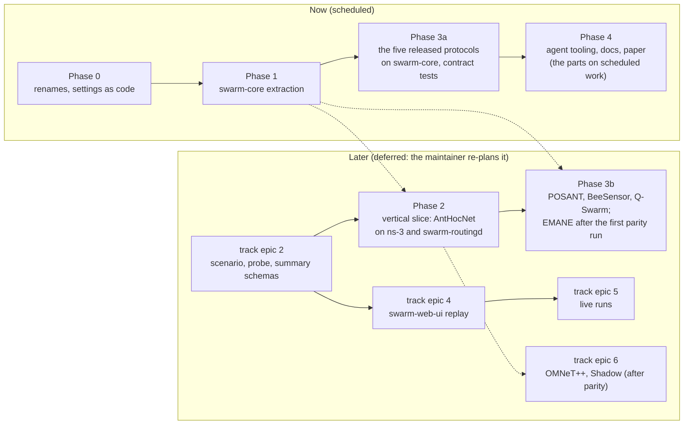
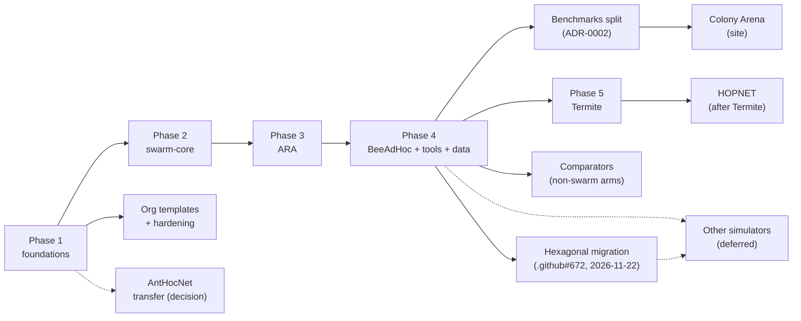
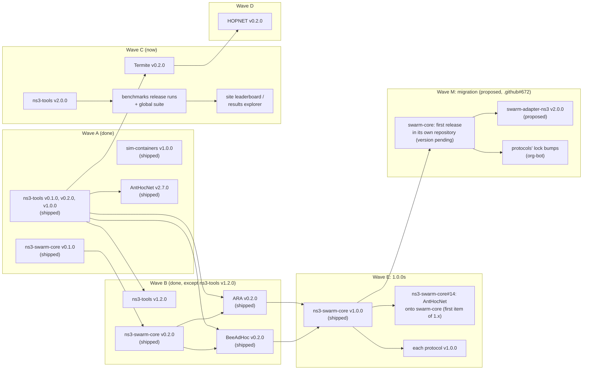

# swarm-routing roadmap

The plan for the whole org: what each phase delivers, what has to be true
before it counts as done, and what we deliberately do not do. It mirrors
[AntHocNet's `docs/roadmap.md`](https://github.com/swarm-routing/AntHocNet/blob/main/docs/roadmap.md)
(ladder, exit criteria, non-goals), the source repository's roadmap, which
keeps governing AntHocNet itself.

**How it is kept.** This file is the plan; issues are the work. Each phase has
one epic in the repository that owns it, its tasks are sub-issues (across
repositories where needed). The public org Project
[Swarm routing plan](https://github.com/orgs/swarm-routing/projects) shows
releases and RCAPA tickets across repositories; it is generated from the
issues and labels by org-bot's `project-sync` (`templates/projects/plan.json`,
#541), read-only, never the record (CONTRIBUTING "Where the plan lives"). A phase moves to *done* here in the
PR that closes its epic. Changing a phase's scope or exit criteria is a PR to
this file, like any other decision. [Epics](#epics) below lists every epic of
every public repository with its status, generated from the issues by
`tools/epics/epics.py` (the same list is in each repository's README).
An issue change that moves it (an epic opened, closed or re-scoped, a
sub-issue closed or reopened) refreshes it through org-bot's PR within the
hour, with no hand step (`epics-refresh.yml`, #572; CONTRIBUTING, "Epics are
the public plan").

## Architecture and migration (decided 2026-11-22)

The org moves from an ns-3-anchored layout to a hexagonal (ports and
adapters) one, in which every protocol's simulator-free `core/` runs on ns-3,
on a Linux daemon and later on other simulators, all on one shared
`swarm-core`. Two epics carry it:
[.github#672](https://github.com/swarm-routing/.github/issues/672) (the
architecture and migration roadmap, phases 0 to 4) and
[.github#674](https://github.com/swarm-routing/.github/issues/674) (the
multi-simulator and web-UI track). The maintainer accepted ten decisions on
2026-11-22 ([on .github#672](https://github.com/swarm-routing/.github/issues/672#issuecomment-7072008862),
items 4–6 and 8 also on .github#674); they are written below as decided.
The 21 questions the review left open were all accepted on the same day
([second set, on .github#672](https://github.com/swarm-routing/.github/issues/672#issuecomment-7072939484)) and are written below as decided too.
Everything else in the two epics is a plan: an unreleased version is marked
*proposed*; no question in this section waits on the maintainer.
This section supersedes [Direction beyond ns-3](#direction-beyond-ns-3-proposed-2026-11-12)
(track B, .github#250, and the roadmap-by-tracks epic .github#251 were closed
as superseded by .github#672 on 2026-11-22, decision 7) and the plan in
[Later: other simulators](#later-other-simulators-deferred); both sections
stay below as the record of the decisions taken on 2026-11-12 and
2026-11-16, each with a pointer back here. The review of the plan against
the org's rules, with the conflicts it found and the questions it left, is
[on .github#672](https://github.com/swarm-routing/.github/issues/672#issuecomment-7072128849).

**Now and Later (decision 23, 2026-11-22).** The maintainer narrowed what is
scheduled: "We don't need to do the new protocols and the UI now, we need to
plan it later, and also the new simulators and Linux support."

| | Scheduled now | Planned later (deferred, not scheduled) |
|---|---|---|
| Migration | phase 0; phase 1; [phase 3a](#migration-phase-3a-the-five-released-protocols-on-the-extracted-swarm-core): the five released protocols on the extracted swarm-core with the contract tests; [phase 4](#migration-phase-4-agent-tooling-docs-paper) where it does not need a deferred track | [phase 2](#migration-phase-2-the-vertical-slice-deferred) (the vertical slice on the Linux daemon); [phase 3b](#migration-phase-3b-new-protocols-and-runtimes-deferred) (POSANT, BeeSensor, Q-Swarm; CORE/EMANE, OMNeT++, Shadow) |
| Epics | swarm-core#3, swarm-adapter-ns3#228, sim-containers#210 (its ns-3 layout and canary half), .github#689 to #692; the five protocols' chores (AntHocNet#1117, ARA#220, BeeAdHoc#198, Termite#185, HOPNET#188) | swarm-routingd#3 and its children; POSANT#3, BeeSensor#3, Q-Swarm#3; swarm-web-ui#1, #2; [.github#674](https://github.com/swarm-routing/.github/issues/674) as a whole (sim-tools#277, sim-tools#279, AntHocNet#32); .github#48, #322, #324, #325; benchmarks#145 |
| Everything else | the [release train](#the-release-train) and the ns-3 work (comparators, families, the ns-3 upstream bridge, the site) as before | — |

A deferred item keeps its epic and its plan text below, marked *deferred*.
Its trigger is the same for all of them: **the maintainer re-plans it**; no
date, release or result starts one by itself. Until then a deferred epic's
children carry no `release:*` label. Decisions 1–22 stay the rules that apply
when a deferred item starts.

**Lifted for setup and skeletons (2026-11-24,
[#881](https://github.com/swarm-routing/.github/issues/881#issuecomment-7147054971)).**
In POSANT, BeeSensor, Q-Swarm, swarm-adapter-omnet, swarm-routingd and
swarm-web-ui the maintainer re-planned the setup: the org templates, CI,
`release.yml` (with `vcpkg-ports` where C++ ships), CITATION.cff,
`docs/roadmap.md`, `docs/install.md` and a building, tested skeleton are
allowed now. A protocol repository writes no protocol logic until its
`docs/fidelity.md` has been reviewed (golden rule 6, each repository's
"fidelity sheet before code" rule). Cutting a release and `release:*`
labels are not covered: each release still needs the maintainer's word. The
rest of the deferred work (phase 2's vertical slice, the new simulators and
the .github#674 track) stays deferred.

**Public-source v0 protocols (2026-11-24,
[#881](https://github.com/swarm-routing/.github/issues/881#issuecomment-7147077907)).**
A protocol whose paper has no open copy in hand (POSANT, Q-Swarm, and
BeeSensor if its paper is not open) fills `docs/fidelity.md` from public
sources: the abstract and publisher page, open preprints, theses, surveys,
later papers and public reference implementations. Every row names its
source by DOI link or public URL and how it was read (`paper`, `secondary:
<source>` or `repo choice`); nothing is cited from memory. Once that sheet
is reviewed, `core/` may implement it. The version is labelled v0, built from
secondary sources, in the README, `docs/fidelity.md` and its first release
notes, which list the rows that wait on the paper; when the paper is in
hand those rows are re-checked and each deviation recorded. The three gates
are unchanged (golden rule 6): the anchor stays open until the paper is in
hand, and no benchmark claims paper fidelity. Two pieces stay scheduled because the sim-tools `v1.2.0`
scope needs them: [sim-tools#128](https://github.com/swarm-routing/sim-tools/issues/128)
(`--failures`, labelled `release:v1.2.0`, a sub-issue of the deferred
sim-tools#277), and the ns-3 rung of
[.github#268](https://github.com/swarm-routing/.github/issues/268) (the scene
catalogue, its generator and the ns-3 reference runs RT-3 and RT-6 that
sim-tools#128's criteria name); .github#268's other rungs wait with phase 2.

**The four layers.**

| Layer | Repositories | Responsibility | State on 2026-11-22 |
|---|---|---|---|
| 1. Core | [swarm-core](https://github.com/swarm-routing/swarm-core) | simulator-free C++23 ports and primitives (`swarm::core`), the wire helpers, the testbench and the protocol contract tests; no OS or simulator header | created 2026-11-21, empty; the code is still in swarm-adapter-ns3's `core/` (released up to `v1.0.0` there) and moves in phase 1 |
| 2. Runtimes and adapters | [swarm-adapter-ns3](https://github.com/swarm-routing/swarm-adapter-ns3) (was `ns3-swarm-core`), [swarm-routingd](https://github.com/swarm-routing/swarm-routingd) (the Linux daemon, *deferred*), one `swarm-adapter-<sim>` per in-process C++ simulator, `swarm-adapter-omnet` next (*proposed*, *deferred*; decision 24) | each runtime's implementation of the ports; CORE/EMANE and Shadow run the swarm-routingd binary and reuse its Linux adapter, so they need no adapter repository (decision 24) | swarm-adapter-ns3 is the ns-3 contrib module `swarm-core` (golden rule 4); swarm-routingd created 2026-11-21, empty |
| 3. Protocols | AntHocNet, ARA, BeeAdHoc, Termite, HOPNET; POSANT, BeeSensor, Q-Swarm (*proposed*, *deferred*, [Protocol repositories](#protocol-repositories)) | each a simulator-free `core/` on swarm-core and its ns-3 module (`ns3/`); the Linux glue lives in swarm-routingd, which consumes the cores by release lock (decision 13) | five released; three created 2026-11-21, fidelity sheets only (decision 1) |
| 4. Infrastructure and tooling | `.github`, [sim-containers](https://github.com/swarm-routing/sim-containers) (was `ns3-containers`), [sim-tools](https://github.com/swarm-routing/sim-tools) (was `ns3-tools`), [vcpkg-registry](https://github.com/swarm-routing/vcpkg-registry), [benchmarks](https://github.com/swarm-routing/benchmarks), [swarm-routing.github.io](https://github.com/swarm-routing/swarm-routing.github.io), [swarm-web-ui](https://github.com/swarm-routing/swarm-web-ui) (the workbench, *deferred*); **AI:** [skills](https://github.com/swarm-routing/skills), [swarm-mcp](https://github.com/swarm-routing/swarm-mcp) (decision 26) | reusable CI, simulator images, orchestration and statistics, packages, released datasets, the public showcase, the workbench; the AI pair: the skills and the Claude Code plugin, and the MCP server the plugin bundles (and will pin once the code has moved) | the renames of 2026-11-22 are followed by the phase 0 PRs; swarm-web-ui created 2026-11-21, empty; swarm-mcp created 2026-11-22, empty (its code is still in skills' `tools/swarm-mcp/`) |

**Decided on 2026-11-22 (the maintainer, on .github#672):**

1. **Order.** Phase 0 (renames, settings as code) first, then the swarm-core
   extraction, then one vertical slice before anything is widened: AntHocNet
   end to end on ns-3 and on Linux (swarm-routingd in network namespaces),
   compared in benchmarks. Until swarm-core's first release from its own
   repository exists, POSANT, BeeSensor and Q-Swarm get their fidelity sheets
   only, no `core/` code.
2. **Wire format: an ADR before any code**
   ([.github#689](https://github.com/swarm-routing/.github/issues/689)). Each
   protocol keeps its own leading version byte (golden rule 3; AntHocNet
   `kWireVersion`, its ADR-0006). If the shared 4-byte envelope is adopted, it
   carries its own version byte and wraps the protocol message rather than
   replacing that message's version; adopting it bumps every protocol's wire
   version, with roundtrip and fuzz tests.
3. **The swarm-core extraction keeps today's consumption path.** History is
   kept (`git filter-repo` from swarm-adapter-ns3's `core/`); protocols keep
   consuming a released version through org-bot's lock-bump PRs
   (`swarm-core.lock`, `SWARM_CORE_REF`); the vcpkg port moves to
   swarm-core, which gets its own Zenodo concept DOI; swarm-adapter-ns3 keeps
   its DOI and continues as `v2.0.0` (*proposed*). Both releases are cut only
   on the maintainer's word.
4. **sim-tools stays one repository.** No new `ns3-tools` repository is
   created; the ns-3-specific parts (`routing-bench`, upstream fixes, the
   probe emitter) live under a GPL-2.0-only `ns3/` directory behind
   .github#674's `SimAdapter` contract; a split happens later only if licence
   or release cadence forces it. *Amended by decision 24:* an in-process
   simulator's adapter code goes to its own `swarm-adapter-<sim>` repository,
   not into sim-tools, whose per-simulator directories hold only
   non-adapter glue.
5. **swarm-web-ui is the workbench** (replay, live runs, the scenario editor);
   the Colony Arena site stays the public showcase and may later embed the
   replay view. Neither holds routing logic (site golden rule 10), and every
   number shown comes from benchmarks data (site golden rule 12).
6. **Q-Swarm is a protocol; Q-routing stays a comparator** in sim-tools
   ([sim-tools#34](https://github.com/swarm-routing/sim-tools/issues/34)),
   and Q-Swarm is benchmarked against it. If Q-Swarm follows a published
   paper, it clears the three gates.
7. **Old epics.** .github#250 and .github#251 close as superseded by .github#672;
   [.github#252](https://github.com/swarm-routing/.github/issues/252) (a
   protocol of our own) and [.github#272](https://github.com/swarm-routing/.github/issues/272)
   (routing security) stay open as tracks .github#672 references.
8. **Simulators.** OMNeT++ and Shadow wait until ns-3 and Linux parity holds;
   the CORE/EMANE image in sim-containers follows the first end-to-end
   parity run.
9. **Sub-issues** are opened for phases 0 and 1 only; later phases keep their
   checklist in .github#672 and get sub-issues when they start.
10. **This file** marks unreleased versions *proposed* and names the issue
    of every question still open.

**Decided on 2026-11-22, second set** (the maintainer accepted the 21
questions of [the review](https://github.com/swarm-routing/.github/issues/672#issuecomment-7072128849),
each as recommended; [recorded on .github#672](https://github.com/swarm-routing/.github/issues/672#issuecomment-7072939484); numbered on from the
first set, the review's question number in brackets):

11. **swarm-core's first release from its own repository continues the
    existing line** (q1, [swarm-core#10](https://github.com/swarm-routing/swarm-core/issues/10)):
    `v1.1.0` if the change is additive, `v2.0.0` if a frozen name changes,
    set through `first-release-from-config`. Never a second `v1.0.0`: that
    version already exists in the vcpkg port and in every lock, and vcpkg
    versions are immutable.
12. **The host contract lands in swarm-core's next major after that first
    release** (q2, [swarm-core#11](https://github.com/swarm-routing/swarm-core/issues/11)).
    swarm-adapter-ns3#71, #72, #73 and #82 move to swarm-core
    (swarm-adapter-ns3#82 is now a sub-issue of swarm-core#3).
    **Ports** (q3, [swarm-core#7](https://github.com/swarm-routing/swarm-core/issues/7)):
    the frozen names stay; the energy and location ports are added, the
    location port marked experimental (`docs/api-policy.md`: 1.x is
    additions only). **MSVC** in swarm-core's CI is report-only (q18,
    swarm-core#9). **The C++ standard rule is unchanged** (q19): `core/`
    follows ns-3's minimum while ns-3 is the reference rung.
13. **Protocol layout** (q7). Each protocol keeps its `ns3/`. The Linux glue
    lives in swarm-routingd, which consumes the cores by release lock
    (.github#253, closed as answered).
14. **Phase 2 parity** (q4) is judged on .github#268's scenes; published
    numbers come from ns-3 only, because a daemon on a wall clock is not
    reproducible from its seed. The standalone discrete-event host
    (.github#322) moves under .github#672, phase 2.
15. **Re-parenting** (q5). .github#253 closed as answered and .github#261 as
    done (.github#700 merged); .github#260, #268, #322, #324 and #325 moved
    under .github#672; sim-tools#128 under sim-tools#277; .github#323 closed
    as superseded by swarm-routingd#3, with its five children (.github#255,
    #256, #258, #267, #548) moved there; .github#48 under .github#674;
    .github#262 and #279 standalone; .github#271, #274 and #283 under
    .github#141; .github#275 under sim-tools#43.
16. **The telemetry schema belongs to sim-tools** (q6), as marker contract v2
    (sim-tools golden rule 11); benchmarks vendors and validates it.
17. **swarm-web-ui** (q8, q9): its licence is `MIT OR GPL-2.0-only`, written
    fresh, and any directory that embeds the site's renderer is
    `GPL-2.0-only`. Its demo is served under the Colony Arena site at a
    pinned commit; swarm-web-ui deploys no Pages of its own.
18. **New protocols** (q10–q12). BeeSensor's scope reversal is recorded on
    .github#54 and .github#275: a many-to-one WSN convergecast family is
    added (sim-tools#55), not the ruled-out sub-GHz duty-cycled mesh, and
    the fidelity sheet comes first. Q-Swarm names the paper it reproduces;
    if there is none, it moves under .github#252 with .github#264's gates.
    POSANT's reference version is decided in its fidelity sheet, the 2008
    journal version primary if it specifies more.
19. **sim-containers' canary** (q13, [sim-containers#215](https://github.com/swarm-routing/sim-containers/issues/215)):
    measure first; every consumer with an ns-3 module keeps gating
    `latest-*`, new protocols are advisory until their `v0.2.0`.
20. **Tooling** (q14–q16). Per-simulator tooling lives in directories in
    sim-tools; `swarm-adapter-omnet` comes only after parity, once
    OMNeT++'s image licence is confirmed. *Amended by decision 24:* every
    in-process C++ simulator gets its own `swarm-adapter-<sim>` repository as
    the plan, not after parity (still deferred, and OMNeT++'s image licence
    is still confirmed first); CORE/EMANE and Shadow get none; sim-tools'
    per-simulator directories keep only non-adapter glue. Dependency bumps are done by
    org-bot, not Renovate. swarm-mcp and the phase 4 skills are prototyped
    in swarm-routing/skills, not benchmarks, by extending `protocol-review`,
    `fidelity-sheet` and `release` instead of adding four new skills.
    *Amended by decision 26:* swarm-mcp moves out of swarm-routing/skills
    into its own repository; the phase 4 skills stay there.
21. **The paper** (q17) is folded into AntHocNet#109; cross-runtime results
    are stated qualitatively.
22. **Overlapping tickets** (q20, q21). .github#54 (re-scoped to the
    remaining candidates), .github#150, sim-tools#15 and sim-tools#34 stay;
    AntHocNet#32 stays, re-pointed at .github#674 (track B) now;
    AntHocNet#65 closes as superseded by swarm-routingd#3 once that epic has
    its own children. .github#674's title and layout table follow decisions
    4 and 5, its original plan kept in a collapsed block.

**Decided on 2026-11-22, third** (the maintainer, recorded on .github#672):

23. **Now and Later.** Scheduled now: phases 0 and 1, phase 3a (the five
    released protocols on the extracted swarm-core with the contract tests),
    the existing release train and ns-3 work, and phase 4 where it does not
    need a deferred track. Planned later, not scheduled: the Linux daemon
    (phase 2, swarm-routingd#3 and its children), the new protocols POSANT,
    BeeSensor and Q-Swarm (their fidelity sheets may continue, no code),
    swarm-web-ui (#1, #2), the new simulators and runtimes (CORE/EMANE,
    OMNeT++, Shadow; .github#48, .github#324, AntHocNet#32) and the
    .github#674 track as a whole (sim-tools#277, #279). Each keeps its epic
    and plan, marked deferred; its trigger is the maintainer re-planning it;
    decisions 1–22 are the rules that apply when it starts. sim-tools#128 and
    .github#268's ns-3 rung stay scheduled for sim-tools `v1.2.0`.
    **Amended on 2026-11-24** (the maintainer, recorded on
    [#881](https://github.com/swarm-routing/.github/issues/881)): lifted
    for setup and building, tested skeletons in POSANT, BeeSensor, Q-Swarm,
    swarm-adapter-omnet, swarm-routingd and swarm-web-ui (templates, CI,
    `release.yml`, CITATION.cff, `docs/roadmap.md`, `docs/install.md`);
    protocol logic still waits for the repository's reviewed fidelity sheet,
    and releases and `release:*` labels are not covered. A protocol without
    an open paper gets its first version built from public sources: each
    fidelity row marked by its source (`paper`, `secondary: <source>`, `repo
    choice`), the version labelled v0, and the anchor gate left open until
    the paper is in hand ([Now and Later](#architecture-and-migration-decided-2026-11-22)).
24. **Every in-process simulator gets its own adapter repository**,
    `swarm-adapter-<sim>`. This amends decision 20 (no longer "only after
    parity") and the part of decision 4 that put per-simulator code in
    sim-tools. Like the rest of the simulator track it is deferred
    (decision 23): the repositories are created when the maintainer re-plans
    that track, none now. Its split, confirmed by the maintainer the same day:
    - **sim-tools owns orchestration and statistics**: the simulator-agnostic
      runner, seed-sweep orchestration, the shared telemetry schema, and
      statistical analysis and plotting.
    - **Its per-simulator subdirectories** (`ns3/`, `emane/`, `shadow/`,
      `omnet/`) **hold only non-adapter glue**: launch and topology configs
      (for example `shadow.yaml`, CORE/EMANE RF and mobility XMLs, ns-3 CLI
      wrappers), and trace normalizers and probes that convert raw simulator
      logs into the unified JSONL/Parquet schema.
    - **CORE/EMANE and Shadow get no adapter repository**: both run the
      compiled Linux swarm-routingd binary directly and reuse its Linux
      adapter (epoll, UDP/TUN, rtnetlink).
    - **Only in-process C++ simulators get a `swarm-adapter-<sim>`
      repository**: ns-3 has swarm-adapter-ns3, and OMNeT++ gets
      `swarm-adapter-omnet` later.
25. **The workbench's client and daemon** (the maintainer, 2026-11-22:
    "Accept the ADR"). swarm-web-ui's
    [ADR-0002](https://github.com/swarm-routing/swarm-web-ui/blob/main/docs/adr/0002-web-first-client-with-a-go-daemon.md)
    (swarm-web-ui#6) is accepted: a web-first client served by a Go daemon
    (org ADR-0002, replacing "FastAPI or Go"), Tauri or a PWA only as an
    optional wrapper, no Electron. The same day the maintainer added "Keep
    Go, record TypeScript for the frontend" (Node.js rejected for the daemon,
    build-time tooling only) and "we should not have two services running in
    different ports" (one Go process embeds the frontend with `go:embed` and
    serves it, `/api/` and `/ws/` on one port; the static replay build still
    runs with no daemon). React + TypeScript + Vite, React Flow,
    PixiJS, uPlot and ECharts, xterm.js, types generated from sim-tools'
    schemas, and an escape hatch (a raw-config tab, "Export native
    project" through `SimAdapter`). Only the decision is accepted: the UI
    track stays deferred under decision 23, and its children
    (swarm-web-ui#6 to #23, sub-issues of swarm-web-ui#1 and #2) are
    planned, not scheduled.
26. **The AI repositories** (the maintainer, 2026-11-22: "Accept ADR-0005"
    and "configure the MCP repo out of skills
    https://github.com/swarm-routing/swarm-mcp — Skills and MCP repo need to
    work together — update the org profile and site to have these two as our
    AI repos"). [ADR-0005](docs/adr/0005-the-mcp-and-agent-tooling-standard.md)
    is accepted and amended: [skills](https://github.com/swarm-routing/skills)
    holds the procedures and ships the Claude Code plugin `swarm-routing`;
    [swarm-mcp](https://github.com/swarm-routing/swarm-mcp) holds the
    read-only stdio MCP server (today in skills' `tools/swarm-mcp/`,
    swarm-routing/skills#185), versioned and released on its own; the plugin
    bundles it and, once the code has moved, pins a swarm-mcp release. The two are listed together
    as the org's AI repositories, a labelled group of layer 4.

### Migration phase 0: renames and settings as code

The 2026-11-22 renames (`ns3-swarm-core` → swarm-adapter-ns3,
`ns3-containers` → sim-containers, `ns3-tools` → sim-tools) and the six
repositories created on 2026-11-21 (swarm-core, swarm-routingd, swarm-web-ui,
POSANT, BeeSensor, Q-Swarm) brought onto the org templates and settings as
code. GitHub redirects the old links, so the bodies of existing issues are
not edited.

**Exit criteria**

- [ ] Every workflow, tool, template and doc in `.github` names the new slugs (the rename PRs .github#682, #683, #684), and every repository's org-managed files follow through org-bot's refresh.
- [ ] The six new repositories are in org-sync with their `[settings]` applied, the org labels synced, and licence files matching their directories (`core/` and the hosts `MIT OR GPL-2.0-only`, ns-3 modules `GPL-2.0-only`; each `LICENSE` is plain MIT on 2026-11-22).
- [ ] The GHCR packages (`ns3-dev`, `ns3-dev-ci`, `ns3-dev-cache`) are linked to sim-containers and a `publish-images` run on `main` promotes ([sim-containers#213](https://github.com/swarm-routing/sim-containers/issues/213)).
- [ ] Zenodo, SonarQube Cloud, Codecov, CodeRabbit and the Best Practices entries follow the renamed repositories, each manual step listed in .github#568 ([.github#690](https://github.com/swarm-routing/.github/issues/690)).

### Migration phase 1: swarm-core in its own repository

swarm-core's simulator-free code leaves swarm-adapter-ns3 with its history;
protocols move to it by lock bumps; the ns-3 module consumes it. Epics:
[swarm-core#3](https://github.com/swarm-routing/swarm-core/issues/3),
[swarm-adapter-ns3#228](https://github.com/swarm-routing/swarm-adapter-ns3/issues/228),
[sim-containers#210](https://github.com/swarm-routing/sim-containers/issues/210)
(its layout half).

**Exit criteria**

- [ ] The wire-format ADR accepted ([.github#689](https://github.com/swarm-routing/.github/issues/689)); no envelope code before it.
- [ ] `core/` builds, tests and installs alone in swarm-core with its history, the CMake package `swarm-core` / `swarm::core` unchanged, and the `api-surface` check passing against the `v1.0.0` surface ([swarm-core#6](https://github.com/swarm-routing/swarm-core/issues/6), [#9](https://github.com/swarm-routing/swarm-core/issues/9)).
- [ ] The new energy and location ports and the protocol contract tests, added under `docs/api-policy.md` ([swarm-core#7](https://github.com/swarm-routing/swarm-core/issues/7), [#8](https://github.com/swarm-routing/swarm-core/issues/8)): the frozen names stay, the location port is experimental (decision 12).
- [ ] swarm-core's first release from its own repository, its Zenodo concept DOI and the vcpkg port, on the maintainer's word ([swarm-core#10](https://github.com/swarm-routing/swarm-core/issues/10), [vcpkg-registry#50](https://github.com/swarm-routing/vcpkg-registry/issues/50)); it continues the existing line, `v1.1.0` if additive or `v2.0.0` if a frozen name changes, never a second `v1.0.0` (decision 11).
- [ ] Every protocol's lock bumped to it by org-bot, core tests green ([.github#691](https://github.com/swarm-routing/.github/issues/691)).
- [ ] swarm-adapter-ns3 `v2.0.0` (*proposed*) builds on that release as a `PUBLIC` dependency with `core/` removed, every protocol's ns-3 build green on it, released on the maintainer's word ([swarm-adapter-ns3#231](https://github.com/swarm-routing/swarm-adapter-ns3/issues/231), [#232](https://github.com/swarm-routing/swarm-adapter-ns3/issues/232), [#233](https://github.com/swarm-routing/swarm-adapter-ns3/issues/233)).
- [ ] The host-contract issues (swarm-adapter-ns3#71, #72, #73, #82) moved to swarm-core, for its next major after the first release (decision 12; [swarm-core#11](https://github.com/swarm-routing/swarm-core/issues/11)).
- [ ] sim-containers' per-simulator layout keeps `images gate` on every PR ([sim-containers#214](https://github.com/swarm-routing/sim-containers/issues/214)); the downstream canary measured before any trim, every consumer with an ns-3 module still gating `latest-*` and new protocols advisory until their `v0.2.0` (decision 19; [sim-containers#215](https://github.com/swarm-routing/sim-containers/issues/215)).
- [ ] A `swarm-routing` Zenodo community holds every concept DOI ([.github#692](https://github.com/swarm-routing/.github/issues/692)).

### Migration phase 2: the vertical slice (deferred)

> **Deferred on 2026-11-22** (decision 23): planned later, not scheduled; it
> starts when the maintainer re-plans it, under decisions 1–22. Its epics
> keep their plan; their children carry no `release:*` label. .github#322
> (the standalone discrete-event host), .github#324 (emulation) and
> .github#325 (the Raspberry Pi testbed) wait with it. The ns-3 rung of
> .github#268 stays scheduled, for sim-tools#128 (sim-tools `v1.2.0`).

AntHocNet end to end on ns-3 and on swarm-routingd in network namespaces,
compared in benchmarks (decision 1), before any other protocol or runtime is
widened. Epics: [swarm-routingd#3](https://github.com/swarm-routing/swarm-routingd/issues/3),
[benchmarks#145](https://github.com/swarm-routing/benchmarks/issues/145); the
schemas of [sim-tools#279](https://github.com/swarm-routing/sim-tools/issues/279).
No sub-issues yet (decision 9).

**Exit criteria**

- [ ] The data-plane ADR ([.github#255](https://github.com/swarm-routing/.github/issues/255)) and the node identity ([swarm-adapter-ns3#72](https://github.com/swarm-routing/swarm-adapter-ns3/issues/72)) decided before the daemon's data path is written.
- [ ] swarm-routingd runs AntHocNet's core over real sockets in 3–5 network namespaces in CI.
- [ ] One telemetry schema read by both runtimes' outputs: sim-tools' marker contract v2, vendored and validated by benchmarks (decision 16).
- [ ] benchmarks' manifest records the host that produced a run ([benchmarks#69](https://github.com/swarm-routing/benchmarks/issues/69)) before the first non-ns-3 run lands.
- [ ] The first end-to-end parity run recorded, judged on the scenes of [.github#268](https://github.com/swarm-routing/.github/issues/268), with published numbers from ns-3 only (decision 14); the standalone discrete-event host ([.github#322](https://github.com/swarm-routing/.github/issues/322)) is this phase's deterministic rung.

Phase 3 is split in two by decision 23: 3a is scheduled now, 3b is deferred.

### Migration phase 3a: the five released protocols on the extracted swarm-core

The five released protocols move to swarm-core's new repository by lock
bumps and opt into the contract tests (their chores: AntHocNet#1117, ARA#220,
BeeAdHoc#198, Termite#185, HOPNET#188). It follows phase 1 directly: it needs
swarm-core's first release from its own repository and the contract tests
(swarm-core#8), not phase 2.

**Exit criteria**

- [ ] Each of the five on the extracted swarm-core's release, its contract tests green, the wire ADR's outcome applied.

### Migration phase 3b: new protocols and runtimes (deferred)

> **Deferred on 2026-11-22** (decision 23): planned later, not scheduled; it
> starts when the maintainer re-plans it, under decisions 1–22 and 24.
> Re-planned in part on 2026-11-24 (decision 23 as amended, #881): the new
> protocols set up and build a tested skeleton now, write protocol logic
> once their fidelity sheet is reviewed (a v0 from public sources where the
> paper is not open), and cut no release without the maintainer's word.

POSANT, BeeSensor and Q-Swarm write `core/` after their fidelity sheets and
swarm-core's first release
(epics [POSANT#3](https://github.com/swarm-routing/POSANT/issues/3),
[BeeSensor#3](https://github.com/swarm-routing/BeeSensor/issues/3),
[Q-Swarm#3](https://github.com/swarm-routing/Q-Swarm/issues/3)); the
CORE/EMANE image follows the first parity run, OMNeT++ and Shadow follow
parity (decision 8); OMNeT++ through its own `swarm-adapter-omnet`
repository, CORE/EMANE and Shadow by running the swarm-routingd binary
(decision 24).

**Exit criteria**

- [ ] Each new protocol's fidelity sheet merged before its `core/`; its three gates passed or a written infeasibility verdict (golden rule 6). BeeSensor is in scope on a many-to-one WSN convergecast family, the reversal recorded on .github#54 and .github#275; Q-Swarm names the paper it reproduces, or moves under .github#252 with .github#264's gates (decision 18).
- [ ] The CORE/EMANE image in sim-containers runs swarm-routingd (after the first parity run).

### Migration phase 4: agent tooling, docs, paper

The org's agent skills extended to the new layers, `llms.txt` on the site
([swarm-routing.github.io#234](https://github.com/swarm-routing/swarm-routing.github.io/issues/234)),
a `swarm-mcp` prototype and one paper. The skills live in
swarm-routing/skills, as extensions of `protocol-review`, `fidelity-sheet`
and `release` (decision 20); the MCP server moves to its own repository,
[swarm-mcp](https://github.com/swarm-routing/swarm-mcp), which the plugin
will pin (decision 26); the paper folds into
AntHocNet#109, with cross-runtime results stated qualitatively (decision 21).
The architecture page and porting guide is .github#260, now under
.github#672.

Scheduled now only where it needs no deferred track (decision 23): the skill
extensions, `llms.txt`, the `swarm-mcp` prototype over the scheduled
repositories, the architecture page of .github#260 and the paper's ns-3
results. The porting guide's second host and the paper's cross-runtime
results wait for phase 2 and 3b.

### The multi-simulator and web-UI track (.github#674, deferred)

> **Deferred on 2026-11-22 as a whole** (decision 23): planned later, not
> scheduled; it starts when the maintainer re-plans it. Nothing scheduled
> depends on sim-tools#277 or #279; the one exception is sim-tools#128, a
> sub-issue of sim-tools#277 that stays scheduled in sim-tools `v1.2.0`
> (ns-3 work, it needs none of the split).

| Epic (.github#674) | Owner | Delivers | Waits on |
|---|---|---|---|
| 1 and 3: orchestration split, the ns-3 adapter as reference | [sim-tools#277](https://github.com/swarm-routing/sim-tools/issues/277) | the agnostic core in sim-tools' Python and the ns-3 parts under `ns3/` (GPL-2.0-only) behind `SimAdapter`; outputs byte-identical on the fixtures | decision 4 (one repository) |
| 2: scenario, probe and summary schemas | [sim-tools#279](https://github.com/swarm-routing/sim-tools/issues/279) | `scenario.v1`, the probe side-file, `summary.v1`, one validator for sim-tools and swarm-web-ui | decision 16: sim-tools owns them as marker contract v2; benchmarks vendors and validates them |
| 4: offline replay | [swarm-web-ui#1](https://github.com/swarm-routing/swarm-web-ui/issues/1) | replay, KPI charts from benchmarks and `bench_parse` output only; sub-issues swarm-web-ui#6 to #15 (the stack ADR, generated types, scaffold, loader, canvas, charts, side-by-side, replay determinism, axe, the demo) | epic 2; its demo is served under the Colony Arena site at a pinned commit, no Pages of its own (decision 17); the stack is swarm-web-ui's ADR-0002 (decision 25) |
| 5: live runs | [swarm-web-ui#2](https://github.com/swarm-routing/swarm-web-ui/issues/2) | the Go workbench daemon (org ADR-0002), the scenario editor, runs on sim-containers images by digest; sub-issues swarm-web-ui#16 to #23 (API, editor, runner, streaming, SSH, native export, xterm.js consoles, the optional Tauri/PWA wrapper) | epic 4 |
| 6: a second runtime | [swarm-routingd#3](https://github.com/swarm-routing/swarm-routingd/issues/3) (track A); OMNeT++ and Shadow (track B) | the same scenario on ns-3 and another runtime, side by side, labelled qualitative | parity (decision 8); an in-process simulator's adapter (OMNeT++: `swarm-adapter-omnet`) in its own repository, created when the track is re-planned, CORE/EMANE and Shadow on the swarm-routingd binary with no adapter repository, and sim-tools' per-simulator directories only for non-adapter glue (decision 24, amending decision 20); AntHocNet#32 is AntHocNet's instance of track B, .github#48 the other simulators |

**Non-goals of the migration.**

- **No code in a new protocol repository before swarm-core's first release from its own repository** (decision 1); fidelity sheets first.
- **No wire-format change before its ADR** (decision 2), and no envelope that replaces a protocol's own version byte.
- **No release without the maintainer's word** (decision 3), and no DOI typed: each is read from Zenodo.
- **No `ns3-tools` repository** (decision 4); sim-tools keeps the orchestration and statistics, and an in-process simulator's adapter code goes to its own `swarm-adapter-<sim>` repository (CORE/EMANE and Shadow get none), none created before the maintainer re-plans the simulator track (decisions 23 and 24).
- **Nothing deferred starts by itself** (decision 23): no protocol logic for POSANT, BeeSensor or Q-Swarm before its fidelity sheet is reviewed, no swarm-routingd, swarm-web-ui, swarm-adapter-omnet or new-simulator work beyond setup and a building, tested skeleton (amended 2026-11-24, #881), and no release or `release:*` label on a deferred epic's children, until the maintainer re-plans it.
- **No second Pages site and no routing logic or hand-made numbers in a UI** (decision 5; site golden rules 10–12).
- **No OMNeT++ or Shadow before ns-3 and Linux parity, no EMANE image before the first parity run** (decision 8).
- **Off-ns-3 results stay qualitative**: published numbers come from ns-3 only, and parity is judged on named scenes (decision 14).

**Where to start (the migration).** Phase 0's open items (.github#690,
sim-containers#213; the rename PRs and the new repositories' onboarding are in
flight in another session), then phase 1 in this order: .github#689 (the
wire ADR) and swarm-core#6 (the extraction) first, swarm-core#9, #7, #8 and
#11 next, swarm-core#10 (the release, on the maintainer's word), then
.github#691 and swarm-adapter-ns3#231. sim-containers#214 and #215 and
.github#692 are independent. Every phase 1 item is a sub-issue of its epic
and of .github#672. Phase 3a's five chores (AntHocNet#1117, ARA#220,
BeeAdHoc#198, Termite#185, HOPNET#188) follow swarm-core's release; the
deferred phases and tracks wait for the maintainer (decision 23).

## Direction beyond ns-3 (proposed 2026-11-12)

> **Superseded on 2026-11-22** by [Architecture and migration](#architecture-and-migration-decided-2026-11-22)
> (.github#672; decision 7 closed track B's epic .github#250 and the
> roadmap-by-tracks epic .github#251 as superseded). Kept as the record of the
> decisions of 2026-11-12 and 2026-11-16. Where they differ from the 2026-11-22
> decisions, those win: the host contract "swarm-core 2.0.0" (below) is now
> swarm-core's next major after its first release from its own repository
> (decision 12, swarm-core#11); the hosts are now
> the repositories swarm-core and swarm-routingd; track C's research epics
> .github#252 and .github#272 stay open as tracks; track A and the release
> train below are unchanged.

Proposed after a review of every repository and open issue on 2026-11-12, and
not decided yet: the issues marked *decision* below wait on the maintainer.
This section becomes the frame of this file when
[.github#261](https://github.com/swarm-routing/.github/issues/261) rewrites it
by tracks; until then the phases below stay as they are.

**The goal.** A swarm-protocol environment built on ns-3 whose protocols also
run on other simulators and as software installed on Raspberry Pis and other
Linux computers, tested there with the same scenes, and a protocol of the org's
own if the tests say one is needed.

**Decided on 2026-11-12 (the maintainer, on the issues named):**
- **swarm-core is required for every protocol, AntHocNet included**
  ([ns3-swarm-core#14](https://github.com/swarm-routing/swarm-adapter-ns3/issues/14)).
  AntHocNet's `core/` and ns-3 adapter move onto it before swarm-core's
  `v1.0.0`, so the freeze covers every protocol. `v1.0.0` shipped on
  2026-11-16 with #14 still open: what it froze and what remains is under
  [The release train](#the-release-train).
- **The host contract is swarm-core `2.0.0`**
  ([.github#253](https://github.com/swarm-routing/.github/issues/253), item 4).
  `v1.0.0` freezes the ns-3 API as it is. Support for other simulators, Linux
  daemons, emulation and Raspberry Pi follows on the 2.0.0 line, one epic per
  target.
- **Priorities ([.github#262](https://github.com/swarm-routing/.github/issues/262))**,
  the `model:*` labels as Claude Pro suggestions
  ([.github#280](https://github.com/swarm-routing/.github/issues/280)), outside
  PRs ([.github#288](https://github.com/swarm-routing/.github/issues/288)), the
  test ladder ([.github#268](https://github.com/swarm-routing/.github/issues/268)),
  the fitness tests ([.github#269](https://github.com/swarm-routing/.github/issues/269))
  and routing security ([.github#273](https://github.com/swarm-routing/.github/issues/273)):
  as recommended on each issue.

| Track | What | Epic | Decisions it waits on |
|---|---|---|---|
| **A** Protocols on ns-3 | the phases and the [release train](#the-release-train) below, unchanged | each repository's epic | none |
| **B** Portable runtime | one host contract for every `core/`, a standalone discrete-event host, a Linux daemon, installable packages, a Raspberry Pi testbed; another simulator last ([Later: other simulators](#later-other-simulators-deferred)) | [.github#250](https://github.com/swarm-routing/.github/issues/250) | none left: [.github#253](https://github.com/swarm-routing/.github/issues/253) and [.github#268](https://github.com/swarm-routing/.github/issues/268) were decided on 2026-11-12; still open is work, not a decision: #268's tolerances are fixed once the first ns-3 reference runs exist |
| **C** Research | security under one epic; network families under one owner; AntHocNet or a protocol of our own, decided by tests; the remaining swarm protocols' verdicts | [.github#272](https://github.com/swarm-routing/.github/issues/272); [ns3-tools#43](https://github.com/swarm-routing/sim-tools/issues/43) ([.github#275](https://github.com/swarm-routing/.github/issues/275)); [.github#252](https://github.com/swarm-routing/.github/issues/252); [.github#54](https://github.com/swarm-routing/.github/issues/54) | none left: [.github#264](https://github.com/swarm-routing/.github/issues/264) (gates for a protocol with no paper) was accepted as written on 2026-11-16 and is not scheduled until the fitness tests of #269 have run; the owner of the network-family list was decided the same day (ns3-tools, through its family catalogue, [ns3-tools#55](https://github.com/swarm-routing/sim-tools/issues/55)); [.github#273](https://github.com/swarm-routing/.github/issues/273) and [.github#269](https://github.com/swarm-routing/.github/issues/269) were decided on 2026-11-12, and what remains is their work: #273's ADR or CONTRIBUTING section, #269's runs |
| **I** Infrastructure | templates, hardening, CI time, images, releases, skills, the AI files; it rides along with any release and gates none, except the items [Releases](#releases) names as gates (the release workflow's `increment` input, .github#211, for wave E: closed 2026-11-13) | [.github#6](https://github.com/swarm-routing/.github/issues/6), [#14](https://github.com/swarm-routing/.github/issues/14), [#150](https://github.com/swarm-routing/.github/issues/150), [#141](https://github.com/swarm-routing/.github/issues/141), [#216](https://github.com/swarm-routing/.github/issues/216) | none left: [.github#262](https://github.com/swarm-routing/.github/issues/262) (priorities, the infrastructure share) and [.github#280](https://github.com/swarm-routing/.github/issues/280) (the `model:*` labels) were decided on 2026-11-12 |

**One test ladder.** Nine named scenes with stated expectations (RT-1 to RT-9,
[.github#268](https://github.com/swarm-routing/.github/issues/268)) are run on
every rung and judged by one checker: `core/` unit tests, ns-3 (the reference,
and the only rung whose numbers are published), a standalone discrete-event
host, another simulator, the Linux daemon in network namespaces, emulation,
and real computers. A host is written to pass them; results off ns-3 stay
qualitative.

**Tests decide the protocol.** AntHocNet is the pathfinder for track B. Seven
deployment-fitness tests ([.github#269](https://github.com/swarm-routing/.github/issues/269)),
most runnable on ns-3 today, decide whether it is installed under its own name
or whether its failures become the requirements of a new protocol, which needs
a new name as soon as a mechanism its paper lacks is on by default.

**The clean-up that goes with it** is
[.github#251](https://github.com/swarm-routing/.github/issues/251): this file
by tracks, duplicated and finished issues, stale handoffs, decisions as a
queue. Making the agent files shorter and the org's state readable by a new
session is under [.github#141](https://github.com/swarm-routing/.github/issues/141)
([#277](https://github.com/swarm-routing/.github/issues/277),
[#278](https://github.com/swarm-routing/.github/issues/278),
[#281](https://github.com/swarm-routing/.github/issues/281)).

### Outside review, 2026-11-16

An outside review of the org and three design notes on the Linux daemon (the
data plane, a namespace test, IPv6) were checked against every issue they
touch on 2026-11-16. Each proposal already had an owner, so it is recorded
as a comment there; the few issues opened that day are listed under the
table. Nothing in this table
changes a decision, a scope or a release; a row marked out of scope or ruled
out stays so until the maintainer reopens it on the issue named.

| Proposal | Where it lives | Outcome |
|---|---|---|
| A kernel route alone drops the first packet of a reactive protocol and cannot draw a next hop per packet; forward in user space (a TUN device with an underlay socket, NFQUEUE as a second mode, rtnetlink for link events, a route mirror and an optional multipath mode); an eBPF fast path | [.github#255](https://github.com/swarm-routing/.github/issues/255) (the data-plane ADR), [AntHocNet#152](https://github.com/swarm-routing/AntHocNet/issues/152) | the problem and the TUN-or-NFQUEUE choice were already the ADR's; the proposed design, the eBPF option and seven points it leaves open are recorded there as input |
| A three-namespace chain in CI: two subnets, kernel forwarding off, 0 % loss on a cold ping, the mirrored route checked | [.github#256](https://github.com/swarm-routing/.github/issues/256) | candidate for the scene runner after the ADR; not the first slice, which needs no root |
| IPv6: a compact node id in the cores, the address mapping in the host, a dual-stack TUN device and underlay | [ns3-swarm-core#72](https://github.com/swarm-routing/swarm-adapter-ns3/issues/72) (the identity decision), [.github#255](https://github.com/swarm-routing/.github/issues/255) | an argument for the opaque-id option (control messages stay small); it does not answer AntHocNet ADR-0011's objection, recorded there |
| Raspberry Pi built-in Wi-Fi is weak for ad hoc, mesh and monitor mode; use USB adapters with mainline drivers; OpenWrt routers as stand-ins; Babel and batman-adv as baselines | [.github#259](https://github.com/swarm-routing/.github/issues/259) | leads for the bill of materials, unverified until measured; the baselines were already in scope |
| Microcontroller boards with LoRa radios, compared with Meshtastic | [.github#258](https://github.com/swarm-routing/.github/issues/258), [.github#267](https://github.com/swarm-routing/.github/issues/267) | **out of scope** as recorded (no microcontrollers; the cores use the heap and `std::function`); the maintainer confirmed it on 2026-11-16 |
| Simulator order: CORE/EMANE first, then Shadow, OMNeT++/INET and Veins last | [.github#253](https://github.com/swarm-routing/.github/issues/253), [.github#324](https://github.com/swarm-routing/.github/issues/324), [.github#48](https://github.com/swarm-routing/.github/issues/48) | the order was decided on 2026-11-12 and agrees; Shadow is new and is recorded as an emulator candidate |
| arm64 `ns3-dev` images, urgently, as the base for hardware | [sim-containers#11](https://github.com/swarm-routing/sim-containers/issues/11), [sim-containers#54](https://github.com/swarm-routing/sim-containers/issues/54) | open, and the two issues overlap; decided 2026-11-16: #54 is #11's child, and arm64 images are for development and CI, not for published numbers. They do not gate hardware: the boards run the cores and daemons ([.github#258](https://github.com/swarm-routing/.github/issues/258), [.github#267](https://github.com/swarm-routing/.github/issues/267)), not ns-3 |
| Pin swarm-core by release tag, not `@main` | [ns3-swarm-core#134](https://github.com/swarm-routing/swarm-adapter-ns3/issues/134), [.github#411](https://github.com/swarm-routing/.github/issues/411) | **done** before the review: every protocol builds on the release its `swarm-core.lock` names, with a non-blocking canary on `main` (AntHocNet has none: it builds from release locks and is exempt, decided 2026-11-16) |
| Trust-metric and ant-authenticator interfaces in swarm-core; an org-wide attack matrix | [.github#272](https://github.com/swarm-routing/.github/issues/272), [.github#273](https://github.com/swarm-routing/.github/issues/273) | the attack grid was already planned; shared interfaces go beyond the 2026-11-12 decision (into swarm-core once a second protocol uses them), so recorded, not adopted |
| Mechanisms: a repellent pheromone for congestion, evaporation driven by predicted link lifetime, cross-layer signals in reinforcement, a learned heuristic | [.github#265](https://github.com/swarm-routing/.github/issues/265), [AntHocNet#574](https://github.com/swarm-routing/AntHocNet/issues/574) | hypotheses only (default off, an A/B in every family). The signals are ports already ([ns3-swarm-core#73](https://github.com/swarm-routing/swarm-adapter-ns3/issues/73)); lifetime and adaptive evaporation were each measured in AntHocNet and missed their target families |
| Families: 3D aerial swarms with air-to-ground shadowing, a ground network behind satellite gateways, sub-GHz duty-cycled meshes | [.github#275](https://github.com/swarm-routing/.github/issues/275), [ns3-tools#43](https://github.com/swarm-routing/sim-tools/issues/43) | the first two to assess against the existing FANET and SAGIN cells; LoRa mesh is **ruled out** in AntHocNet's research landscape, and its airtime-cap argument is recorded as possible new evidence |
| Protocols: POSANT, PACONET, slime-mould routing, BeeSensor / M-IAR, an ACO and Q-learning hybrid | [.github#54](https://github.com/swarm-routing/.github/issues/54) | POSANT and PACONET added as provisional candidates (citations confirmed, papers unread); slime-mould and the sensor-network protocols stay out of scope as recorded; the hybrid names no paper and is a design ([.github#265](https://github.com/swarm-routing/.github/issues/265)) |

Later the same day two more notes (IPv6 mechanics, hardware tiers) went to
the same owners: the data-plane ADR ([.github#255](https://github.com/swarm-routing/.github/issues/255): duplicate address
detection, link-local multicast, the MTU, a link-local IPv6 underlay as
Babel uses), the identity decision ([ns3-swarm-core#72](https://github.com/swarm-routing/swarm-adapter-ns3/issues/72): addresses
derived from a node's key), the testbed ([.github#259](https://github.com/swarm-routing/.github/issues/259): how a scene's
topology is forced when every board hears every other), the link signals
([ns3-swarm-core#73](https://github.com/swarm-routing/swarm-adapter-ns3/issues/73): what a real radio reports), the packages
([.github#267](https://github.com/swarm-routing/.github/issues/267): one static binary) and the mechanism note
([.github#265](https://github.com/swarm-routing/.github/issues/265): keeping a flow on one next hop between bursts).

**Issues opened on 2026-11-16**, each announced by an existing issue or
closing a gap the check found:

- [ns3-swarm-core#191](https://github.com/swarm-routing/swarm-adapter-ns3/issues/191): whether the ns-3 reference rung gets an IPv6
  adapter, so an IPv6 host run has something to be compared with (under
  [ns3-swarm-core#82](https://github.com/swarm-routing/swarm-adapter-ns3/issues/82)).
- [benchmarks#117](https://github.com/swarm-routing/benchmarks/issues/117): the attack grid as one `benchmarks` suite, and
  [AntHocNet#1078](https://github.com/swarm-routing/AntHocNet/issues/1078): AntHocNet's phase-0 security design ADR; both were
  announced by [.github#272](https://github.com/swarm-routing/.github/issues/272) and not filed.
- [.github#513](https://github.com/swarm-routing/.github/issues/513), [.github#514](https://github.com/swarm-routing/.github/issues/514), [.github#515](https://github.com/swarm-routing/.github/issues/515): the three
  children the emulation epic ([.github#324](https://github.com/swarm-routing/.github/issues/324)) names (emulator choice
  and container, scene translation, runner and checker).
- In the private `papers` repository: its library restructured by topic with
  a generated catalogue, and a reading epic with one review per group that
  had none (security, learned routing, baselines and methodology, hosts, and
  what the protocols' papers leave unstated about their evaluations).

**Decided on 2026-11-16 (the maintainer):**

1. **The attack grid** ([benchmarks#117](https://github.com/swarm-routing/benchmarks/issues/117)). Its first run holds AntHocNet,
   AODV, OLSR and DSDV. ARA, BeeAdHoc, Termite and HOPNET appear in a second
   table labelled ungated, not in the headline. The suite is named
   `attack-grid`; it re-runs on an ns3-tools release that adds or changes an
   adversary and on a release of any protocol in the grid.
2. **AntHocNet's phase-0 security design ADR** ([AntHocNet#1078](https://github.com/swarm-routing/AntHocNet/issues/1078)) carries
   `release:v3.0.0`, and keeps its scope item that the trust seam and the
   authentication check are designed as ports with no AntHocNet type. Nothing
   moves to swarm-core until a second protocol needs it ([.github#273](https://github.com/swarm-routing/.github/issues/273),
   item 7, stands).
3. **The canary** ([.github#411](https://github.com/swarm-routing/.github/issues/411)). AntHocNet is exempt from the canary
   leg because it builds from release locks. The issue closes once a run on
   `main` showing the canary leg is linked. The org-managed text that says
   AntHocNet has a canary is to be corrected through the template.
4. **Network families** ([.github#275](https://github.com/swarm-routing/.github/issues/275)). ns3-tools owns the list, through
   the family catalogue ([ns3-tools#55](https://github.com/swarm-routing/sim-tools/issues/55)); [AntHocNet#858](https://github.com/swarm-routing/AntHocNet/issues/858) becomes a
   pointer. The proposed 3D aerial and satellite-gateway families are assessed
   against the existing FANET and SAGIN cells before being called new;
   sub-GHz duty-cycled meshes stay ruled out.
5. **Gates for a protocol with no paper** ([.github#264](https://github.com/swarm-routing/.github/issues/264)): accepted as
   written, and not scheduled until the fitness tests of [.github#269](https://github.com/swarm-routing/.github/issues/269)
   have run.
6. **Microcontrollers and LoRa hardware stay out of scope**
   ([.github#258](https://github.com/swarm-routing/.github/issues/258), [.github#267](https://github.com/swarm-routing/.github/issues/267)).
7. **arm64 images.** [sim-containers#54](https://github.com/swarm-routing/sim-containers/issues/54) becomes the child of
   [sim-containers#11](https://github.com/swarm-routing/sim-containers/issues/11); arm64 images are for development and CI, not for
   published numbers.
8. **swarm-core `v1.0.0` shipped with [ns3-swarm-core#14](https://github.com/swarm-routing/swarm-adapter-ns3/issues/14) open.** This
   file says so ([The release train](#the-release-train)), and #14 is the
   first item of swarm-core's 1.x line.

Three of the review's premises were out of date and are corrected by the
rows above: protocols no longer build on swarm-core `@main`, the host order
was already decided, and hardware does not wait for arm64 ns-3 images.

**What the review leaves out** (found while checking it; each is already an
issue, so the plan does not change, but a reader of the review should know):

- **The host contract comes before any daemon.** The review writes the daemon
  against one `core` interface. The five cores have five entry shapes and
  AntHocNet returns its own decision type ([.github#250](https://github.com/swarm-routing/.github/issues/250)); one node-driver
  interface is [ns3-swarm-core#71](https://github.com/swarm-routing/swarm-adapter-ns3/issues/71), on swarm-core's 2.0.0 line
  ([ns3-swarm-core#82](https://github.com/swarm-routing/swarm-adapter-ns3/issues/82)). HOPNET is absent from its comparison.
- **The deterministic rung is the standalone discrete-event host**
  ([.github#322](https://github.com/swarm-routing/.github/issues/322)), which the review does not mention. A daemon on a wall
  clock is not reproducible from its seed, whatever its PRNG; that is why
  results off ns-3 stay qualitative and why `benchmarks` must record the host
  first ([benchmarks#69](https://github.com/swarm-routing/benchmarks/issues/69)). The same host is what the site's second
  protocol needs ([swarm-routing.github.io#13](https://github.com/swarm-routing/swarm-routing.github.io/issues/13)).
- **Scenes and measurement before code.** A daemon is done when it passes
  named scenes with stated expectations ([.github#268](https://github.com/swarm-routing/.github/issues/268)), measured the same
  way on every host ([.github#270](https://github.com/swarm-routing/.github/issues/270)); a ping across three namespaces is one
  scene, not the acceptance.
- **A daemon on a real network is an attack surface.** It listens on an
  unauthenticated control port with `CAP_NET_ADMIN`. The decoders are the trust
  boundary ([Termite#71](https://github.com/swarm-routing/Termite/issues/71), [HOPNET#66](https://github.com/swarm-routing/HOPNET/issues/66)), and what an install is safe
  for is part of the packaging issue ([.github#267](https://github.com/swarm-routing/.github/issues/267)); routing security
  ([.github#272](https://github.com/swarm-routing/.github/issues/272)) stops being optional the day a daemon leaves a lab.
- **IPv6 has no ns-3 reference yet.** The ns-3 adapters are IPv4
  (`Ipv4RoutingProtocol`), and [ns3-swarm-core#72](https://github.com/swarm-routing/swarm-adapter-ns3/issues/72) leaves IPv6 forwarding
  on ns-3 out of scope. An IPv6 daemon would therefore have no reference rung
  to be compared with; the identity decision should say whether that is
  accepted.
- **Gates still decide what counts.** The review praises the written verdict
  on an anchor miss; two exist now (ARA's `docs/benchmarks/v0.2.0-anchor.md`,
  HOPNET's `docs/anchor-verdict.md`). A protocol whose anchor missed can run
  on a new host, but its numbers still do not count in comparisons.

**Suggested next steps** (proposed 2026-11-16; items 3 to 6 were settled the
same day by the decisions above, as marked on each; items 1 and 2 are not
decided and are the maintainer's to order):

1. Write the data-plane ADR ([.github#255](https://github.com/swarm-routing/.github/issues/255)) now. It is a document, it is
   `priority:P2`, it blocks the daemon, and the design input is fresh. Decide
   the node identity ([ns3-swarm-core#72](https://github.com/swarm-routing/swarm-adapter-ns3/issues/72)) with it: both fix what is on the
   wire.
2. Run fitness test F2 of [.github#269](https://github.com/swarm-routing/.github/issues/269) (one best next hop instead of a
   draw per packet) on ns-3 first. It costs one campaign and tells whether a
   kernel forwarding mode is worth building at all.
3. Settle the two arm64 image issues into one ([sim-containers#11](https://github.com/swarm-routing/sim-containers/issues/11),
   [sim-containers#54](https://github.com/swarm-routing/sim-containers/issues/54)) and answer #11's three open decisions, whose
   premise (39 images) no longer holds. **Decided 2026-11-16** (decision 7):
   #54 is #11's child and arm64 images are for development and CI; #11's
   three open decisions are not among the decisions above.
4. ~~File what open issues announce but nobody filed~~ (done 2026-11-16,
   listed above): next is the attack grid's one definition
   ([benchmarks#117](https://github.com/swarm-routing/benchmarks/issues/117)), which waits on the maintainer. **Decided
   2026-11-16** (decision 1): the protocols, the ungated table, the suite's
   name and what re-runs it.
5. Answer the two decisions the review's proposals wait on: the owner of the
   network-family list ([.github#275](https://github.com/swarm-routing/.github/issues/275)) and the gates for a protocol with
   no paper ([.github#264](https://github.com/swarm-routing/.github/issues/264)). **Decided 2026-11-16** (decisions 4 and
   5): ns3-tools owns the list; #264 is accepted as written and waits for the
   fitness tests.
6. Housekeeping: [.github#48](https://github.com/swarm-routing/.github/issues/48) was renamed on 2026-11-16 (CORE/EMANE
   moved to [.github#324](https://github.com/swarm-routing/.github/issues/324)). [.github#411](https://github.com/swarm-routing/.github/issues/411) was checked: two criteria
   are met, a run on `main` showing the canary leg is still to be linked, and
   AntHocNet has no canary because it does not call `reusable-ns3-ci.yml`;
   that needs a decision, recorded on the issue. **Decided 2026-11-16**
   (decision 3): AntHocNet is exempt; the linked run is still owed.

## The ladder

| Phase | Owner repo · epic | Delivers | Status |
|---|---|---|---|
| 1 Foundations | `.github`, `sim-containers` | org defaults, labels, reusable CI, licence gate; `ns3-dev` images; issue migration | done |
| 1+ Org templates | [.github#6](https://github.com/swarm-routing/.github/issues/6) | `tools/org-sync` + `templates/`: AGENTS/CLAUDE org sections, badges, SECURITY.md, licence files, ADR template, per-repo Makefiles with the same target names; the `org-repo` skill ([skills](https://github.com/swarm-routing/skills)) | tool and skills merged; every public repo has adopted it, AntHocNet included ([AntHocNet#855](https://github.com/swarm-routing/AntHocNet/issues/855), closed 2026-11-11; its prerequisite #860 closed 2026-11-09), except `.github` itself; each adopter enables the `swarm-routing` plugin and the Agent skills section ([.github#79](https://github.com/swarm-routing/.github/issues/79)); keeping the AI files' facts correct is epic [.github#141](https://github.com/swarm-routing/.github/issues/141) (decided 2026-11-10, in progress) |
| 1+ Hardening | [.github#14](https://github.com/swarm-routing/.github/issues/14) | Scorecard, rulesets, merge policy, CI hygiene in every repo (from AntHocNet#328 and its children) | open; the order is on [.github#35](https://github.com/swarm-routing/.github/issues/35); the admin decisions were made 2026-11-09 ([.github#81](https://github.com/swarm-routing/.github/issues/81)) and wait on the settings; CI time (every job under its budget, the shared runners' queue) is epic [.github#150](https://github.com/swarm-routing/.github/issues/150) (in progress) |
| 2 swarm-core | [ns3-swarm-core#6](https://github.com/swarm-routing/swarm-adapter-ns3/issues/6) | the shared `swarm-core` contrib module | skeleton (#7), the primitives in `core/` (#8, ns3-swarm-core#27) and the ns-3 glue in `model/` (#9, ns3-swarm-core#30; `kSwarmCoreApiVersion` 2) merged 2026-11-10, CI green on `main`; the third exit criterion is met: ARA's `ns3/` module (ARA#40, merged 2026-11-10) and BeeAdHoc's (BeeAdHoc#48, merged 2026-11-11) build green against `@main`; the epic closed with the release `v0.1.0` (ns3-swarm-core#38, wave A of the [release train](#the-release-train)); since then `v0.2.0` (2026-11-13: #33, #40, #43, #46), `v0.3.0` (2026-11-14: #2, #3, #4, #15), `v0.4.0` (2026-11-15) and `v1.0.0` (2026-11-16, the API frozen at `kSwarmCoreApiVersion` 2) shipped ([its ladder](https://github.com/swarm-routing/swarm-adapter-ns3/blob/main/docs/roadmap.md)), and the protocols consume it by release (`swarm-core.lock`, ns3-swarm-core#134, closed 2026-11-15); the freeze issue [ns3-swarm-core#83](https://github.com/swarm-routing/swarm-adapter-ns3/issues/83) closed on 2026-11-16; open: #14 (AntHocNet onto swarm-core, AntHocNet#1019), the first item of the 1.x line (maintainer decision 2026-11-16) |
| 3 ARA | [ARA#3](https://github.com/swarm-routing/ARA/issues/3) | first protocol on swarm-core, through the three gates | version decided (ARA#15: ARA 2002); fidelity sheet merged (ARA#4 closed; ARA#25, #26, #28); `core/` started on swarm-core's primitives ([ARA#33](https://github.com/swarm-routing/ARA/pull/33): FANT/BANT route discovery, trails, evaporation, retries, 14 tests; the `core` check required by ARA#34); the ns-3 module `ara` on `SwarmRoutingBase` green on `main` against swarm-core `@main` (ARA#40, merged 2026-11-10); `v0.1.0` released 2026-11-11 (ungated); the gated `v0.2.0` shipped 2026-11-13 ([its ladder](https://github.com/swarm-routing/ARA/blob/main/docs/roadmap.md)): [ARA#5](https://github.com/swarm-routing/ARA/issues/5) (duplicate errors, route-failure backtracking) and the pipeline (ARA#36) closed 2026-11-13, and the anchor **missed**, recorded as a [written infeasibility verdict](https://github.com/swarm-routing/ARA/blob/main/docs/benchmarks/v0.2.0-anchor.md), so its numbers do not count; `v0.2.1` (2026-11-16) is built on swarm-core `v1.0.0`; next, `v0.3.0`: the review against the 2003 version (ARA#27) and its features behind default-off switches, with their own anchor (ARA#125) |
| 4 BeeAdHoc | [BeeAdHoc#3](https://github.com/swarm-routing/BeeAdHoc/issues/3) | second protocol | reference version decided (BeeAdHoc#16: PG 460's Linux module); fidelity sheet merged and its readings settled (BeeAdHoc#13, #4 closed; the scout-TTL reading decided on #5); `core/` started ([BeeAdHoc#37](https://github.com/swarm-routing/BeeAdHoc/pull/37): scouts and forager arrays, 13 tests; the `core` check required by BeeAdHoc#38); the ns-3 module `beeadhoc` green on `main` against swarm-core `@main` (BeeAdHoc#48, merged 2026-11-11); `v0.1.0` released 2026-11-11 (ungated); the gated `v0.2.0` shipped 2026-11-16 ([its ladder](https://github.com/swarm-routing/BeeAdHoc/blob/main/docs/roadmap.md)): [BeeAdHoc#36](https://github.com/swarm-routing/BeeAdHoc/issues/36) (the data path, swarms, link failure) and the module's issue (BeeAdHoc#47) closed 2026-11-13, the pipeline (BeeAdHoc#41) closed 2026-11-16, and the anchor **missed** (3 of 5 pause times), recorded as a [written infeasibility verdict](https://github.com/swarm-routing/BeeAdHoc/blob/main/docs/benchmarks/v0.2.0-anchor.md), so its numbers do not count; `v0.2.1` (2026-11-16) is built on swarm-core `v1.0.0`; open, for `v0.3.0`: #5 and #27 (review against GECCO 2005) |
| 4 Tools | [ns3-tools#2](https://github.com/swarm-routing/sim-tools/issues/2), [ns3-tools#7](https://github.com/swarm-routing/sim-tools/issues/7) | the comparison harness, probes, arenas, `ns3-tool` CLI | harness + readers moved (ns3-tools#13); reader fixes (#14), strict warnings (#31), `scenario_check` (#28) and CI gates on the reader (#6) closed 2026-11-10; the multi-protocol campaign runner `ns3-campaign` (#66) and its change-test plans (ns3-tools#82) merged; `v0.1.0` shipped on 2026-11-11 (#26; ns3-tools#105, the refused tag push that first held it, closed), `v0.2.0` and `v1.0.0` (CLI and marker contract v1 frozen) on 2026-11-13, wave A of the [release train](#the-release-train), `v1.1.0` (per-arm process isolation, ns3-tools#198; `ns3-tools` on PyPI, ns3-tools#196) and its patches `v1.1.1` and `v1.1.2` on 2026-11-15; the `ns3-tool` CLI (#39) and AntHocNet's switch-over (#29) done, probes (#40) open, in `v1.2.0` ([its ladder](https://github.com/swarm-routing/sim-tools/blob/main/docs/roadmap.md)) |
| 4 Comparators | [ns3-tools#15](https://github.com/swarm-routing/sim-tools/issues/15) | non-swarm comparator arms (secure, learned, DTN), each its own module under `ns3-tools/ns3/arms/`; swarm-based variants with their protocol (BeeAdHoc#9, ARA#9, ARA#10) | migrated; gates pending (each arm needs its three before a number counts) |
| 4 Data | [benchmarks#3](https://github.com/swarm-routing/benchmarks/issues/3) | dataset layout, manifest schema, validator | **done** (benchmarks#3 closed 2026-11-10; benchmarks#16, #17): CI validates every run's manifest and refuses edits to merged runs (`runs.yml`); first run recorded, `runs/2026-11-10-anthocnet-aodv-smoke` (benchmarks#21, a pipeline smoke that predates ADR-0002); the legacy import (benchmarks#7, open) has its first family, static-mesh from AntHocNet `v2.6.1` (benchmarks#53, 2026-11-12; [benchmarks ADR-0003](https://github.com/swarm-routing/benchmarks/blob/main/docs/adr/0003-pre-org-results-are-a-frozen-legacy-archive.md)) |
| 4 Benchmarks split | [.github#156](https://github.com/swarm-routing/.github/issues/156) | each protocol repo benchmarks its own changes (paired change tests, anchors included) through `reusable-benchmark-cell.yml` with a pinned `source_sha` and `ns3-campaign`; `benchmarks` records released versions only, a run started by a protocol release, a new supported ns-3 release or a tool release that changes what is measured; a global suite plus specialized suites, and a generated overview the site's leaderboard (site#12) reads | decided 2026-11-10 ([benchmarks ADR-0002](https://github.com/swarm-routing/benchmarks/blob/main/docs/adr/0002-benchmarks-records-released-versions.md), benchmarks#26); merged: the reusable cell ([.github#158](https://github.com/swarm-routing/.github/pull/158), for #157), `ns3-campaign` change-test plans ([ns3-tools#82](https://github.com/swarm-routing/sim-tools/pull/82), for ns3-tools#81), AntHocNet's cells on it (AntHocNet#908, for #905); ARA's and BeeAdHoc's pipelines (ARA#36, closed 2026-11-13; BeeAdHoc#41, closed 2026-11-16); open: Termite's and HOPNET's pipelines (Termite#31, HOPNET#28), release runs (benchmarks#24), suites (#23), the overview (#25), the ns-3 sender (sim-containers#93) |
| Site | [swarm-routing.github.io#3](https://github.com/swarm-routing/swarm-routing.github.io/issues/3) | Colony Arena: multi-protocol site and leaderboard | served from `main`, AntHocNet's game, docs and API moved (cutover 2026-11-08); the leaderboard (site#12) reads the overview `benchmarks` generates (benchmarks#25, ADR-0002); the second protocol (site#13) needs a second `core/` at a pinned ref (ARA's and BeeAdHoc's first slices merged 2026-11-10); polish epic site#27 |
| Transfer | [.github#2](https://github.com/swarm-routing/.github/issues/2) | AntHocNet moves into the org, or stays | **done**: [swarm-routing/AntHocNet](https://github.com/swarm-routing/AntHocNet), CI green after the move (AntHocNet#854); missed releases are archived on Zenodo by the daily `zenodo` workflow (.github#66); the links ([.github#63](https://github.com/swarm-routing/.github/issues/63), closed 2026-11-12) and the org template (AntHocNet#855, closed 2026-11-11) followed, and the handoff [AntHocNet#856](https://github.com/swarm-routing/AntHocNet/issues/856) closed 2026-11-14 |
| 5 Termite | [Termite#3](https://github.com/swarm-routing/Termite/issues/3) (was .github#51) | Termite as a standalone protocol: its own repo, fidelity sheet, anchor-miss analysis, `core/` on swarm-core, the three gates | version decided (ch. 4, Termite#4); fidelity sheet merged (Termite#21, #23–#26; #4 stays open on its last criterion); anchor-miss pre-registration accepted 2026-11-10 ([Termite#5](https://github.com/swarm-routing/Termite/issues/5), closed 2026-11-11; its runs are Termite#59, open); `core/` started ([Termite#28](https://github.com/swarm-routing/Termite/pull/28): the ch. 4 data path, 16 tests; the `core` check required by Termite#29); the ns-3 module `termite` on `main` ([Termite#37](https://github.com/swarm-routing/Termite/pull/37), merged 2026-11-11); `v0.1.0` released 2026-11-11 (ungated); next in [Termite#6](https://github.com/swarm-routing/Termite/issues/6), for the gated `v0.2.0` ([its ladder](https://github.com/swarm-routing/Termite/blob/main/docs/roadmap.md)): route requests, hello and seed, without which the arm delivers nothing, then the pre-registered cells (Termite#59) and the pipeline's campaigns (Termite#31) |
| 5+ HOPNET | [HOPNET#3](https://github.com/swarm-routing/HOPNET/issues/3) (was .github#52) | HOPNET (ants + zone routing) in its own repo; the thesis's fidelity sheet first | scheduled after Termite (maintainer decision 2026-11-10, [on HOPNET#3](https://github.com/swarm-routing/HOPNET/issues/3)); fidelity sheet merged (HOPNET#4 closed) and the #5 pre-registration accepted 2026-11-10; `core/` started ([HOPNET#25](https://github.com/swarm-routing/HOPNET/pull/25): the intra-zone half; `core-test`/`core-format` required by HOPNET#26); [HOPNET#5](https://github.com/swarm-routing/HOPNET/issues/5) closed 2026-11-14: the rest of `core/` (the inter-zone half, the local repair), the ns-3 module `hopnet` (HOPNET#85, merged 2026-11-13) and the anchor against AntHocNet, recorded as a [written infeasibility verdict](https://github.com/swarm-routing/HOPNET/blob/main/docs/anchor-verdict.md) (2026-11-14: the pilot rounds missed and the anchor itself was not run), so its numbers do not count; `v0.1.0` released 2026-11-11 (ungated); the gated `v0.2.0` ([its ladder](https://github.com/swarm-routing/HOPNET/blob/main/docs/roadmap.md)) waits on the pipeline (HOPNET#28, open) |
| Later: other simulators | [.github#48](https://github.com/swarm-routing/.github/issues/48) | `<sim>-containers` and `<sim>-tools` repos for OMNeT++/INET, Veins and CORE/EMANE, built like `sim-containers` / `ns3-tools` | deferred: ns-3 first; proposed 2026-11-12 as the last step of the portable runtime ([.github#250](https://github.com/swarm-routing/.github/issues/250)), the order decided on 2026-11-12 ([.github#253](https://github.com/swarm-routing/.github/issues/253)): standalone discrete-event host, Linux daemon, emulation, Raspberry Pi, other simulators alongside when needed; emulation (CORE/EMANE) has its own epic, [.github#324](https://github.com/swarm-routing/.github/issues/324), and #48 keeps OMNeT++/INET and Veins |
| Migration | [.github#672](https://github.com/swarm-routing/.github/issues/672), [.github#674](https://github.com/swarm-routing/.github/issues/674) | the hexagonal multi-runtime layout: swarm-core in its own repository, swarm-adapter-ns3, swarm-routingd, three new protocols, the multi-simulator and web-UI track ([Architecture and migration](#architecture-and-migration-decided-2026-11-22)) | decided 2026-11-22 (25 decisions); phase 0 in flight, phase 1's sub-issues opened; phase 2, phase 3b and .github#674 deferred by decision 23 (the maintainer re-plans them); it supersedes the "Later: other simulators" row above, whose order now follows decision 8 |

## Where to start

Each workstream has a **handoff issue** written for a session with no chat history, a person's or an AI agent's: the goal and what "done" means, the state, the next steps in order, the commands, the pitfalls already hit, and the decisions that wait on the maintainer. Pick one, attach the repositories it names, and work its steps in order. Close it when its goal is met. A session that stops with work in flight updates it or opens a new one (each repository's `CLAUDE.md`, "Handoffs are always a ticket"). The live list is every open issue labelled [`handoff`](https://github.com/search?q=org%3Aswarm-routing+label%3Ahandoff+state%3Aopen&type=issues).

| Workstream | Handoff | First tickets, in order | Can start now? |
|---|---|---|---|
| swarm-core after `v1.0.0` | none open ([ns3-swarm-core#18](https://github.com/swarm-routing/swarm-adapter-ns3/issues/18) closed; `v0.1.0` to `v1.0.0` shipped) | ns3-swarm-core#14 (AntHocNet onto swarm-core, AntHocNet#1019), the first item of the 1.x line (maintainer decision 2026-11-16; the freeze issue #83 closed that day); #135 ([its ladder](https://github.com/swarm-routing/swarm-adapter-ns3/blob/main/docs/roadmap.md)) | yes |
| ARA: `v0.3.0` (reviewed) | none open ([ARA#14](https://github.com/swarm-routing/ARA/issues/14) closed; the gated `v0.2.0` shipped 2026-11-13) | ARA#27, #140, #125 (#135 to #139), #132, #50, #99, #100 ([its ladder](https://github.com/swarm-routing/ARA/blob/main/docs/roadmap.md)) | yes |
| BeeAdHoc: `v0.3.0` (reviewed) | none open ([BeeAdHoc#14](https://github.com/swarm-routing/BeeAdHoc/issues/14) closed 2026-11-10; the gated `v0.2.0` shipped 2026-11-16) | BeeAdHoc#5, #27, #55 ([its ladder](https://github.com/swarm-routing/BeeAdHoc/blob/main/docs/roadmap.md)) | yes |
| Termite: the gated `v0.2.0` | [Termite#7](https://github.com/swarm-routing/Termite/issues/7) (written before code; the fidelity sheet merged, #5 closed, the `ns3/` module, #37, on `main`) | Termite#6's next slices (route requests, hello, seed), then #59 (#5's runs) and #31 ([its ladder](https://github.com/swarm-routing/Termite/blob/main/docs/roadmap.md)) | yes |
| Data: legacy import | [benchmarks#9](https://github.com/swarm-routing/benchmarks/issues/9) (#3 and #5 done) | benchmarks#7 (static-mesh imported, benchmarks#53) | yes |
| Tools: `v1.2.0` (families and metrics) | none open ([ns3-tools#41](https://github.com/swarm-routing/sim-tools/issues/41) closed 2026-11-14; #26, #39 and #29 done) | the open `release:v1.2.0` issues, ns3-tools#40 (probes), #55 (the family catalogue) and #5 (the satellite harnesses) among them ([its ladder](https://github.com/swarm-routing/sim-tools/blob/main/docs/roadmap.md)) | yes |
| Images: trust `latest` | [sim-containers#62](https://github.com/swarm-routing/sim-containers/issues/62) | sim-containers#55, #44, #43, #17, #13 | yes (#27 scoped to the supported release, 2026-11-09) |
| Site: self-verifying deploys, polish | [swarm-routing.github.io#39](https://github.com/swarm-routing/swarm-routing.github.io/issues/39) | site#28, #30, #31, #29, #17, #18 | yes |
| Org: templates and gates everywhere | none open ([.github#64](https://github.com/swarm-routing/.github/issues/64) closed 2026-11-14) | .github#55, #26 (#63 and #29 done); the AI files (epic .github#141) and CI time (epic .github#150) | yes |
| AntHocNet after the move | none open ([AntHocNet#856](https://github.com/swarm-routing/AntHocNet/issues/856) closed 2026-11-14) | AntHocNet#460, #855 and the hardening P2s #789, #840, #786, #787 done; `v2.7.0` released 2026-11-13; open: AntHocNet#1019 (onto swarm-core, ns3-swarm-core#14) | with the maintainer's go-ahead per PR |
| Benchmarks: each repo's pipeline, releases in `benchmarks` | none yet (epic [.github#156](https://github.com/swarm-routing/.github/issues/156)) | AntHocNet#905 (#867 done); benchmarks#24, #23, #25; sim-containers#93; Termite#31 and HOPNET#28 (ARA#36 and BeeAdHoc#41 done) | yes |
| Migration phase 0 (renames, settings as code) | none (in flight in another session; epic [.github#672](https://github.com/swarm-routing/.github/issues/672)) | .github#690, sim-containers#213; the rename PRs .github#682, #683, #684 | yes |
| Migration phase 1 (swarm-core in its own repository) | none yet (epics [swarm-core#3](https://github.com/swarm-routing/swarm-core/issues/3), [swarm-adapter-ns3#228](https://github.com/swarm-routing/swarm-adapter-ns3/issues/228)) | .github#689 (the wire ADR) and swarm-core#6 first; swarm-core#9, #7, #8, #11; swarm-core#10 on the maintainer's word; .github#691, swarm-adapter-ns3#231 ([Where to start (the migration)](#architecture-and-migration-decided-2026-11-22)) | yes, after phase 0's onboarding of swarm-core |

The order that matters across them: swarm-core's primitives and glue (ns3-swarm-core#8, #9) came before any protocol `core/` (maintainer decision 2026-11-10: a protocol's simulator-free `core/` may start once they have merged); they merged on 2026-11-10, and the first `core/` slice of each protocol followed the same day (ARA#33, BeeAdHoc#37, Termite#28, HOPNET#25). The dataset format (benchmarks#3) is done. ARA's `ns3/` module on `SwarmRoutingBase` went green against swarm-core `main` (ARA#40, 2026-11-10), meeting phase 2's last exit criterion, and BeeAdHoc's followed (BeeAdHoc#48, 2026-11-11); the other protocols' ns-3 modules may now start (same decision). All four protocols released an ungated `v0.1.0` on 2026-11-11. From here the order is the [release train](#the-release-train): with its module, each protocol's own benchmark pipeline (.github#156) runs its anchor for its gated `v0.2.0`. ARA's shipped on 2026-11-13 and BeeAdHoc's on 2026-11-16, each with its anchor's written infeasibility verdict (ARA#5, BeeAdHoc#41); Termite's and HOPNET's are open (Termite#6, #59 and #31; HOPNET#28). The site's leaderboard (site#12) follows the generated overview (benchmarks#25), and the second protocol (site#13) a second `core/`. HOPNET is scheduled after Termite (maintainer decision 2026-11-10, [on HOPNET#3](https://github.com/swarm-routing/HOPNET/issues/3)) and has no handoff yet; its `core/`, its ns-3 module and its anchor's written infeasibility verdict are in (HOPNET#5, closed 2026-11-14).

The 2026-11-09 review of every open ticket against this plan, with the answers to "did the migration finish, can protocol code start, are the images, tools, skills and pipelines ready", and the decisions taken that day, is [.github#81](https://github.com/swarm-routing/.github/issues/81).

## Releases

**Every releasing repository keeps a release ladder** (maintainer decision
2026-11-11, "adopt the release ladder and replace the phase-targets rule"),
modelled on [AntHocNet's `docs/roadmap.md`](https://github.com/swarm-routing/AntHocNet/blob/main/docs/roadmap.md)
and kept in the repository's own `docs/roadmap.md`: themed minor releases
`vX.Y.0`, each with a table of exit criteria; a mermaid "what blocks what"; an
infrastructure track that rides along with any release, labelled but never
gating one; and deliberate non-goals. Only the issues a release actually gates
carry its `release:vX.Y.Z` label (CONTRIBUTING, Labels). A major version is
reserved for a breaking change, and **`1.0.0` is a stability promise**,
green on the release ns-3 supports. For a protocol: the `core/` API and wire
format frozen, paper-faithful with every deviation documented in its fidelity
sheet, and the three gates passed (CONTRIBUTING invariant 6). For a shared
component, which has no paper of its own: its public contract frozen with a
deprecation policy (`ns3-swarm-core`: `kSwarmCoreApiVersion`, with two gated
protocols on it unchanged; `ns3-tools`: marker contract v1 and the CLI, maintainer decision
2026-11-13, with contract v2 its 2.0.0), and
the protocols that consume it green. This replaces the earlier per-phase
release targets: this file keeps the phases and the cross-repo
[release train](#the-release-train) below, and each repository's ladder says
what its next release holds.

The rules that still hold (decided 2026-11-09,
[.github#81](https://github.com/swarm-routing/.github/issues/81), and for the
protocols 2026-11-10):

- **Every org repository releases through the reusable release workflow**,
  `reusable-release.yml`
  ([.github#20](https://github.com/swarm-routing/.github/issues/20): Commitizen
  bump from Conventional-Commit history, `SHA256SUMS`, SLSA provenance as
  `*.intoto.jsonl`, a CycloneDX SBOM, the verify commands in the release
  notes, and a dry run; how a repository adopts it is in
  [CONTRIBUTING](CONTRIBUTING.md#cutting-a-release)). A copy of AntHocNet's
  `release.yml` in a protocol repo is not a substitute: the copies would
  drift.
- **A first release is `v0.1.0`**, bumped from there by Commitizen. A release
  of a citable repository is archived on Zenodo under that repository's
  concept DOI ([.github#45](https://github.com/swarm-routing/.github/issues/45), the daily `zenodo` workflow).
- **A protocol's `v0.1.0` is ungated** (maintainer decision 2026-11-10). ARA,
  BeeAdHoc, Termite and HOPNET released `v0.1.0` on 2026-11-11 from what was
  on `main` (release workflows ARA#45, BeeAdHoc#49, Termite#36, HOPNET#35).
  Such a release has **not** cleared the three gates, and its notes and
  README say so; the gates are the next release's, `v0.2.0` "gated". An
  ungated release does not enter the `benchmarks` global suite, which holds
  released protocols that cleared their gates
  ([benchmarks ADR-0002](https://github.com/swarm-routing/benchmarks/blob/main/docs/adr/0002-benchmarks-records-released-versions.md)
  decision 3; benchmarks#23).

Each protocol's ladder has the same three rungs: **`v0.2.0` "gated"** (module
green, the `swarm-core` router observer adopted, its own benchmark pipeline,
the anchor verdict recorded as PASS or a written infeasibility verdict, the
fidelity sheet's open items settled), **`v0.3.0` "reviewed"** (the
paper-review issues, performance follow-ups, default-off A/Bs) and
**`v1.0.0`** (wire format and `core/` API frozen; the released version's run
recorded in the `benchmarks` global suite).

| Repository | Ladder | Next release |
|---|---|---|
| ns3-swarm-core | [docs/roadmap.md](https://github.com/swarm-routing/swarm-adapter-ns3/blob/main/docs/roadmap.md) | the 1.x line, which its ladder does not name a version for yet: ns3-swarm-core#14 first (AntHocNet onto swarm-core; maintainer decision 2026-11-16), and `v2.0.0` is the host contract (ns3-swarm-core#82); `v1.0.0` "API frozen" shipped on 2026-11-16, after `v0.1.0` "the shared module" (2026-11-11), `v0.2.0` "adapter complete" (2026-11-13), `v0.3.0` "metrics and testbench" (2026-11-14) and `v0.4.0` "AntHocNet port primitives, C++23" (2026-11-15) |
| ns3-tools | [docs/roadmap.md](https://github.com/swarm-routing/sim-tools/blob/main/docs/roadmap.md) | `v1.2.0` (families and metrics, additive), then `v2.0.0` (marker contract v2); `v1.1.0` (arm isolation and PyPI: what merged since `v1.0.0`, re-plan 2026-11-15) and its patches `v1.1.1` and `v1.1.2` shipped on 2026-11-15; `v1.0.0` (CLI and marker contract v1 frozen; maintainer decision 2026-11-13) shipped on 2026-11-13, after `v0.1.0` "harness packaged" (2026-11-11) and `v0.2.0` "campaigns and CLI" (2026-11-13) |
| AntHocNet | [docs/roadmap.md](https://github.com/swarm-routing/AntHocNet/blob/main/docs/roadmap.md) (its own ladder, v2.1.0 → v3.3.0) | `v3.0.0` "secured AntHocNet"; `v2.7.0` "harness packaged" shipped on 2026-11-13, after the ns3-tools#29 switch-over (closed 2026-11-11) |
| ARA | [docs/roadmap.md](https://github.com/swarm-routing/ARA/blob/main/docs/roadmap.md) | `v0.3.0` "reviewed"; `v0.2.0` "gated" shipped on 2026-11-13 with its anchor's written infeasibility verdict, and the patch `v0.2.1`, built on swarm-core `v1.0.0`, on 2026-11-16 (`v0.1.0` released 2026-11-11) |
| BeeAdHoc | [docs/roadmap.md](https://github.com/swarm-routing/BeeAdHoc/blob/main/docs/roadmap.md) | `v0.3.0` "reviewed"; `v0.2.0` "gated" shipped on 2026-11-16 with its anchor's written infeasibility verdict, and the patch `v0.2.1`, built on swarm-core `v1.0.0`, the same day (`v0.1.0` released 2026-11-11) |
| Termite | [docs/roadmap.md](https://github.com/swarm-routing/Termite/blob/main/docs/roadmap.md) | `v0.2.0` "gated" (`v0.1.0` released 2026-11-11) |
| HOPNET | [docs/roadmap.md](https://github.com/swarm-routing/HOPNET/blob/main/docs/roadmap.md) | `v0.2.0` "gated" (`v0.1.0` released 2026-11-11), after Termite's |
| swarm-core (its own repository, from phase 1) | none yet (to continue swarm-adapter-ns3's) | the first release from [swarm-core](https://github.com/swarm-routing/swarm-core), *proposed*, on the maintainer's word (decision 3 of 2026-11-22): `v1.1.0` if additive, `v2.0.0` if a frozen name changes, never a second `v1.0.0`, since that is already swarm-adapter-ns3's tag and the vcpkg port's version (decision 11) |
| swarm-adapter-ns3 (the `ns3-swarm-core` row above, renamed 2026-11-22) | [docs/roadmap.md](https://github.com/swarm-routing/swarm-adapter-ns3/blob/main/docs/roadmap.md) | `v2.0.0` *proposed*: the ns-3 module on swarm-core's release as a `PUBLIC` dependency (swarm-adapter-ns3#231), keeping its concept DOI, on the maintainer's word; the host contract is no longer its 2.0.0 but swarm-core's next major (decision 12) |
| POSANT, BeeSensor, Q-Swarm | none yet | *deferred* (decision 23): a first `v0.1.0`, *proposed*, after `core/`, on the maintainer's word; setup, `release.yml` and a tested skeleton allowed since 2026-11-24, protocol logic after the reviewed fidelity sheet, a v0 from public sources where the paper is not open (decision 23 as amended, #881) |
| swarm-routingd, swarm-web-ui | none yet | *deferred* (decision 23): a first release, *proposed*, after migration phase 2 (swarm-routingd) and the replay epic (swarm-web-ui), on the maintainer's word; setup, `release.yml` and a tested skeleton allowed since 2026-11-24 (#881) |

**No version ladder** for the repositories whose output is not a versioned
artifact; their milestones are tied to the waves below and written here only:
`benchmarks` (immutable runs, each started by a release: benchmarks#24, #23,
#25, #7, #33), `sim-containers` (tags per ns-3 release and profile, each
image tested by digest before its tag moves; sim-containers#35, the AODV
livelock that pins the anchors to ns-3.48, then #44 and #43; since the
maintainer's decision of 2026-11-13 it also has releases: v1.0.0, shipped on
2026-11-13, versions its image pipeline: the tags, profiles, bases and
`ns3-build-contrib`, never an image tag, which stays the ns-3 release), the site
(deploys from `main`; site#28, epic site#27, and after wave C site#12, #13,
#55, #56, #57), and `skills` and `.github` (the infrastructure track; their
gating item was the release workflow's `increment` input for wave E,
.github#211, closed 2026-11-13).

### The release train

Releases across repositories move in waves: a wave starts when the releases
it depends on are out.

The arrows from ns3-tools to the gated protocol releases start at wave A
since 2026-11-16: the paired campaign their pipelines need shipped in
`ns3-tools v0.2.0`, and `ARA v0.2.0` and `BeeAdHoc v0.2.0` shipped without
`ns3-tools v1.2.0`, which is not released.

| Wave | Releases | Gated by |
|---|---|---|
| A (done) | `ns3-tools v0.1.0` and `ns3-swarm-core v0.1.0` (both shipped 2026-11-11); `ns3-tools v0.2.0`, `ns3-tools v1.0.0` and `sim-containers v1.0.0` (shipped 2026-11-13; the 1.0.0s by the decision of 2026-11-13, below); AntHocNet `v2.7.0` (shipped 2026-11-13) | ns3-tools: its release workflow (ns3-tools#26), shipped; ns3-swarm-core#38 (phase 2's exit criteria all hold); AntHocNet: the switch-over to the released harness (ns3-tools#29, closed 2026-11-11) |
| B (done, except `ns3-tools v1.2.0`) | `ns3-tools v1.2.0` (families and metrics, additive, not released; `v1.1.0` was re-planned on 2026-11-15 to ship what merged since `v1.0.0`, and shipped that day with its patches `v1.1.1` and `v1.1.2`), `ns3-swarm-core v0.2.0` (shipped 2026-11-13), then `ARA v0.2.0` (shipped 2026-11-13) and `BeeAdHoc v0.2.0` (shipped 2026-11-16), the first gated protocol releases, each with its anchor's written infeasibility verdict | ns3-tools v1.2.0: its families-and-metrics scope, additive to contract v1 (the family catalogue ns3-tools#55, survivorship-safe metrics, probes as their own module ns3-tools#40, the user guide ns3-tools#4; [its ladder](https://github.com/swarm-routing/sim-tools/blob/main/docs/roadmap.md)); the paired campaign end to end that every protocol pipeline needs shipped in v0.2.0; ns3-swarm-core v0.2.0: the adapter complete, additive and byte-identical, every consumer green; each protocol's own pipeline and anchor (ARA#36, closed 2026-11-13; BeeAdHoc#41, closed 2026-11-16) |
| C (now) | `Termite v0.2.0`; `ns3-tools v2.0.0` (was v0.3.0: marker contract v2, the `benchmarks` schema in step, benchmarks#33), then the `benchmarks` release runs and global suite (benchmarks#24, #23), then the site's leaderboard and results explorer (site#12) | Termite: its module, pipeline and anchor (Termite#37, #31; the pre-registered runs of Termite#5); ns3-tools v2.0.0: readers refuse unknown contracts, outputs byte-identical apart from new fields |
| D | `HOPNET v0.2.0` | after Termite's; the anchor against AntHocNet through ns3-tools (HOPNET#28; HOPNET golden rule 12) passes or ships as a written infeasibility verdict: the verdict is written (HOPNET#5, closed 2026-11-14), and the pipeline issue HOPNET#28 is open |
| E | `1.0.0`s: `ns3-swarm-core` (shipped 2026-11-16, before waves C and D), then each protocol after its `v0.3.0` review (`ns3-tools` and `sim-containers` released theirs ahead of the wave, below) | swarm-core, as it shipped: two gated protocol releases on it with no API change (`ARA v0.2.0`, `BeeAdHoc v0.2.0`) and the last additions AntHocNet's port needs (ns3-swarm-core#168); the planned gate, every protocol on it with AntHocNet included (ns3-swarm-core#14), was open at the release and is the first item of the 1.x line (below); the host contract waits for `2.0.0` (.github#253); a protocol: its `v0.3.0` review; all of them: the release workflow's `increment` input, so a major can be released ([.github#211](https://github.com/swarm-routing/.github/issues/211), closed 2026-11-13) |
| M (*proposed*, migration) | swarm-core's first release from its own repository (`v1.1.0` or `v2.0.0`, decision 11), then swarm-adapter-ns3 `v2.0.0` (*proposed*), then every protocol's lock bump by org-bot | migration phase 1's exit criteria ([Architecture and migration](#architecture-and-migration-decided-2026-11-22)); each release on the maintainer's word (decision 3 of 2026-11-22) |

**Wave E reordered (maintainer decision 2026-11-13: "ns3-tools now, core
later").** Until this decision wave E put `ns3-swarm-core` first, then `ns3-tools`;
the order is now reversed. `ns3-tools` releases `v1.0.0` now, freezing its
CLI and today's marker contract v1; marker contract v2 (wave C) becomes its
`2.0.0`, and the campaign release of wave B a minor after 1.0 (`v1.1.0`;
ns3-tools' own ladder, its `docs/roadmap.md`, has the versions; the labels
`release:v1.1.0`, `release:v1.2.0` and `release:v2.0.0` exist for it; on 2026-11-15 the maintainer re-planned it: `v1.1.0` ships what merged since `v1.0.0`, and the families-and-metrics scope moved to `v1.2.0`). `ns3-swarm-core`
was to reach `1.0.0` only after AntHocNet runs on it
(swarm-routing/swarm-adapter-ns3#14); that is not what happened (next
paragraph). `sim-containers` gets a first release,
`v1.0.0`, that versions its image pipeline. Both 1.0.0s released now are
gated by the release workflow's `increment` input
([.github#211](https://github.com/swarm-routing/.github/issues/211)):
`increment: MAJOR` with `major_version_zero = false`, and, for a repository
with no tag yet, the configured version's next major (CONTRIBUTING "Cutting a
release").

**swarm-core's `1.0.0` shipped with ns3-swarm-core#14 open (corrected
2026-11-16).** `ns3-swarm-core v1.0.0` was released on 2026-11-16, while
[ns3-swarm-core#14](https://github.com/swarm-routing/swarm-adapter-ns3/issues/14)
(AntHocNet onto swarm-core) was open, and it still is. On 2026-11-15 the
maintainer had decided to cut it once the last additions AntHocNet's port
needs were in (ns3-swarm-core#168, merged that day) and `BeeAdHoc v0.2.0` was
released, and to let the port's last slices finish on the frozen version
(the `v1.0.0` row of
[its ladder](https://github.com/swarm-routing/swarm-adapter-ns3/blob/main/docs/roadmap.md)).
What `v1.0.0` froze (ns3-swarm-core#83, closed 2026-11-16; its CHANGELOG):
`kSwarmCoreApiVersion` stays 2 for all of 1.x; the API is recorded in
`docs/api-surface.txt` and guarded by the required `api-surface` check; a
breaking change waits for `2.0.0`, after a deprecation of at least two minor
releases (`docs/api-policy.md`). `FuzzyMetric` and `IslLinkMonitor` are
experimental, outside the promise until a second protocol adopts them
(ns3-swarm-core#160). The evidence for the freeze was `ARA v0.2.0` and
`BeeAdHoc v0.2.0` on it with no API change; all five protocols lock `v1.0.0`
since 2026-11-16, ARA and BeeAdHoc each with a `v0.2.1` patch built on it.
What remains under #14: AntHocNet's port merged its last slices and its ADR
on `v1.0.0` after the release, the same day, with no API change
(AntHocNet#1064, #1065, #1066, #1061), but #14's four acceptance criteria are
unticked, and AntHocNet's tracking issue (AntHocNet#1019) is open until the
standard-cell campaign (`main` before the port against `main` after it, on
one `ns3-dev` digest) confirms byte-identical output. Maintainer decision,
2026-11-16: this file says what happened, and #14 stays open as the first
item of swarm-core's 1.x line; if finishing it needs an API change,
`docs/api-policy.md` decides whether that is an addition (a minor release) or
breaking (the `2.0.0` line, ns3-swarm-core#82).

### After 1.0

These lines come after the 1.0.0 releases (wave E). Each is a theme, not a date. **None of them gates any release before 1.0**: their issues carry no `release:` label until the repository that owns them adds them to its own ladder. Every arm in them clears the three gates (a fidelity sheet from its paper, the per-PR delivery smoke, and an anchor reproducing the paper's own trend) before a number counts (CONTRIBUTING invariant 6).

| Line | Theme | Issues |
|---|---|---|
| **1.1** | **Comparators**: protocols we did not design, under identical conditions (epic [ns3-tools#15](https://github.com/swarm-routing/sim-tools/issues/15)) | secure arms SAODV, SEAD, TAODV and the crypto cost model they share: [ns3-tools#16](https://github.com/swarm-routing/sim-tools/issues/16)–[#19](https://github.com/swarm-routing/sim-tools/issues/19); the multi-agent DRL arm [ns3-tools#20](https://github.com/swarm-routing/sim-tools/issues/20), gated (disjoint training and test seeds, a held-out family, the training budget reported); the DTN arm for the disaster family [ns3-tools#21](https://github.com/swarm-routing/sim-tools/issues/21); AntHocNet's vendored AOMDV and GPSR promoted to `ns3/arms/` ([ns3-tools#34](https://github.com/swarm-routing/sim-tools/issues/34)–[#36](https://github.com/swarm-routing/sim-tools/issues/36)) |
| **1.2** | **Network families**: the ns-3 pieces new network types need, for every arm (epic [ns3-tools#43](https://github.com/swarm-routing/sim-tools/issues/43)) | substrates [ns3-tools#44](https://github.com/swarm-routing/sim-tools/issues/44)–[#53](https://github.com/swarm-routing/sim-tools/issues/53); the tactical narrowband cell [ns3-tools#24](https://github.com/swarm-routing/sim-tools/issues/24). The public-safety fallback cell ([ns3-tools#48](https://github.com/swarm-routing/sim-tools/issues/48)) needs `lte` and `buildings` in the images first ([sim-containers#63](https://github.com/swarm-routing/sim-containers/issues/63)). One owner, one list of families and verdicts before substrates were proposed in [.github#275](https://github.com/swarm-routing/.github/issues/275); decided 2026-11-16: ns3-tools owns the list, through its family catalogue ([ns3-tools#55](https://github.com/swarm-routing/sim-tools/issues/55)) |
| **2.0** | **Security**: attacks every arm can face, and the secure swarm variants | protocol-agnostic adversary nodes (wormhole, rushing, Sybil) [ns3-tools#37](https://github.com/swarm-routing/sim-tools/issues/37); the secure ARA variants [ARA#9](https://github.com/swarm-routing/ARA/issues/9) (trust-weighted ACO) and [ARA#10](https://github.com/swarm-routing/ARA/issues/10) (ACO + watchdog); BeeSec / BeeAIS [BeeAdHoc#9](https://github.com/swarm-routing/BeeAdHoc/issues/9). Alongside AntHocNet's secured profile and wider threat model ([AntHocNet#302](https://github.com/swarm-routing/AntHocNet/issues/302), [AntHocNet#564](https://github.com/swarm-routing/AntHocNet/issues/564)) and the site's campaign chapters on it ([swarm-routing.github.io#21](https://github.com/swarm-routing/swarm-routing.github.io/issues/21)–[#23](https://github.com/swarm-routing/swarm-routing.github.io/issues/23)). One owning epic and the order of work are proposed in [.github#272](https://github.com/swarm-routing/.github/issues/272); its first step, the decision [.github#273](https://github.com/swarm-routing/.github/issues/273), was taken on 2026-11-12 |
| **Later** | **More swarm protocols, other simulators** | the remaining swarm MANET protocols, each a repository, a skip or a fold into an existing one by the verdicts of [.github#54](https://github.com/swarm-routing/.github/issues/54); other simulators (OMNeT++/INET, Veins, CORE/EMANE), deferred until their trigger fires ([.github#48](https://github.com/swarm-routing/.github/issues/48)) |

A 2.0 here is a theme name. A repository bumps its major version only for a breaking change, and an additive security arm is a minor release in the repository that ships it.

The **Later** row's other simulators now follow decision 8 of 2026-11-22 (OMNeT++ and Shadow after ns-3 and Linux parity, the CORE/EMANE image after the first parity run; [Architecture and migration](#architecture-and-migration-decided-2026-11-22)); the remaining swarm protocols' verdicts stay with .github#54, where POSANT, BeeSensor and Q-Swarm now have repositories. Both are deferred by decision 23 until the maintainer re-plans them (since 2026-11-24 the three new protocols and swarm-adapter-omnet may set up and build a tested skeleton, #881), an in-process simulator through its own `swarm-adapter-<sim>` repository, CORE/EMANE and Shadow through swarm-routingd (decision 24).

## Epics

<!-- epics:begin -->
<!-- Generated by swarm-routing/.github tools/epics/epics.py from the issues labelled `epic`; edit the issues, then re-run it. -->

Every epic of every public repository, open first. A status is derived from the issue: an open epic is **Planned** (no sub-issue closed) or **In progress** (at least one closed); it is **Done** or **Dropped** only once the epic itself is closed (as completed or as not planned). Each repository's README carries its own list.

### [.github](https://github.com/swarm-routing/.github)

| Epic | Status | Sub-issues closed |
|------|--------|-------------------|
| [#6](https://github.com/swarm-routing/.github/issues/6) org repo template — security policy, README badges and community files, applied and kept in sync by a tool and a skill | In progress | 16 / 28 |
| [#14](https://github.com/swarm-routing/.github/issues/14) Repository hardening for every org repo: Scorecard, rulesets, merge policy, CI hygiene | In progress | 5 / 18 |
| [#50](https://github.com/swarm-routing/.github/issues/50) One repository per swarm protocol: create the missing ones (Termite, HOPNET) | In progress | 2 / 3 |
| [#107](https://github.com/swarm-routing/.github/issues/107) ns-3 images: every protocol release and campaign builds on sim-containers | In progress | 6 / 7 |
| [#141](https://github.com/swarm-routing/.github/issues/141) AI files stay correct: automated review of AGENTS.md and CLAUDE.md in every repo | In progress | 2 / 17 |
| [#150](https://github.com/swarm-routing/.github/issues/150) CI time: every job under its budget | In progress | 1 / 4 |
| [#156](https://github.com/swarm-routing/.github/issues/156) benchmarks: each protocol repo benchmarks its changes, swarm-routing/benchmarks records every release | In progress | 9 / 16 |
| [#370](https://github.com/swarm-routing/.github/issues/370) Container images: official `<name>`, development `<name>-dev`, a 2-day retention for development images | In progress | 4 / 11 |
| [#436](https://github.com/swarm-routing/.github/issues/436) C++ packages through a vcpkg git registry (swarm-routing/vcpkg-registry) | In progress | 15 / 18 |
| [#467](https://github.com/swarm-routing/.github/issues/467) release automation, less duplication, correctness guards (2026-11 improvement round) | In progress | 11 / 23 |
| [#531](https://github.com/swarm-routing/.github/issues/531) migrate pipeline tools from Python to Go | In progress | 2 / 2 |
| [#672](https://github.com/swarm-routing/.github/issues/672) Swarm-Routing Architecture & Migration Roadmap (Hexagonal Multi-Runtime) | In progress | 3 / 17 |
| [#881](https://github.com/swarm-routing/.github/issues/881) every c++ release on vcpkg, with class docs and install guides per simulator; set up the new repositories | In progress | 7 / 9 |
| [#35](https://github.com/swarm-routing/.github/issues/35) code quality across the org — order of work and maintainer decisions | Planned | no sub-issues yet |
| [#48](https://github.com/swarm-routing/.github/issues/48) Other simulators: container and tooling repos for OMNeT++/INET and Veins (deferred; ns-3 first) | Planned | 0 / 2 |
| [#216](https://github.com/swarm-routing/.github/issues/216) every public repository releases and is archived on zenodo: sim-containers, benchmarks, skills, the site and .github too | Planned | 0 / 5 |
| [#252](https://github.com/swarm-routing/.github/issues/252) A swarm protocol of our own, designed from what the five implementations measured | Planned | 0 / 4 |
| [#272](https://github.com/swarm-routing/.github/issues/272) Routing security: one threat model, shared adversaries, default-off defences per protocol, secure comparators | Planned | 0 / 5 |
| [#322](https://github.com/swarm-routing/.github/issues/322) Standalone discrete-event host: every core run without ns-3, deterministic, on the same scenes | Planned | 0 / 3 |
| [#324](https://github.com/swarm-routing/.github/issues/324) Emulation: the daemons on CORE/EMANE, real stacks over emulated radio links | Planned | 0 / 3 |
| [#325](https://github.com/swarm-routing/.github/issues/325) Raspberry Pi testbed: the protocols on real boards, run and judged by one command | Planned | 0 / 1 |
| [#674](https://github.com/swarm-routing/.github/issues/674) Multi-Simulator & Unified Web UI Plan (sim-tools, swarm-web-ui) | Planned | 0 / 2 |

Closed: 5 epics

| Epic | Closed |
|------|--------|
| [#323](https://github.com/swarm-routing/.github/issues/323) Linux daemon host: every core over real sockets, packaged for amd64 and arm64 | Dropped 2026-11-22 |
| [#251](https://github.com/swarm-routing/.github/issues/251) Roadmap by tracks (protocols on ns-3, portable runtime, research, infrastructure) and the ticket clean-up that goes with it | Dropped 2026-11-22 |
| [#250](https://github.com/swarm-routing/.github/issues/250) Portable runtime: one host contract, a discrete-event host and a Linux daemon, then real computers, tested on the same scenes at every step | Dropped 2026-11-22 |
| [#491](https://github.com/swarm-routing/.github/issues/491) developer experience: a newcomer can build, test and contribute from the docs alone | Done 2026-11-16 |
| [#307](https://github.com/swarm-routing/.github/issues/307) docs/references.bib in every repository, DOI links first, sections generated and checked | Done 2026-11-13 |

### [AntHocNet](https://github.com/swarm-routing/AntHocNet)

| Epic | Status | Sub-issues closed |
|------|--------|-------------------|
| [#64](https://github.com/swarm-routing/AntHocNet/issues/64) Abstract discrete-event testbench in core/tests — trend regression without a simulator | In progress | 1 / 2 |
| [#109](https://github.com/swarm-routing/AntHocNet/issues/109) Publish the AntHocNet implementation (reproducibility + cross-simulator paper) | In progress | 1 / 4 |
| [#328](https://github.com/swarm-routing/AntHocNet/issues/328) 5-star open-source packaging — visibility, supply-chain trust, onboarding, docs site | In progress | 20 / 25 |
| [#1068](https://github.com/swarm-routing/AntHocNet/issues/1068) developer experience: a newcomer can build, test and contribute from the docs alone | In progress | 1 / 1 |
| [#32](https://github.com/swarm-routing/AntHocNet/issues/32) Add an OMNeT++/INET adapter (third simulator target) | Planned | 0 / 4 |
| [#65](https://github.com/swarm-routing/AntHocNet/issues/65) CORE/EMANE emulation target — run the real core as a Linux daemon | Planned | 0 / 3 |
| [#194](https://github.com/swarm-routing/AntHocNet/issues/194) Make the NS-3 adapter satellite-capable (multi-interface, timescales, non-wifi signals) | Planned | no sub-issues yet |
| [#302](https://github.com/swarm-routing/AntHocNet/issues/302) secured AntHocNet — attribute-gated trust + authenticated ants, default-off and byte-identical to the paper-faithful path | Planned | 0 / 4 |
| [#564](https://github.com/swarm-routing/AntHocNet/issues/564) Wider threat model (v3.3.0): wormhole, rushing, Sybil and pheromone poisoning | Planned | 0 / 4 |

Closed: 32 epics

| Epic | Closed |
|------|--------|
| [#634](https://github.com/swarm-routing/AntHocNet/issues/634) The Workshop: the API and ns-3 inside the game | Done 2026-11-08 |
| [#562](https://github.com/swarm-routing/AntHocNet/issues/562) Campaign mode: one chapter per network type, with a game UI | Dropped 2026-11-08 |
| [#563](https://github.com/swarm-routing/AntHocNet/issues/563) Comparators: swarm, learned and secure protocols under identical conditions | Dropped 2026-11-02 |
| [#294](https://github.com/swarm-routing/AntHocNet/issues/294) metrics 2026 — age of information, delay percentile/CDF export, energy-per-bit, route lifetime/convergence as CSV metrics | Dropped 2026-11-01 |
| [#764](https://github.com/swarm-routing/AntHocNet/issues/764) A protocol-agnostic comparison harness, packaged on its own | Dropped 2026-11-01 |
| [#603](https://github.com/swarm-routing/AntHocNet/issues/603) Infrastructure track: easy ns-3 install, faster CI, clean release packages | Done 2026-10-30 |
| [#298](https://github.com/swarm-routing/AntHocNet/issues/298) 2026 roadmap — literature gap analysis (MANET × satellite × methodology) and release goals v1.3.0 → v3.0.0 | Done 2026-10-30 |
| [#31](https://github.com/swarm-routing/AntHocNet/issues/31) Landscape & project positioning (item 09) | Dropped 2026-10-30 |
| [#29](https://github.com/swarm-routing/AntHocNet/issues/29) Finish trace coverage (item 15 remainder) | Dropped 2026-10-30 |
| [#28](https://github.com/swarm-routing/AntHocNet/issues/28) Finish the comparison harness + validation (items 07, 08) | Dropped 2026-10-30 |
| [#27](https://github.com/swarm-routing/AntHocNet/issues/27) Adapter-correctness gaps (item 11 + NS-3 link-failure) | Dropped 2026-10-30 |
| [#26](https://github.com/swarm-routing/AntHocNet/issues/26) Remaining protocol-fidelity deviations (items 04, 06, 10) | Dropped 2026-10-30 |
| [#581](https://github.com/swarm-routing/AntHocNet/issues/581) Space-air-ground (SAGIN) family: a HAPS/UAV layer on leo-walker | Done 2026-10-26 |
| [#580](https://github.com/swarm-routing/AntHocNet/issues/580) Disaster / emergency-response family (with a tactical narrowband cell) | Done 2026-10-26 |
| [#142](https://github.com/swarm-routing/AntHocNet/issues/142) Pluggable link metrics — make the ILinkMetric seam usable and populate it | Done 2026-10-18 |
| [#626](https://github.com/swarm-routing/AntHocNet/issues/626) The whole site is the game (v2.1.0) | Done 2026-10-09 |
| [#233](https://github.com/swarm-routing/AntHocNet/issues/233) Satellite build environment — substrate in an image, not a second build | Done 2026-10-08 |
| [#307](https://github.com/swarm-routing/AntHocNet/issues/307) Remove NS-2 support — v1.2.0 is the last release that ships it | Done 2026-10-08 |
| [#192](https://github.com/swarm-routing/AntHocNet/issues/192) Satellite networking — can AntHocNet route a satellite constellation? | Done 2026-10-08 |
| [#196](https://github.com/swarm-routing/AntHocNet/issues/196) Satellite benchmark harness + the precomputed-shortest-path control | Done 2026-10-08 |
| [#297](https://github.com/swarm-routing/AntHocNet/issues/297) satellite evaluation credibility — canonical dynamic scenarios, handover metric family, measurement calibration | Done 2026-10-08 |
| [#195](https://github.com/swarm-routing/AntHocNet/issues/195) Build our own ns-3 satellite/LEO module (gated on the substrate spike) | Dropped 2026-10-08 |
| [#193](https://github.com/swarm-routing/AntHocNet/issues/193) Satellite simulation substrate — pick the platform (spike set) | Done 2026-10-08 |
| [#542](https://github.com/swarm-routing/AntHocNet/issues/542) Learn AntHocNet — an interactive, game-like site that teaches the protocol on every network family, plus the API reference (v2.0.0) | Done 2026-10-08 |
| [#301](https://github.com/swarm-routing/AntHocNet/issues/301) VANET support — road-constrained mobility (Manhattan grid, SUMO trace import) | Done 2026-10-07 |
| [#300](https://github.com/swarm-routing/AntHocNet/issues/300) FANET support — 3D Gauss-Markov scenarios for the family where AntHocNet's reputation is made | Done 2026-10-02 |
| [#91](https://github.com/swarm-routing/AntHocNet/issues/91) First fully paper-compliant version (v1.0): ledger, ordering, and open gaps | Done 2026-09-24 |
| [#296](https://github.com/swarm-routing/AntHocNet/issues/296) baselines 2026 — oracle shortest-path control, multipath + geographic baselines, modern deployed-protocol feasibility | Done 2026-08-15 |
| [#308](https://github.com/swarm-routing/AntHocNet/issues/308) close the delay-tail deficit — #21 is now statistically confirmed, and nothing owns fixing it | Done 2026-08-09 |
| [#295](https://github.com/swarm-routing/AntHocNet/issues/295) scenario realism — mobility beyond RWP, fading channels, modern-PHY arm, TCP traffic, 200+ nodes | Done 2026-08-08 |
| [#293](https://github.com/swarm-routing/AntHocNet/issues/293) statistical credibility — 95% CIs on every published number, paired difference tests, warm-up discipline | Done 2026-08-07 |
| [#30](https://github.com/swarm-routing/AntHocNet/issues/30) Reproducibility & release (item 14 E2/E3) | Done 2026-07-06 |

### [ARA](https://github.com/swarm-routing/ARA)

| Epic | Status | Sub-issues closed |
|------|--------|-------------------|
| [#3](https://github.com/swarm-routing/ARA/issues/3) ARA as a standalone hexagonal protocol (Phase 3) | In progress | 4 / 6 |
| [#173](https://github.com/swarm-routing/ARA/issues/173) developer experience: a newcomer can build, test and contribute from the docs alone | In progress | 1 / 2 |

### [BeeAdHoc](https://github.com/swarm-routing/BeeAdHoc)

| Epic | Status | Sub-issues closed |
|------|--------|-------------------|
| [#3](https://github.com/swarm-routing/BeeAdHoc/issues/3) BeeAdHoc as a standalone hexagonal protocol (Phase 4) | In progress | 7 / 7 |
| [#150](https://github.com/swarm-routing/BeeAdHoc/issues/150) developer experience: a newcomer can build, test and contribute from the docs alone | In progress | 1 / 2 |

### [BeeSensor](https://github.com/swarm-routing/BeeSensor)

| Epic | Status | Sub-issues closed |
|------|--------|-------------------|
| [#3](https://github.com/swarm-routing/BeeSensor/issues/3) Bootstrap BeeSensor protocol on swarm-core (ConvergecastScorer, fidelity, WSN battery-drain benchmarks) | In progress | 1 / 2 |
| [#40](https://github.com/swarm-routing/BeeSensor/issues/40) core/: BeeSensor's simulator-free C++ core on swarm-core (package beesensor-core) | In progress | 1 / 2 |

### [benchmarks](https://github.com/swarm-routing/benchmarks)

| Epic | Status | Sub-issues closed |
|------|--------|-------------------|
| [#145](https://github.com/swarm-routing/benchmarks/issues/145) Unified telemetry schema, cross-runtime parity runs, and UAV/WSN scenario profiles | Planned | no sub-issues yet |

Closed: 1 epic

| Epic | Closed |
|------|--------|
| [#108](https://github.com/swarm-routing/benchmarks/issues/108) developer experience: a newcomer can build, test and contribute from the docs alone | Done 2026-11-16 |

### [HOPNET](https://github.com/swarm-routing/HOPNET)

| Epic | Status | Sub-issues closed |
|------|--------|-------------------|
| [#3](https://github.com/swarm-routing/HOPNET/issues/3) HOPNET as a standalone hexagonal protocol (scheduled after Termite) | In progress | 2 / 3 |
| [#149](https://github.com/swarm-routing/HOPNET/issues/149) developer experience: a newcomer can build, test and contribute from the docs alone | In progress | 1 / 2 |

### [ns3-upstream-report](https://github.com/swarm-routing/ns3-upstream-report)

| Epic | Status | Sub-issues closed |
|------|--------|-------------------|
| [#2](https://github.com/swarm-routing/ns3-upstream-report/issues/2) zero-manual upstream reporting: draft, verify, publish, track, reply, maintain, release | Planned | 0 / 1 |

### [POSANT](https://github.com/swarm-routing/POSANT)

| Epic | Status | Sub-issues closed |
|------|--------|-------------------|
| [#3](https://github.com/swarm-routing/POSANT/issues/3) Bootstrap POSANT protocol on swarm-core (DirectionalZoning 2D/3D, fidelity, 3D UAV benchmarks) | Planned | 0 / 2 |
| [#37](https://github.com/swarm-routing/POSANT/issues/37) core/: POSANT's simulator-agnostic protocol on swarm-core, from the reviewed fidelity sheet | Planned | 0 / 1 |

### [Q-Swarm](https://github.com/swarm-routing/Q-Swarm)

| Epic | Status | Sub-issues closed |
|------|--------|-------------------|
| [#3](https://github.com/swarm-routing/Q-Swarm/issues/3) Bootstrap Q-Swarm protocol on swarm-core (QEnergyUpdater, fidelity, contract tests) | Planned | 0 / 2 |
| [#38](https://github.com/swarm-routing/Q-Swarm/issues/38) core/: Q-Swarm's simulator-free core, written from the reviewed fidelity sheet | Planned | 0 / 1 |

### [sim-containers](https://github.com/swarm-routing/sim-containers)

| Epic | Status | Sub-issues closed |
|------|--------|-------------------|
| [#19](https://github.com/swarm-routing/sim-containers/issues/19) OS and compiler coverage — the platforms ns-3 supports and researchers use | In progress | 2 / 6 |
| [#36](https://github.com/swarm-routing/sim-containers/issues/36) image test pipeline — every image built is tested by digest (security, structure, unit, profile, integration, regression, downstream) before any tag moves | In progress | 5 / 9 |
| [#172](https://github.com/swarm-routing/sim-containers/issues/172) developer experience: a newcomer can build, test and contribute from the docs alone | In progress | 1 / 1 |
| [#11](https://github.com/swarm-routing/sim-containers/issues/11) multi-platform ns3-dev images (linux/amd64 + linux/arm64) with docker buildx | Planned | 0 / 1 |
| [#12](https://github.com/swarm-routing/sim-containers/issues/12) developer documentation for the ns3-dev images (usage, per-image pages, debugging, CI/CD) kept current by AI review | Planned | 0 / 7 |
| [#27](https://github.com/swarm-routing/sim-containers/issues/27) security refresh — keep the supported ns-3 release's images patched (scheduled base refresh + scan-triggered rebuilds; older releases on demand) | Planned | 0 / 4 |
| [#210](https://github.com/swarm-routing/sim-containers/issues/210) Post-rename stabilization, path-filtered layout (ns3/ + emane/), and canary trim | Planned | 0 / 3 |

Closed: 1 epic

| Epic | Closed |
|------|--------|
| [#3](https://github.com/swarm-routing/sim-containers/issues/3) ns3-dev image matrix — top 10 ns-3 versions, full profiles on the latest 3, Ubuntu/Debian/slim bases | Done 2026-11-02 |

### [sim-tools](https://github.com/swarm-routing/sim-tools)

| Epic | Status | Sub-issues closed |
|------|--------|-------------------|
| [#2](https://github.com/swarm-routing/sim-tools/issues/2) A protocol-agnostic comparison harness, packaged on its own | In progress | 5 / 8 |
| [#7](https://github.com/swarm-routing/sim-tools/issues/7) metrics 2026 — age of information, delay percentile/CDF export, energy-per-bit, route lifetime/convergence as CSV metrics | In progress | 1 / 1 |
| [#224](https://github.com/swarm-routing/sim-tools/issues/224) developer experience: a newcomer can build, test and contribute from the docs alone | In progress | 1 / 2 |
| [#227](https://github.com/swarm-routing/sim-tools/issues/227) per-protocol resource metrics: state footprint, energy, overhead and simulator cost, without disturbing results | In progress | 1 / 10 |
| [#375](https://github.com/swarm-routing/sim-tools/issues/375) sim-tools layout and packages: every file classified by simulator and kind, one package per shipped group | In progress | 1 / 8 |
| [#15](https://github.com/swarm-routing/sim-tools/issues/15) Comparators: swarm, learned and secure protocols under identical conditions | Planned | 0 / 13 |
| [#34](https://github.com/swarm-routing/sim-tools/issues/34) promote AntHocNet's vendored comparator modules into ns3/arms/: aomdv, gpsr, qrouting, oracle | Planned | 0 / 2 |
| [#43](https://github.com/swarm-routing/sim-tools/issues/43) Network substrates: the ns-3 pieces new network types need, for every arm | Planned | 0 / 11 |
| [#277](https://github.com/swarm-routing/sim-tools/issues/277) Agnostic orchestration split (sim-tools) & Scenario IR / probes.v1.jsonl adapter alignment | Planned | 0 / 1 |
| [#279](https://github.com/swarm-routing/sim-tools/issues/279) Standardized Input & Output Contracts (Scenario IR & Probe Stream) | Planned | no sub-issues yet |

### [skills](https://github.com/swarm-routing/skills)

| Epic | Status | Sub-issues closed |
|------|--------|-------------------|
| [#9](https://github.com/swarm-routing/skills/issues/9) Protocol-development and org-ops skills: fidelity sheets, invariant review, module scaffolds, anchors, handoffs | In progress | 3 / 13 |

Closed: 1 epic

| Epic | Closed |
|------|--------|
| [#129](https://github.com/swarm-routing/skills/issues/129) developer experience: a newcomer can build, test and contribute from the docs alone | Done 2026-11-16 |

### [swarm-adapter-ns3](https://github.com/swarm-routing/swarm-adapter-ns3)

| Epic | Status | Sub-issues closed |
|------|--------|-------------------|
| [#177](https://github.com/swarm-routing/swarm-adapter-ns3/issues/177) developer experience: a newcomer can build, test and contribute from the docs alone | In progress | 1 / 2 |
| [#228](https://github.com/swarm-routing/swarm-adapter-ns3/issues/228) Post-rename stabilization & v2.0.0 migration to swarm-core PUBLIC dependency | In progress | 1 / 5 |

Closed: 2 epics

| Epic | Closed |
|------|--------|
| [#82](https://github.com/swarm-routing/swarm-adapter-ns3/issues/82) swarm-core 3.0.0: the host contract, so a protocol core runs on any host | Dropped 2026-11-24 |
| [#6](https://github.com/swarm-routing/swarm-adapter-ns3/issues/6) swarm-core: the shared contrib module every swarm protocol links (Phase 2) | Done 2026-11-11 |

### [swarm-adapter-omnet](https://github.com/swarm-routing/swarm-adapter-omnet)

| Epic | Status | Sub-issues closed |
|------|--------|-------------------|
| [#2](https://github.com/swarm-routing/swarm-adapter-omnet/issues/2) OMNeT++/INET adapter of swarm-core's ports (deferred: decisions 23, 24) | Planned | 0 / 7 |

### [swarm-core](https://github.com/swarm-routing/swarm-core)

| Epic | Status | Sub-issues closed |
|------|--------|-------------------|
| [#3](https://github.com/swarm-routing/swarm-core/issues/3) Extract swarm-core (C++23 ports, the daemon's 4-byte wire envelope, ProtocolContractTest) & release v1.0.0 | In progress | 7 / 12 |
| [#62](https://github.com/swarm-routing/swarm-core/issues/62) swarm-core 3.0.0: the host contract, so a protocol core runs on any host | Planned | 0 / 5 |

### [swarm-mcp](https://github.com/swarm-routing/swarm-mcp)

No open epic: the work here is tracked as single issues.

### [swarm-routing.github.io](https://github.com/swarm-routing/swarm-routing.github.io)

| Epic | Status | Sub-issues closed |
|------|--------|-------------------|
| [#3](https://github.com/swarm-routing/swarm-routing.github.io/issues/3) Colony Arena: the one org site, built from the protocol repos | In progress | 5 / 7 |
| [#92](https://github.com/swarm-routing/swarm-routing.github.io/issues/92) Colony Arena for researchers: a game that is good to play and leads to evidence | In progress | 1 / 19 |
| [#120](https://github.com/swarm-routing/swarm-routing.github.io/issues/120) release sync: every org release reaches the site, by a bot PR when it is mechanical and by a ticket an agent works with a skill when it is not | In progress | 4 / 5 |
| [#165](https://github.com/swarm-routing/swarm-routing.github.io/issues/165) developer experience: a newcomer can build, test and contribute from the docs alone | In progress | 1 / 2 |
| [#21](https://github.com/swarm-routing/swarm-routing.github.io/issues/21) Campaign mode: one chapter per network type, with a game UI | Planned | 0 / 2 |
| [#27](https://github.com/swarm-routing/swarm-routing.github.io/issues/27) Colony Arena polish: navigation, SEO, usability, search | Planned | 0 / 10 |

### [swarm-routingd](https://github.com/swarm-routing/swarm-routingd)

| Epic | Status | Sub-issues closed |
|------|--------|-------------------|
| [#3](https://github.com/swarm-routing/swarm-routingd/issues/3) Bootstrap swarm-routingd Linux daemon (epoll reactor, RtNetlinkSync, TUN, swarm-core ports) | In progress | 1 / 9 |

### [swarm-web-ui](https://github.com/swarm-routing/swarm-web-ui)

| Epic | Status | Sub-issues closed |
|------|--------|-------------------|
| [#1](https://github.com/swarm-routing/swarm-web-ui/issues/1) swarm-web-ui MVP — Offline Replay & Benchmark Explorer | In progress | 2 / 10 |
| [#2](https://github.com/swarm-routing/swarm-web-ui/issues/2) Local & Remote Execution Control Plane (swarm-web-ui/daemon) | Planned | 0 / 8 |

### [Termite](https://github.com/swarm-routing/Termite)

| Epic | Status | Sub-issues closed |
|------|--------|-------------------|
| [#3](https://github.com/swarm-routing/Termite/issues/3) Termite as a standalone hexagonal protocol (Phase 5) | In progress | 1 / 4 |
| [#141](https://github.com/swarm-routing/Termite/issues/141) developer experience: a newcomer can build, test and contribute from the docs alone | In progress | 1 / 2 |

### [vcpkg-registry](https://github.com/swarm-routing/vcpkg-registry)

| Epic | Status | Sub-issues closed |
|------|--------|-------------------|
| [#10](https://github.com/swarm-routing/vcpkg-registry/issues/10) developer experience: a newcomer can build, test and contribute from the docs alone | In progress | 1 / 2 |

<!-- epics:end -->

## Protocol repositories

Every swarm protocol has its own repository (maintainer decision 2026-11-03,
epic [.github#50](https://github.com/swarm-routing/.github/issues/50)): a
simulator-agnostic `core/` and an ns-3 module on `swarm-core`, bootstrapped with
`tools/org-sync/org_sync.py init <dir> --kind protocol`. Non-swarm comparator
arms are not protocols of ours and live in `ns3-tools/ns3/arms/`; swarm-based
variants (secure, trust-aware) live with the protocol they extend.

| Protocol | Repository | Phase | Status |
|---|---|---|---|
| AntHocNet (Di Caro et al. 2005) | [swarm-routing/AntHocNet](https://github.com/swarm-routing/AntHocNet) | Transfer | in the org since the 2026-11 transfer ([.github#2](https://github.com/swarm-routing/.github/issues/2)); keeps its own release ladder (`v2.7.0` released 2026-11-13) |
| ARA (Güneş et al. 2002) | [swarm-routing/ARA](https://github.com/swarm-routing/ARA) | 3 | fidelity sheet merged; `core/` (ARA#33) and the ns-3 module (ARA#40) on `main`; `v0.1.0` released 2026-11-11 (ungated); the gated `v0.2.0` released 2026-11-13 with the anchor's [written infeasibility verdict](https://github.com/swarm-routing/ARA/blob/main/docs/benchmarks/v0.2.0-anchor.md) (the anchor missed); `v0.2.1` released 2026-11-16 on swarm-core `v1.0.0` |
| BeeAdHoc (Wedde & Farooq 2005) | [swarm-routing/BeeAdHoc](https://github.com/swarm-routing/BeeAdHoc) | 4 | fidelity sheet merged; `core/` (BeeAdHoc#37) and the ns-3 module (BeeAdHoc#48) on `main`; `v0.1.0` released 2026-11-11 (ungated); the gated `v0.2.0` released 2026-11-16 with the anchor's [written infeasibility verdict](https://github.com/swarm-routing/BeeAdHoc/blob/main/docs/benchmarks/v0.2.0-anchor.md) (the anchor missed); `v0.2.1` released 2026-11-16 on swarm-core `v1.0.0` |
| Termite (Roth & Wicker 2003/2005) | [swarm-routing/Termite](https://github.com/swarm-routing/Termite) | 5 | fidelity sheet merged, anchor-miss pre-registration accepted; `core/` started (Termite#28) and the ns-3 module (Termite#37) on `main`, delivering nothing until route discovery lands (Termite#6); `v0.1.0` released 2026-11-11 (ungated); epic [Termite#3](https://github.com/swarm-routing/Termite/issues/3) |
| HOPNET (Wang 2007) | [swarm-routing/HOPNET](https://github.com/swarm-routing/HOPNET) | 5+, after Termite | fidelity sheet merged; `core/` (HOPNET#25, HOPNET#5) and the ns-3 module (HOPNET#85) on `main`; `v0.1.0` released 2026-11-11 (ungated); the anchor is a [written infeasibility verdict](https://github.com/swarm-routing/HOPNET/blob/main/docs/anchor-verdict.md) (2026-11-14); epic [HOPNET#3](https://github.com/swarm-routing/HOPNET/issues/3), scheduled after Termite (maintainer decision 2026-11-10) |
| POSANT (position-based ant routing; ICWMC 2007, [10.1109/icwmc.2007.68](https://doi.org/10.1109/icwmc.2007.68); journal version [10.4304/jnw.3.4.31-41](https://doi.org/10.4304/jnw.3.4.31-41)) | [swarm-routing/POSANT](https://github.com/swarm-routing/POSANT) | migration 3b, *proposed*, *deferred* | created 2026-11-21; deferred by decision 23, lifted on 2026-11-24 for setup and a building, tested skeleton (#881); protocol logic after its reviewed fidelity sheet, a v0 from public sources while the paper is not open (POSANT#24; #881); the reference version is decided in its fidelity sheet, the 2008 journal version primary if it specifies more (decision 18); epic [POSANT#3](https://github.com/swarm-routing/POSANT/issues/3) |
| BeeSensor (bee-inspired WSN routing) | [swarm-routing/BeeSensor](https://github.com/swarm-routing/BeeSensor) | migration 3b, *proposed*, *deferred* | created 2026-11-21; deferred by decision 23, lifted on 2026-11-24 for setup and a building, tested skeleton (#881); in scope since 2026-11-22 (decision 18), reversing .github#54's record: a many-to-one WSN convergecast family (sim-tools#55), not the ruled-out duty-cycled mesh, the reversal recorded on .github#54 and .github#275; protocol logic after its reviewed fidelity sheet, a v0 from public sources if its paper is not open (#881); epic [BeeSensor#3](https://github.com/swarm-routing/BeeSensor/issues/3) |
| Q-Swarm (pheromone tables with on-node Q-learning) | [swarm-routing/Q-Swarm](https://github.com/swarm-routing/Q-Swarm) | migration 3b, *proposed*, *deferred* | created 2026-11-21; deferred by decision 23, lifted on 2026-11-24 for setup and a building, tested skeleton (#881); protocol logic after its reviewed fidelity sheet, a v0 from public sources while the paper is not open (Q-Swarm#23; #881); a protocol, benchmarked against the `qrouting` comparator in sim-tools (decision 6); it names the paper it reproduces, or moves under .github#252 with the gates of .github#264 if there is none (decision 18); epic [Q-Swarm#3](https://github.com/swarm-routing/Q-Swarm/issues/3) |

Not planned as repositories: AntNet (wired networks, AntHocNet's ancestor), and
the swarm-based variants above (BeeSec/BeeAIS in BeeAdHoc#9; trust-weighted ACO
and ACO + watchdog in ARA#9, ARA#10). The maintainer creates a repository; it may
exist early as an empty, bootstrapped placeholder (Termite and HOPNET, 2026-11-03),
but no protocol code lands in it before its phase is scheduled. The remaining swarm MANET protocols
the landscape never assessed (Ant-AODV, ANSI, PERA, ARAMA, EARA, BeeIP, APAR,
SARA) each get a verdict (repo, fold into an existing protocol, or skip) in
[.github#54](https://github.com/swarm-routing/.github/issues/54).

The repositories that are not protocols and were created for the migration
(2026-11-21; [Architecture and migration](#architecture-and-migration-decided-2026-11-22)):

| Repository | Layer | Status |
|---|---|---|
| [swarm-routing/swarm-core](https://github.com/swarm-routing/swarm-core) | 1, core | empty; receives swarm-adapter-ns3's `core/` with its history in migration phase 1 (swarm-core#3); first release *proposed* |
| [swarm-routing/swarm-routingd](https://github.com/swarm-routing/swarm-routingd) | 2, the Linux daemon | empty; migration phase 2 (swarm-routingd#3), *deferred* by decision 23; first release *proposed* |
| [swarm-routing/swarm-web-ui](https://github.com/swarm-routing/swarm-web-ui) | 4, the workbench (decision 5) | empty; *deferred* by decision 23; .github#674 epics 4 and 5 (swarm-web-ui#1, #2, their sub-issues #6 to #23 planned, not scheduled); web-first client, Go daemon, Tauri/PWA optional, no Electron (its [ADR-0002](https://github.com/swarm-routing/swarm-web-ui/blob/main/docs/adr/0002-web-first-client-with-a-go-daemon.md), accepted, decision 25); `MIT OR GPL-2.0-only`, written fresh; its demo served under the Colony Arena site at a pinned commit, no Pages of its own (decision 17) |

## Phase 1: foundations

Org-wide defaults (profile, issue forms, PR template, labels, `.clang-format`),
the reusable workflows (`reusable-ns3-ci.yml`, `reusable-licence-check.yml`,
`sync-labels.yml`), the licence-header gate, agent docs and per-directory
licensing in every repository, the `ns3-dev` images with `ns3-build-contrib` (since sim-containers#10/#33: the release ns-3 supports, older releases on demand), and the migration of AntHocNet's issues (13 moved; swarm-routing/AntHocNet#800 closed as done).

A second wave (2026-11-02) moved the issues that are not specific to AntHocNet:
14 moved (the comparators epic and its children to ns3-tools#15–#21, benchmark
methodology to ns3-tools#22–#25, BeeSec/BeeAIS to BeeAdHoc#9, the swarm-based
secure arms to ARA#9 and ARA#10); swarm-routing/AntHocNet#770 split, its
harness package going to ns3-tools#26; swarm-routing/AntHocNet#656 closed as a
duplicate of #843. Infrastructure items under swarm-routing/AntHocNet#328 link to
the hardening epic .github#14. A third wave (2026-11-08) moved the learn-site
issues with the game to swarm-routing.github.io: AntHocNet#562 (site#21),
#590 (site#22), #602 (site#23) and #751 (site#24); #634 closed as done and #846
as fixed.

**Exit criteria**

- [x] Every repository has `CLAUDE.md`, `AGENTS.md`, `LICENSING.md` and synced labels.
- [x] The image smoke builds a C++20 contrib module in 8 Ninja steps and passes `test.py` on all three profiles.
- [x] Images published to GHCR from `main`, signed, and public (run 41330598151; anonymous pull verified 2026-11-01).

## Phase 2: swarm-core

What two or more protocols share, extracted from AntHocNet's dual-licensed
`core/` and its ns-3 modules into `swarm-core`: the simulator-free primitives
and ports in `core/`, the ns-3 glue in `model/`, and the link-metric seams
migrated from AntHocNet ([ns3-swarm-core#2](https://github.com/swarm-routing/swarm-adapter-ns3/issues/2), [#3](https://github.com/swarm-routing/swarm-adapter-ns3/issues/3), [#4](https://github.com/swarm-routing/swarm-adapter-ns3/issues/4); all three closed on 2026-11-14 and shipped in `v0.3.0`).

**Exit criteria**

- [x] `test.py -s swarm-core` green on `debug` and `sanitized`; `core/` passes the include check (ns3-swarm-core#27, #30; ticked on [the epic](https://github.com/swarm-routing/swarm-adapter-ns3/issues/6)).
- [x] Every wire helper has deterministic roundtrip + fuzz tests (ns3-swarm-core#27).
- [x] A downstream module builds against it with `dependencies: swarm-core=swarm-routing/swarm-adapter-ns3@main`: ARA's `ns3/` (ARA#40, merged 2026-11-10; `ns-3` green on `main`, run 42970177950) and BeeAdHoc's (BeeAdHoc#48, merged 2026-11-11; run 42970724058). The protocol cores built against swarm-core's `core/` at a pinned commit then (ARA#33, BeeAdHoc#37, Termite#28, HOPNET#25); since ns3-swarm-core#134 (closed 2026-11-15) every protocol builds on the swarm-core release its `swarm-core.lock` names (`v1.0.0` in all five on 2026-11-16).

## Phase 3: ARA

ARA (Güneş, Sorges & Bouazizi, 2002) as a standalone protocol, and the proof
that swarm-core's API is enough: a fidelity sheet first, `core/` written fresh,
the ns-3 module `ara`, then the three comparator gates.

**Exit criteria**

- [x] Fidelity sheet with every parameter sourced or marked *repo choice* / *unknown* (ARA#4, closed 2026-11-10).
- [x] Module green in CI; same seed, byte-identical output (ARA#40; both ticked on [ARA#5](https://github.com/swarm-routing/ARA/issues/5), closed 2026-11-13).
- [x] Anchor verdict recorded (PASS, or a written infeasibility verdict): a change test in ARA's own benchmark pipeline (ARA#36); the released version's run is then recorded in `benchmarks` (benchmarks ADR-0002). Met by a written infeasibility verdict: the anchor missed ([`docs/benchmarks/v0.2.0-anchor.md`](https://github.com/swarm-routing/ARA/blob/main/docs/benchmarks/v0.2.0-anchor.md), ARA#124, 2026-11-13; ticked on ARA#5); no released run is in `benchmarks` yet (benchmarks#24, open).

## Phase 4: BeeAdHoc, tools and data

BeeAdHoc (Wedde & Farooq, 2005) on the same path as ARA. It starts from
AntHocNet's arm, whose PG 460 anchor **missed** (3 of 5 pause times,
[swarm-routing/AntHocNet#841](https://github.com/swarm-routing/AntHocNet/pull/841)); its fidelity questions ([BeeAdHoc#4](https://github.com/swarm-routing/BeeAdHoc/issues/4), [BeeAdHoc#5](https://github.com/swarm-routing/BeeAdHoc/issues/5))
are settled before code moves. Alongside it, `ns3-tools` becomes the
protocol-agnostic harness, and `benchmarks` fixed its dataset format first
(benchmarks#3, done 2026-11-10).

**Benchmarks are split by what they measure** (maintainer decision 2026-11-10,
[benchmarks ADR-0002](https://github.com/swarm-routing/benchmarks/blob/main/docs/adr/0002-benchmarks-records-released-versions.md),
epic [.github#156](https://github.com/swarm-routing/.github/issues/156)). Each protocol repository
benchmarks its own changes: paired change tests (smoke, A/B, anchor, control)
through the org's `reusable-benchmark-cell.yml` with a pinned `source_sha`
(.github#158) and `ns3-tools`' `ns3-campaign` runner (ns3-tools#82), and they
stay in that repository. `benchmarks` records released versions only: a
protocol release, a new supported ns-3 release reaching `ns3-dev` or a tool
release that changes what is measured starts a run there, on the released
commit and image. It holds a global suite (every released protocol that
cleared the three gates, on every family) and specialized suites, and a
generated overview the site's leaderboard (site#12) reads.

**Exit criteria**

- [ ] BeeAdHoc's interpretations each *settled (§x)* or *unresolved* in its fidelity sheet; module green; anchor re-recorded (a change test in BeeAdHoc's pipeline, benchmarks ADR-0002). Not ticked: the module is green (BeeAdHoc#48) and the anchor is re-recorded as a written infeasibility verdict, a miss ([`docs/benchmarks/v0.2.0-anchor.md`](https://github.com/swarm-routing/BeeAdHoc/blob/main/docs/benchmarks/v0.2.0-anchor.md), BeeAdHoc#41, closed 2026-11-16), but the review against GECCO 2005 is open (BeeAdHoc#5, #27).
- [ ] The harness runs any registered arm in the MANET and LEO arenas and emits the versioned marker lines. Not ticked: marker contract v1 is frozen since ns3-tools `v1.0.0` (2026-11-13), but the satellite harnesses are not on the arm registry yet (ns3-tools#5, open).
- [x] `benchmarks` validates every run's manifest in CI and refuses edits to merged data (benchmarks#3: `runs.yml` runs `validate_run.py all` and `immutable` on every PR).

The benchmark split has its own acceptance criteria on .github#156.

## Phase 5: Termite

Termite (Roth & Wicker) routes by stigmergy: routing state rides inside data
packets, with no control ants. AntHocNet's arm passed the delivery smoke but
**missed** its anchor in v2.5.0 (the trend points the right way, the CIs span
zero; swarm-routing/AntHocNet#587), so it starts with a pre-registered analysis
of that miss. It is swarm-core's pheromone primitives' next consumer after the
ant protocols, and leaves AntHocNet's `adaptive` module for its own repository,
not for `ns3-tools`.

**Exit criteria**

- [x] `swarm-routing/Termite` created and bootstrapped (Termite#1); its epic is Termite#3.
- [x] Fidelity sheet with every parameter sourced or marked (Termite#21, `fidelity.py check` ok; Termite#4 stays open on its last criterion).
- [x] Why the anchor missed (arm, scenario or power) pre-registered in an issue before `core/` (Termite golden rule 12): accepted on 2026-11-10 ([Termite#5](https://github.com/swarm-routing/Termite/issues/5)), before Termite#28 merged; the issue closed 2026-11-11, and its runs are Termite#59 (open).
- [ ] Module green in CI; three gates recorded, or a written infeasibility verdict. The module is green on `debug` and `sanitized` (Termite#37, merged 2026-11-11); the determinism gate and the gates are open on [Termite#6](https://github.com/swarm-routing/Termite/issues/6).

HOPNET (ants + zone routing, Wang 2007) is scheduled after Termite (maintainer
decision 2026-11-10 on HOPNET#3), thesis fidelity sheet first (epic HOPNET#3); it is the one published result benchmarked against
AntHocNet directly. Its fidelity sheet (HOPNET#4), `core/` and the ns-3 module `hopnet` (HOPNET#85) are in, and its anchor against AntHocNet is recorded as a written infeasibility verdict ([`docs/anchor-verdict.md`](https://github.com/swarm-routing/HOPNET/blob/main/docs/anchor-verdict.md), 2026-11-14; [HOPNET#5](https://github.com/swarm-routing/HOPNET/issues/5) closed); its gated `v0.2.0` waits on the pipeline (HOPNET#28).

## Colony Arena (the site)

The org site, generalized from AntHocNet's learn site: a protocol's own
`core/` compiled to WebAssembly, rendered only, and a leaderboard generated from
`benchmarks`. Epic: [swarm-routing.github.io#3](https://github.com/swarm-routing/swarm-routing.github.io/issues/3).

Decided 2026-11-03: the site lives **only** in `swarm-routing.github.io`. After the
cutover no protocol repo deploys Pages, and there are no redirect stubs (the old
`danieljoppi.github.io/AntHocNet/` stays 404). Every protocol core in the
site is built from its own repository at a pinned commit; nothing is vendored.
AntHocNet's game, docs (`/AntHocNet/docs/`) and API (`/AntHocNet/api/`) move
there; AntHocNet retires `pages.yml` and `web/` at cutover
([AntHocNet#850](https://github.com/swarm-routing/AntHocNet/issues/850); done 2026-11-08 in AntHocNet#852 and site#11). Its open learn-site issues ([#562](https://github.com/swarm-routing/AntHocNet/issues/562), [#634](https://github.com/swarm-routing/AntHocNet/issues/634), [#602](https://github.com/swarm-routing/AntHocNet/issues/602),
[#590](https://github.com/swarm-routing/AntHocNet/issues/590), [#751](https://github.com/swarm-routing/AntHocNet/issues/751), [#846](https://github.com/swarm-routing/AntHocNet/issues/846)) migrate with the game.

**Exit criteria**

- [x] ADR accepted: lock file of pinned protocol commits, browser ABI, where the simulator and parity gate live, URL layout ([site#7](https://github.com/swarm-routing/swarm-routing.github.io/issues/7)).
- [x] Scaffold served from `main` with the browser smoke and axe green ([site#8](https://github.com/swarm-routing/swarm-routing.github.io/issues/8)).
- [x] AntHocNet's game, docs and API served from the site, built from AntHocNet's pinned commit; AntHocNet has no Pages deploy and its `core/` PRs still run parity ([site#9](https://github.com/swarm-routing/swarm-routing.github.io/issues/9), [#10](https://github.com/swarm-routing/swarm-routing.github.io/issues/10), [#11](https://github.com/swarm-routing/swarm-routing.github.io/issues/11); [AntHocNet#850](https://github.com/swarm-routing/AntHocNet/issues/850)).
- [ ] A second protocol in the browser with a byte-identical native-vs-WASM trace ([site#13](https://github.com/swarm-routing/swarm-routing.github.io/issues/13)).
- [ ] Leaderboard regenerated from `benchmarks` data in CI ([site#12](https://github.com/swarm-routing/swarm-routing.github.io/issues/12)).

## Later: other simulators (deferred)

> **Superseded on 2026-11-22** by [Architecture and migration](#architecture-and-migration-decided-2026-11-22):
> the simulators are planned by .github#674 epic 6 and .github#672 phase 3b, both
> deferred (decision 23: the maintainer re-plans them),
> OMNeT++ and Shadow after ns-3 and Linux parity, the CORE/EMANE image (in
> sim-containers, not a `<sim>-containers` repository) after the first parity
> run (decision 8), an in-process simulator's adapter in its own
> `swarm-adapter-<sim>` repository (CORE/EMANE and Shadow run the
> swarm-routingd binary and get none) and the orchestration, statistics and
> non-adapter glue in sim-tools (decision 24, amending decisions 4 and 20). The text below is the record of the 2026-11-03 and
> 2026-11-12 decisions; its trigger rule and "cross-simulator results stay
> qualitative" still hold.

The org's focus is ns-3. Other simulators are planned but not scheduled: when
one is needed, it gets the infrastructure ns-3 has today, one repository per
concern: a `<sim>-containers` repo (prebuilt, tested, signed images of
OMNeT++ + INET, Veins = OMNeT++ + INET + SUMO, or CORE + EMANE for Linux
emulation, built like `sim-containers`), a `<sim>-tools` repo emitting the same
versioned marker lines, and a reusable CI workflow per simulator. `benchmarks`
takes that data only once its manifest and validator record which simulator
and image produced a run (today they pin an `ns3-dev` image); that schema
change is part of the epic, made before the first such run lands. Protocols need no fork: their `core/`
is simulator-agnostic, so a new simulator is a new adapter in the protocol's
repository. AntHocNet's issues for it (swarm-routing/AntHocNet#32, #65, #147–#153,
#485) stay there until this starts; #150 (the OMNeT++/INET image) is the first
item to migrate. Epic: [.github#48](https://github.com/swarm-routing/.github/issues/48).

**Trigger** (any of): phases 2–4 done and a protocol needs a result only another
simulator gives; a venue or reviewer asks for cross-simulator confirmation; an
emulation or real-stack claim is needed. Cross-simulator results stay
qualitative: they confirm an ns-3 ranking, they do not replace its numbers.

The third arm of that trigger is the goal stated on 2026-11-12 (software on
real computers). The proposal that answers it,
[Direction beyond ns-3](#direction-beyond-ns-3-proposed-2026-11-12), puts a
standalone discrete-event host and a Linux daemon before any other simulator
and moves the CORE/EMANE row of this section into the portable runtime
([.github#250](https://github.com/swarm-routing/.github/issues/250)); OMNeT++/INET
and Veins stay here. [.github#253](https://github.com/swarm-routing/.github/issues/253)
was answered on 2026-11-12: the hosts come in the order standalone
discrete-event host ([.github#322](https://github.com/swarm-routing/.github/issues/322)),
Linux daemon ([.github#323](https://github.com/swarm-routing/.github/issues/323)),
emulation ([.github#324](https://github.com/swarm-routing/.github/issues/324)),
Raspberry Pi ([.github#325](https://github.com/swarm-routing/.github/issues/325)),
with other simulators alongside when a result needs one; all of it follows
swarm-core's 2.0.0 host contract
([ns3-swarm-core#82](https://github.com/swarm-routing/swarm-adapter-ns3/issues/82)).
Emulator candidates other than CORE/EMANE (Shadow, ns-3's `TapBridge`) are
recorded on .github#324 for the child issue that chooses one.

## Non-goals

- **No protocol before its foundation.** A protocol's simulator-free `core/` may start once swarm-core's primitives and glue have merged (ns3-swarm-core#8, #9; done 2026-11-10). A protocol's ns-3 module waits until the first protocol module builds green against swarm-core `main` (maintainer decision 2026-11-10; met by ARA#40 on 2026-11-10).
- **No numbers without the three gates.** A comparator that cannot reproduce its own paper's trend ships as a written verdict, never as a leaderboard row.
- **No per-network presets.** A network family changes the scenario, not a protocol's defaults (AntHocNet ADR-0019).
- **No automatic CI on ns-3 releases ns-3 no longer supports.** ns-3 maintains its latest release only; automatic pipelines (images and every repo's CI) follow it, and older releases run on demand (CONTRIBUTING invariant 7).
- **No `optimized` image in CI**, and no ns-3 `optimized` profile anywhere (`-march=native`).
- **No copying from ns-3's `src/aodv` or `src/olsr`**, and no GPL code in a dual `core/`.
- **No paywalled papers in public repositories**; they are kept privately.
- **AntHocNet keeps its own ladder.** Its `docs/roadmap.md` governs AntHocNet's releases; the org's [release train](#the-release-train) only places them among the other repositories' releases. Issues not migrated (95 audited, 31 moved in three waves) keep their `release:` labels there; a migrated issue takes the target repository's `release:` labels, from that repository's own ladder ([Releases](#releases); decision 2026-11-11). The undecided ones (swarm-routing/AntHocNet#319, #112, #405) stay until the maintainer moves them.
- **No learned arm without its gates.** The DRL comparator (ns3-tools#20) needs disjoint training and test seeds, one held-out family and a reported training budget, plus frozen, versioned weights; nothing about it is scheduled before those exist.
- **DTN only where the oracle says so.** The store-carry-forward arm (ns3-tools#21) exists because swarm-routing/AntHocNet#580's trigger fired (the oracle delivers about 81 % on the disaster scene: the rest is partition-bound); it is scoped to the disaster family, not a general comparator.
- **No second simulator for now.** ns-3 is the focus; OMNeT++/INET, Veins and CORE/EMANE are planned as their own container and tooling repositories, deferred until the trigger in [Later: other simulators](#later-other-simulators-deferred) fires (AntHocNet decision 2026-10-06, its roadmap "Why OMNeT++ (#32) is deferred"; org decision 2026-11-03, .github#48). Cross-simulator results would be qualitative only. [.github#253](https://github.com/swarm-routing/.github/issues/253), answered on 2026-11-12, puts hosts that are not simulators (a standalone discrete-event host, a Linux daemon, emulation, real computers) before any second simulator, on swarm-core's 2.0.0 line; a second simulator stays deferred, alongside them only when a result needs one.
  **Superseded on 2026-11-22**: the order is decision 8 of [Architecture and migration](#architecture-and-migration-decided-2026-11-22) (the Linux daemon in the first vertical slice, the CORE/EMANE image after the first parity run, OMNeT++ and Shadow after parity), all of it deferred by decision 23; its non-goals hold for the migration.
