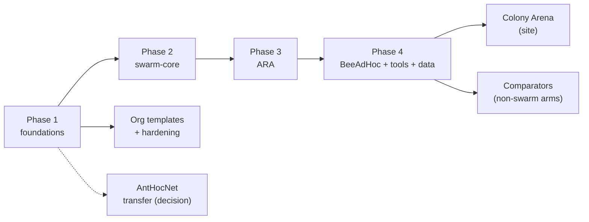

# swarm-routing roadmap

The plan for the whole org: what each phase delivers, what has to be true
before it counts as done, and what we deliberately do not do. It mirrors
[AntHocNet's `docs/roadmap.md`](https://github.com/danieljoppi/AntHocNet/blob/main/docs/roadmap.md)
(ladder, exit criteria, non-goals), the source repository's roadmap, which
keeps governing AntHocNet itself.

**How it is kept.** This file is the plan; issues are the work. Each phase has
one epic in the repository that owns it, its tasks are sub-issues (across
repositories where needed), and live status is the org's GitHub Project board
(views by phase, repository and priority). A phase moves to *done* here in the
PR that closes its epic. Changing a phase's scope or exit criteria is a PR to
this file, like any other decision.

## The ladder

| Phase | Owner repo · epic | Delivers | Status |
|---|---|---|---|
| 1 Foundations | `.github`, `ns3-containers` | org defaults, labels, reusable CI, licence gate; `ns3-dev` images; issue migration | done |
| 1+ Org templates | [.github#6](https://github.com/swarm-routing/.github/issues/6) | `tools/org-sync` + `templates/`: AGENTS/CLAUDE org sections, badges, SECURITY.md, licence files, ADR template, per-repo Makefiles with the same target names; the `org-repo` skill ([skills](https://github.com/swarm-routing/skills)) | tool merged; per-repo adoption open |
| 1+ Hardening | [.github#14](https://github.com/swarm-routing/.github/issues/14) | Scorecard, rulesets, merge policy, CI hygiene in every repo (from AntHocNet#328 and its children) | open |
| 2 swarm-core | [ns3-swarm-core#6](https://github.com/swarm-routing/ns3-swarm-core/issues/6) | the shared `swarm-core` contrib module | not started |
| 3 ARA | [ARA#3](https://github.com/swarm-routing/ARA/issues/3) | first protocol on swarm-core, through the three gates | blocked on 2 |
| 4 BeeAdHoc | [BeeAdHoc#3](https://github.com/swarm-routing/BeeAdHoc/issues/3) | second protocol; fidelity work can start now | fidelity open; code blocked on 2 |
| 4 Tools | [ns3-tools#2](https://github.com/swarm-routing/ns3-tools/issues/2), [ns3-tools#7](https://github.com/swarm-routing/ns3-tools/issues/7) | the comparison harness, probes, arenas, `ns3-tool` CLI | harness + readers moved (ns3-tools#13); AntHocNet switch-over open |
| 4 Comparators | [ns3-tools#15](https://github.com/swarm-routing/ns3-tools/issues/15) | non-swarm comparator arms (secure, learned, DTN), each its own module under `ns3-tools/ns3/arms/`; swarm-based variants with their protocol (BeeAdHoc#9, ARA#9, ARA#10) | migrated; each arm through the three gates |
| 4 Data | [benchmarks#3](https://github.com/swarm-routing/benchmarks/issues/3) | dataset layout, manifest schema, validator | before the first anchor lands |
| Site | [swarm-routing.github.io#3](https://github.com/swarm-routing/swarm-routing.github.io/issues/3) | Colony Arena: multi-protocol site and leaderboard | after a second `core/` and the data format |
| Transfer | [.github#2](https://github.com/swarm-routing/.github/issues/2) | AntHocNet moves into the org, or stays | technically unblocked (own images named by owner, danieljoppi/AntHocNet#845); waits on the Pages decision |

## Phase 1: foundations

Org-wide defaults (profile, issue forms, PR template, labels, `.clang-format`),
the reusable workflows (`reusable-ns3-ci.yml`, `reusable-licence-check.yml`,
`sync-labels.yml`), the licence-header gate, agent docs and per-directory
licensing in every repository, the `ns3-dev` images with `ns3-build-contrib` (since ns3-containers#10/#33: the release ns-3 supports, older releases on demand), and the migration of AntHocNet's issues (13 moved; danieljoppi/AntHocNet#800 closed as done).

A second wave (2026-11-02) moved the issues that are not specific to AntHocNet:
14 moved (the comparators epic and its children to ns3-tools#15–#21, benchmark
methodology to ns3-tools#22–#25, BeeSec/BeeAIS to BeeAdHoc#9, the swarm-based
secure arms to ARA#9 and ARA#10); danieljoppi/AntHocNet#770 split, its
harness package going to ns3-tools#26; danieljoppi/AntHocNet#656 closed as a
duplicate of #843. Infrastructure items under danieljoppi/AntHocNet#328 link to
the hardening epic .github#14.

**Exit criteria**

- [x] Every repository has `CLAUDE.md`, `AGENTS.md`, `LICENSING.md` and synced labels.
- [x] The image smoke builds a C++20 contrib module in 8 Ninja steps and passes `test.py` on all three profiles.
- [x] Images published to GHCR from `main`, signed, and public (run 41330598151; anonymous pull verified 2026-11-01).

## Phase 2: swarm-core

What two or more protocols share, extracted from AntHocNet's dual-licensed
`core/` and its ns-3 modules into `swarm-core`: the simulator-free primitives
and ports in `core/`, the ns-3 glue in `model/`, and the link-metric seams
migrated from AntHocNet ([ns3-swarm-core#2](https://github.com/swarm-routing/ns3-swarm-core/issues/2), [#3](https://github.com/swarm-routing/ns3-swarm-core/issues/3), [#4](https://github.com/swarm-routing/ns3-swarm-core/issues/4)).

**Exit criteria**

- [ ] `test.py -s swarm-core` green on `debug` and `sanitized`; `core/` passes the include check.
- [ ] Every wire helper has deterministic roundtrip + fuzz tests.
- [ ] A downstream module builds against it with `dependencies: swarm-core=swarm-routing/ns3-swarm-core@main`.

## Phase 3: ARA

ARA (Güneş, Sorges & Bouazizi, 2002) as a standalone protocol, and the proof
that swarm-core's API is enough: a fidelity sheet first, `core/` written fresh,
the ns-3 module `ara`, then the three comparator gates.

**Exit criteria**

- [ ] Fidelity sheet with every parameter sourced or marked *repo choice* / *unknown*.
- [ ] Module green in CI; same seed, byte-identical output.
- [ ] Anchor verdict recorded in `benchmarks` (PASS, or a written infeasibility verdict).

## Phase 4: BeeAdHoc, tools and data

BeeAdHoc (Wedde & Farooq, 2005) on the same path as ARA. It starts from
AntHocNet's arm, whose PG 460 anchor **missed** (3 of 5 pause times,
[danieljoppi/AntHocNet#841](https://github.com/danieljoppi/AntHocNet/pull/841)); its fidelity questions ([BeeAdHoc#4](https://github.com/swarm-routing/BeeAdHoc/issues/4), [BeeAdHoc#5](https://github.com/swarm-routing/BeeAdHoc/issues/5))
are settled before code moves. Alongside it, `ns3-tools` becomes the
protocol-agnostic harness, and `benchmarks` fixes its dataset format before the
first anchor writes into it.

**Exit criteria**

- [ ] BeeAdHoc's interpretations each *settled (§x)* or *unresolved* in its fidelity sheet; module green; anchor re-recorded.
- [ ] The harness runs any registered arm in the MANET and LEO arenas and emits the versioned marker lines.
- [ ] `benchmarks` validates every run's manifest in CI and refuses edits to merged data.

## Colony Arena (the site)

The org site, generalized from AntHocNet's learn site: a protocol's own
`core/` compiled to WebAssembly, rendered only, and a leaderboard generated from
`benchmarks`. AntHocNet's learn-site issues (danieljoppi/AntHocNet#562, #626, #634, #602, #590, #751)
stay in AntHocNet until its `web/` moves.

**Exit criteria**

- [ ] Scaffold served from `main` with the browser smoke and axe green.
- [ ] A second protocol in the browser with a byte-identical native-vs-WASM trace.
- [ ] Leaderboard regenerated from `benchmarks` data in CI.

## Non-goals

- **No protocol before its foundation.** No new protocol repository starts code before swarm-core has a consumer (ARA) green against `main`.
- **No numbers without the three gates.** A comparator that cannot reproduce its own paper's trend ships as a written verdict, never as a leaderboard row.
- **No per-network presets.** A network family changes the scenario, not a protocol's defaults (AntHocNet ADR-0019).
- **No automatic CI on ns-3 releases ns-3 no longer supports.** ns-3 maintains its latest release only; automatic pipelines (images and every repo's CI) follow it, and older releases run on demand (CONTRIBUTING invariant 7).
- **No `optimized` image in CI**, and no ns-3 `optimized` profile anywhere (`-march=native`).
- **No copying from ns-3's `src/aodv` or `src/olsr`**, and no GPL code in a dual `core/`.
- **No paywalled papers in public repositories**; they live in the private `papers` repository.
- **AntHocNet's own ladder stays in AntHocNet.** Issues not migrated (95 audited, 27 moved in two waves) keep their `release:` labels there; moved issues drop them, since the org has no release ladder of its own yet. The undecided ones (danieljoppi/AntHocNet#319, #112, #405) stay until the maintainer moves them.
- **No learned arm without its gates.** The DRL comparator (ns3-tools#20) needs disjoint training and test seeds, one held-out family and a reported training budget, plus frozen, versioned weights; nothing about it is scheduled before those exist.
- **DTN only where the oracle says so.** The store-carry-forward arm (ns3-tools#21) exists because danieljoppi/AntHocNet#580's trigger fired (the oracle delivers about 81 % on the disaster scene: the rest is partition-bound); it is scoped to the disaster family, not a general comparator.
- **No second simulator for now.** The OMNeT++/INET adapter and the Veins arm stay deferred (AntHocNet decision 2026-10-06, its roadmap "Why OMNeT++ (#32) is deferred"); cross-simulator results would be qualitative only.
