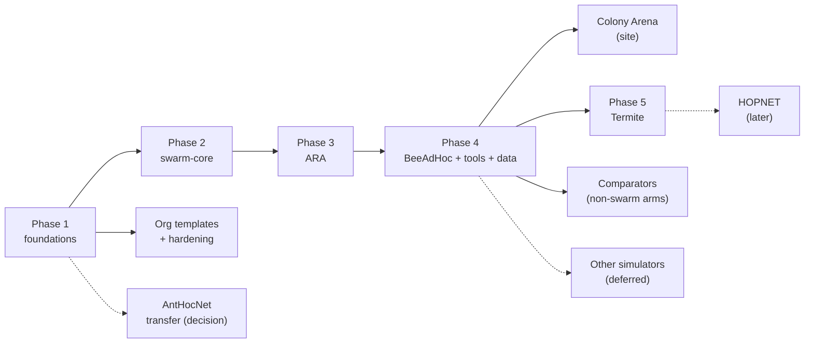

# swarm-routing roadmap

The plan for the whole org: what each phase delivers, what has to be true
before it counts as done, and what we deliberately do not do. It mirrors
[AntHocNet's `docs/roadmap.md`](https://github.com/danieljoppi/AntHocNet/blob/main/docs/roadmap.md)
(ladder, exit criteria, non-goals), the source repository's roadmap, which
keeps governing AntHocNet itself.

**How it is kept.** This file is the plan; issues are the work. Each phase has
one epic in the repository that owns it, its tasks are sub-issues (across
repositories where needed), and live status is the org's GitHub Project board
(views by phase, repository and priority). A phase moves to *done* here in the
PR that closes its epic. Changing a phase's scope or exit criteria is a PR to
this file, like any other decision. [Epics](#epics) below lists every epic of
every public repository with its status, generated from the issues by
`tools/epics/epics.py` (the same list is in each repository's README).
Whoever opens, closes or re-scopes an epic, or changes one of its sub-issues,
refreshes it in that PR or the next one (CONTRIBUTING, "Epics are the public
plan"); the weekly `epics` workflow only reports drift.

## The ladder

| Phase | Owner repo · epic | Delivers | Status |
|---|---|---|---|
| 1 Foundations | `.github`, `ns3-containers` | org defaults, labels, reusable CI, licence gate; `ns3-dev` images; issue migration | done |
| 1+ Org templates | [.github#6](https://github.com/swarm-routing/.github/issues/6) | `tools/org-sync` + `templates/`: AGENTS/CLAUDE org sections, badges, SECURITY.md, licence files, ADR template, per-repo Makefiles with the same target names; the `org-repo` skill ([skills](https://github.com/swarm-routing/skills)) | tool and skills merged; every public repo has adopted it except AntHocNet ([AntHocNet#855](https://github.com/swarm-routing/AntHocNet/issues/855), after #860) and `.github` itself; each adopter enables the `swarm-routing` plugin and the Agent skills section ([.github#79](https://github.com/swarm-routing/.github/issues/79)) |
| 1+ Hardening | [.github#14](https://github.com/swarm-routing/.github/issues/14) | Scorecard, rulesets, merge policy, CI hygiene in every repo (from AntHocNet#328 and its children) | open; the order is on [.github#35](https://github.com/swarm-routing/.github/issues/35); the admin decisions were made 2026-11-09 ([.github#81](https://github.com/swarm-routing/.github/issues/81)) and wait on the settings |
| 2 swarm-core | [ns3-swarm-core#6](https://github.com/swarm-routing/ns3-swarm-core/issues/6) | the shared `swarm-core` contrib module | skeleton merged with every phase-1 gate on (#7); the primitives (#8) are the org's critical path |
| 3 ARA | [ARA#3](https://github.com/swarm-routing/ARA/issues/3) | first protocol on swarm-core, through the three gates | fidelity sheet in review (ARA#17 for ARA#4); version and readings decided (ARA#15: ARA 2002); code (ARA#5) blocked on ns3-swarm-core#8 and #9, and is what closes phase 2 |
| 4 BeeAdHoc | [BeeAdHoc#3](https://github.com/swarm-routing/BeeAdHoc/issues/3) | second protocol; fidelity work can start now | reference version decided (BeeAdHoc#16: PG 460's Linux module); fidelity open (BeeAdHoc#13, #4, #5); code blocked on 2 |
| 4 Tools | [ns3-tools#2](https://github.com/swarm-routing/ns3-tools/issues/2), [ns3-tools#7](https://github.com/swarm-routing/ns3-tools/issues/7) | the comparison harness, probes, arenas, `ns3-tool` CLI | harness + readers moved (ns3-tools#13); reader fixes, strict warnings, the `ns3-tool` CLI (ns3-tools#39), probes (#40) and AntHocNet's switch-over (#29) open |
| 4 Comparators | [ns3-tools#15](https://github.com/swarm-routing/ns3-tools/issues/15) | non-swarm comparator arms (secure, learned, DTN), each its own module under `ns3-tools/ns3/arms/`; swarm-based variants with their protocol (BeeAdHoc#9, ARA#9, ARA#10) | migrated; gates pending (each arm needs its three before a number counts) |
| 4 Data | [benchmarks#3](https://github.com/swarm-routing/benchmarks/issues/3) | dataset layout, manifest schema, validator | not started; must land before the first anchor |
| Site | [swarm-routing.github.io#3](https://github.com/swarm-routing/swarm-routing.github.io/issues/3) | Colony Arena: multi-protocol site and leaderboard | served from `main`, AntHocNet's game, docs and API moved (cutover 2026-11-08); leaderboard and second protocol wait on the data format and a second `core/`; polish epic site#27 |
| Transfer | [.github#2](https://github.com/swarm-routing/.github/issues/2) | AntHocNet moves into the org, or stays | **done**: [swarm-routing/AntHocNet](https://github.com/swarm-routing/AntHocNet), CI green after the move (AntHocNet#854); left: Zenodo, the first release DOI, the links ([.github#63](https://github.com/swarm-routing/.github/issues/63)) |
| 5 Termite | [Termite#3](https://github.com/swarm-routing/Termite/issues/3) (was .github#51) | Termite as a standalone protocol: its own repo, fidelity sheet, anchor-miss analysis, `core/` on swarm-core, the three gates | version decided (ch. 4, Termite#4); parameters in review (Termite#11); anchor-miss pre-registration (Termite#5) before code; code blocked on 2 and 3 |
| Later: HOPNET | [HOPNET#3](https://github.com/swarm-routing/HOPNET/issues/3) (was .github#52) | HOPNET (ants + zone routing) in its own repo; the thesis's fidelity sheet first | not scheduled; only the fidelity sheet may start (HOPNET#4) |
| Later: other simulators | [.github#48](https://github.com/swarm-routing/.github/issues/48) | `<sim>-containers` and `<sim>-tools` repos for OMNeT++/INET, Veins and CORE/EMANE, built like `ns3-containers` / `ns3-tools` | deferred: ns-3 first |

## Where to start

Each workstream has a **handoff issue** written for a session with no chat history, a person's or an AI agent's: the goal and what "done" means, the state, the next steps in order, the commands, the pitfalls already hit, and the decisions that wait on the maintainer. Pick one, attach the repositories it names, and work its steps in order. Close it when its goal is met. A session that stops with work in flight updates it or opens a new one (each repository's `CLAUDE.md`, "Handoffs are always a ticket"). The live list is every open issue labelled [`handoff`](https://github.com/search?q=org%3Aswarm-routing+label%3Ahandoff+state%3Aopen&type=issues).

| Workstream | Handoff | First tickets, in order | Can start now? |
|---|---|---|---|
| Phase 2: swarm-core primitives and glue (**critical path**) | [ns3-swarm-core#18](https://github.com/swarm-routing/ns3-swarm-core/issues/18) | ns3-swarm-core#8, #9 | yes |
| ARA before code | [ARA#14](https://github.com/swarm-routing/ARA/issues/14) | ARA#8 (org template), #4 (fidelity sheet) | yes |
| BeeAdHoc fidelity | [BeeAdHoc#14](https://github.com/swarm-routing/BeeAdHoc/issues/14) | BeeAdHoc#13, #8, #4, #5 | yes (#4 and #5 need the papers) |
| Termite before code | [Termite#7](https://github.com/swarm-routing/Termite/issues/7) | Termite#5 (anchor-miss pre-registration), #4 (fidelity sheet) | yes |
| Data: dataset format and validator | [benchmarks#9](https://github.com/swarm-routing/benchmarks/issues/9) | benchmarks#5, #3, then #7 | yes |
| Tools: one harness, AntHocNet's switch-over | [ns3-tools#41](https://github.com/swarm-routing/ns3-tools/issues/41) | ns3-tools#14, #31, #28, #6, #39, then #29 | yes (#29 opens after `ns3-tools v0.1.0` is tagged, decision 2026-11-09) |
| Images: trust `latest` | [ns3-containers#62](https://github.com/swarm-routing/ns3-containers/issues/62) | ns3-containers#55, #44, #43, #17, #13 | yes (#27 scoped to the supported release, 2026-11-09) |
| Site: self-verifying deploys, polish | [swarm-routing.github.io#39](https://github.com/swarm-routing/swarm-routing.github.io/issues/39) | site#28, #30, #31, #29, #17, #18 | yes |
| Org: templates and gates everywhere | [.github#64](https://github.com/swarm-routing/.github/issues/64) | .github#63, #55, #29, #26 | yes |
| AntHocNet after the move | [AntHocNet#856](https://github.com/swarm-routing/AntHocNet/issues/856) | AntHocNet#460, #855, the hardening P2s; .github#2's Zenodo and DOI | with the maintainer's go-ahead per PR |

The order that matters across them: swarm-core's primitives (ns3-swarm-core#8) come before any protocol code (ARA#5, then BeeAdHoc's port, Termite#6, HOPNET#5). The dataset format (benchmarks#3) comes before the first anchor result. The site's leaderboard (site#12) and second protocol (site#13) follow those two. HOPNET has no handoff: it is not scheduled, and only its fidelity sheet (HOPNET#4) may start.

The 2026-11-09 review of every open ticket against this plan, with the answers to "did the migration finish, can protocol code start, are the images, tools, skills and pipelines ready", and the decisions taken that day, is [.github#81](https://github.com/swarm-routing/.github/issues/81).

## Releases

The org has no version ladder of its own: AntHocNet keeps its ladder in its
`docs/roadmap.md` (Non-goals). Instead each phase has a **release target**:
the first tagged release of the repository that owns it, cut when that
repository's own criteria in the table below hold. They are the repository's
slice of the phase's exit criteria, not the whole phase: `ns3-tools v0.1.0`
waits on the tools items only, not on BeeAdHoc or the data format. Two rules (decided 2026-11-09, [.github#81](https://github.com/swarm-routing/.github/issues/81)):

- **No org repository releases before the reusable release workflow exists**
  ([.github#20](https://github.com/swarm-routing/.github/issues/20): Commitizen
  bump from Conventional-Commit history, `SHA256SUMS`, SLSA provenance as
  `*.intoto.jsonl`, a CycloneDX SBOM, the verify commands in the release
  notes). Its first caller is the harness package,
  [ns3-tools#26](https://github.com/swarm-routing/ns3-tools/issues/26), which is
  the org's first release. A copy of AntHocNet's `release.yml` in a protocol
  repo is not a substitute: the copies would drift.
- **A first release is `v0.1.0`**, bumped from there by Commitizen. A release
  of a citable repository is archived on Zenodo under that repository's
  concept DOI ([.github#45](https://github.com/swarm-routing/.github/issues/45), the daily `zenodo` workflow).

| Phase | Release target | Cut when |
|---|---|---|
| 4 Tools | `ns3-tools v0.1.0` (the first org release) | ns3-tools#14, #31, #28, #6 merged; then AntHocNet's switch-over (ns3-tools#29) pins this tag |
| 2 swarm-core | `ns3-swarm-core v0.1.0` | the three exit criteria hold. ARA#5 starts once the primitives and the glue are merged (ns3-swarm-core#8, #9), before the phase exits; its first green build against `@main` is what proves the third criterion |
| 3 ARA | `ARA v0.1.0` | module green, determinism gate, anchor verdict recorded in `benchmarks` (PASS, or a written infeasibility verdict) |
| 4 BeeAdHoc | `BeeAdHoc v0.1.0` | fidelity settled (BeeAdHoc#4, #5), module green, standalone anchor verdict re-recorded using the `v270a` pre-registration or a new pre-registration (decision on BeeAdHoc#4) |
| 4 Data | none (data is immutable runs, not versions) | the manifest schema and validator (benchmarks#3) carry their own schema version |
| 5 Termite | `Termite v0.1.0` | the anchor-miss analysis (Termite#5) is recorded before code; module green; three gates or a written verdict |
| Site | none (deploys from `main`) | the live smoke verifies each deploy by its build marker (site#28) |
| Images | none (tags per ns-3 release and profile) | each image is tested by digest before its tag moves (ns3-containers golden rule 17) |
| AntHocNet | its own ladder: next **v2.7.0** | after AntHocNet#460's two PRs, the ns3-tools#29 switch-over (its "harness packaged" exit, superseding AntHocNet#770) and the hardening P2s #786, #787, #789, #840; fixes before then ship as v2.6.x (decision 2026-11-09 on AntHocNet#856) |

## Epics

<!-- epics:begin -->
<!-- Generated by swarm-routing/.github tools/epics/epics.py from the issues labelled `epic`; edit the issues, then re-run it. -->

Every epic of every public repository, open first. A status is derived from the issue: an open epic is **Planned** (no sub-issue closed) or **In progress** (at least one closed); it is **Done** or **Dropped** only once the epic itself is closed (as completed or as not planned). Each repository's README carries its own list.

### [.github](https://github.com/swarm-routing/.github)

| Epic | Status | Sub-issues closed |
|------|--------|-------------------|
| [#6](https://github.com/swarm-routing/.github/issues/6) org repo template — security policy, README badges and community files, applied and kept in sync by a tool and a skill | In progress | 12 / 28 |
| [#14](https://github.com/swarm-routing/.github/issues/14) Repository hardening for every org repo: Scorecard, rulesets, merge policy, CI hygiene | In progress | 1 / 11 |
| [#50](https://github.com/swarm-routing/.github/issues/50) One repository per swarm protocol: create the missing ones (Termite, HOPNET) | In progress | 2 / 3 |
| [#107](https://github.com/swarm-routing/.github/issues/107) ns-3 images: every protocol release and campaign builds on ns3-containers | In progress | 2 / 7 |
| [#35](https://github.com/swarm-routing/.github/issues/35) code quality across the org — order of work and maintainer decisions | Planned | no sub-issues yet |
| [#48](https://github.com/swarm-routing/.github/issues/48) Other simulators: container and tooling repos for OMNeT++/INET, Veins and CORE/EMANE (deferred; ns-3 first) | Planned | no sub-issues yet |

### [AntHocNet](https://github.com/swarm-routing/AntHocNet)

| Epic | Status | Sub-issues closed |
|------|--------|-------------------|
| [#64](https://github.com/swarm-routing/AntHocNet/issues/64) Abstract discrete-event testbench in core/tests — trend regression without a simulator | In progress | 1 / 2 |
| [#109](https://github.com/swarm-routing/AntHocNet/issues/109) Publish the AntHocNet implementation (reproducibility + cross-simulator paper) | In progress | 1 / 4 |
| [#328](https://github.com/swarm-routing/AntHocNet/issues/328) 5-star open-source packaging — visibility, supply-chain trust, onboarding, docs site | In progress | 12 / 23 |
| [#32](https://github.com/swarm-routing/AntHocNet/issues/32) Add an OMNeT++/INET adapter (third simulator target) | Planned | 0 / 4 |
| [#65](https://github.com/swarm-routing/AntHocNet/issues/65) CORE/EMANE emulation target — run the real core as a Linux daemon | Planned | 0 / 3 |
| [#194](https://github.com/swarm-routing/AntHocNet/issues/194) Make the NS-3 adapter satellite-capable (multi-interface, timescales, non-wifi signals) | Planned | no sub-issues yet |
| [#302](https://github.com/swarm-routing/AntHocNet/issues/302) secured AntHocNet — attribute-gated trust + authenticated ants, default-off and byte-identical to the paper-faithful path | Planned | no sub-issues yet |
| [#564](https://github.com/swarm-routing/AntHocNet/issues/564) Wider threat model (v3.3.0): wormhole, rushing, Sybil and pheromone poisoning | Planned | 0 / 4 |

Closed: 32 epics

| Epic | Closed |
|------|--------|
| [#634](https://github.com/swarm-routing/AntHocNet/issues/634) The Workshop: the API and ns-3 inside the game | Done 2026-11-08 |
| [#562](https://github.com/swarm-routing/AntHocNet/issues/562) Campaign mode: one chapter per network type, with a game UI | Dropped 2026-11-08 |
| [#563](https://github.com/swarm-routing/AntHocNet/issues/563) Comparators: swarm, learned and secure protocols under identical conditions | Dropped 2026-11-02 |
| [#294](https://github.com/swarm-routing/AntHocNet/issues/294) metrics 2026 — age of information, delay percentile/CDF export, energy-per-bit, route lifetime/convergence as CSV metrics | Dropped 2026-11-01 |
| [#764](https://github.com/swarm-routing/AntHocNet/issues/764) A protocol-agnostic comparison harness, packaged on its own | Dropped 2026-11-01 |
| [#603](https://github.com/swarm-routing/AntHocNet/issues/603) Infrastructure track: easy ns-3 install, faster CI, clean release packages | Done 2026-10-30 |
| [#298](https://github.com/swarm-routing/AntHocNet/issues/298) 2026 roadmap — literature gap analysis (MANET × satellite × methodology) and release goals v1.3.0 → v3.0.0 | Done 2026-10-30 |
| [#31](https://github.com/swarm-routing/AntHocNet/issues/31) Landscape & project positioning (item 09) | Dropped 2026-10-30 |
| [#29](https://github.com/swarm-routing/AntHocNet/issues/29) Finish trace coverage (item 15 remainder) | Dropped 2026-10-30 |
| [#28](https://github.com/swarm-routing/AntHocNet/issues/28) Finish the comparison harness + validation (items 07, 08) | Dropped 2026-10-30 |
| [#27](https://github.com/swarm-routing/AntHocNet/issues/27) Adapter-correctness gaps (item 11 + NS-3 link-failure) | Dropped 2026-10-30 |
| [#26](https://github.com/swarm-routing/AntHocNet/issues/26) Remaining protocol-fidelity deviations (items 04, 06, 10) | Dropped 2026-10-30 |
| [#581](https://github.com/swarm-routing/AntHocNet/issues/581) Space-air-ground (SAGIN) family: a HAPS/UAV layer on leo-walker | Done 2026-10-26 |
| [#580](https://github.com/swarm-routing/AntHocNet/issues/580) Disaster / emergency-response family (with a tactical narrowband cell) | Done 2026-10-26 |
| [#142](https://github.com/swarm-routing/AntHocNet/issues/142) Pluggable link metrics — make the ILinkMetric seam usable and populate it | Done 2026-10-18 |
| [#626](https://github.com/swarm-routing/AntHocNet/issues/626) The whole site is the game (v2.1.0) | Done 2026-10-09 |
| [#233](https://github.com/swarm-routing/AntHocNet/issues/233) Satellite build environment — substrate in an image, not a second build | Done 2026-10-08 |
| [#307](https://github.com/swarm-routing/AntHocNet/issues/307) Remove NS-2 support — v1.2.0 is the last release that ships it | Done 2026-10-08 |
| [#192](https://github.com/swarm-routing/AntHocNet/issues/192) Satellite networking — can AntHocNet route a satellite constellation? | Done 2026-10-08 |
| [#196](https://github.com/swarm-routing/AntHocNet/issues/196) Satellite benchmark harness + the precomputed-shortest-path control | Done 2026-10-08 |
| [#297](https://github.com/swarm-routing/AntHocNet/issues/297) satellite evaluation credibility — canonical dynamic scenarios, handover metric family, measurement calibration | Done 2026-10-08 |
| [#195](https://github.com/swarm-routing/AntHocNet/issues/195) Build our own ns-3 satellite/LEO module (gated on the substrate spike) | Dropped 2026-10-08 |
| [#193](https://github.com/swarm-routing/AntHocNet/issues/193) Satellite simulation substrate — pick the platform (spike set) | Done 2026-10-08 |
| [#542](https://github.com/swarm-routing/AntHocNet/issues/542) Learn AntHocNet — an interactive, game-like site that teaches the protocol on every network family, plus the API reference (v2.0.0) | Done 2026-10-08 |
| [#301](https://github.com/swarm-routing/AntHocNet/issues/301) VANET support — road-constrained mobility (Manhattan grid, SUMO trace import) | Done 2026-10-07 |
| [#300](https://github.com/swarm-routing/AntHocNet/issues/300) FANET support — 3D Gauss-Markov scenarios for the family where AntHocNet's reputation is made | Done 2026-10-02 |
| [#91](https://github.com/swarm-routing/AntHocNet/issues/91) First fully paper-compliant version (v1.0): ledger, ordering, and open gaps | Done 2026-09-24 |
| [#296](https://github.com/swarm-routing/AntHocNet/issues/296) baselines 2026 — oracle shortest-path control, multipath + geographic baselines, modern deployed-protocol feasibility | Done 2026-08-15 |
| [#308](https://github.com/swarm-routing/AntHocNet/issues/308) close the delay-tail deficit — #21 is now statistically confirmed, and nothing owns fixing it | Done 2026-08-09 |
| [#295](https://github.com/swarm-routing/AntHocNet/issues/295) scenario realism — mobility beyond RWP, fading channels, modern-PHY arm, TCP traffic, 200+ nodes | Done 2026-08-08 |
| [#293](https://github.com/swarm-routing/AntHocNet/issues/293) statistical credibility — 95% CIs on every published number, paired difference tests, warm-up discipline | Done 2026-08-07 |
| [#30](https://github.com/swarm-routing/AntHocNet/issues/30) Reproducibility & release (item 14 E2/E3) | Done 2026-07-06 |

### [ARA](https://github.com/swarm-routing/ARA)

| Epic | Status | Sub-issues closed |
|------|--------|-------------------|
| [#3](https://github.com/swarm-routing/ARA/issues/3) ARA as a standalone hexagonal protocol (Phase 3) | In progress | 2 / 3 |

### [BeeAdHoc](https://github.com/swarm-routing/BeeAdHoc)

No open epic: the work here is tracked as single issues.

Closed: 1 epic

| Epic | Closed |
|------|--------|
| [#3](https://github.com/swarm-routing/BeeAdHoc/issues/3) BeeAdHoc as a standalone hexagonal protocol (Phase 4) | Done 2026-11-10 |

### [benchmarks](https://github.com/swarm-routing/benchmarks)

No open epic: the work here is tracked as single issues.

### [HOPNET](https://github.com/swarm-routing/HOPNET)

| Epic | Status | Sub-issues closed |
|------|--------|-------------------|
| [#3](https://github.com/swarm-routing/HOPNET/issues/3) HOPNET as a standalone hexagonal protocol (later: not scheduled) | In progress | 1 / 3 |

### [ns3-containers](https://github.com/swarm-routing/ns3-containers)

| Epic | Status | Sub-issues closed |
|------|--------|-------------------|
| [#19](https://github.com/swarm-routing/ns3-containers/issues/19) OS and compiler coverage — the platforms ns-3 supports and researchers use | In progress | 2 / 6 |
| [#36](https://github.com/swarm-routing/ns3-containers/issues/36) image test pipeline — every image built is tested by digest (security, structure, unit, profile, integration, regression, downstream) before any tag moves | In progress | 5 / 9 |
| [#11](https://github.com/swarm-routing/ns3-containers/issues/11) multi-platform ns3-dev images (linux/amd64 + linux/arm64) with docker buildx | Planned | no sub-issues yet |
| [#12](https://github.com/swarm-routing/ns3-containers/issues/12) developer documentation for the ns3-dev images (usage, per-image pages, debugging, CI/CD) kept current by AI review | Planned | 0 / 7 |
| [#27](https://github.com/swarm-routing/ns3-containers/issues/27) security refresh — keep the supported ns-3 release's images patched (scheduled base refresh + scan-triggered rebuilds; older releases on demand) | Planned | 0 / 4 |

Closed: 1 epic

| Epic | Closed |
|------|--------|
| [#3](https://github.com/swarm-routing/ns3-containers/issues/3) ns3-dev image matrix — top 10 ns-3 versions, full profiles on the latest 3, Ubuntu/Debian/slim bases | Done 2026-11-02 |

### [ns3-swarm-core](https://github.com/swarm-routing/ns3-swarm-core)

| Epic | Status | Sub-issues closed |
|------|--------|-------------------|
| [#6](https://github.com/swarm-routing/ns3-swarm-core/issues/6) swarm-core: the shared contrib module every swarm protocol links (Phase 2) | In progress | 3 / 8 |

### [ns3-tools](https://github.com/swarm-routing/ns3-tools)

| Epic | Status | Sub-issues closed |
|------|--------|-------------------|
| [#2](https://github.com/swarm-routing/ns3-tools/issues/2) A protocol-agnostic comparison harness, packaged on its own | Planned | 0 / 8 |
| [#7](https://github.com/swarm-routing/ns3-tools/issues/7) metrics 2026 — age of information, delay percentile/CDF export, energy-per-bit, route lifetime/convergence as CSV metrics | Planned | 0 / 1 |
| [#15](https://github.com/swarm-routing/ns3-tools/issues/15) Comparators: swarm, learned and secure protocols under identical conditions | Planned | 0 / 10 |
| [#34](https://github.com/swarm-routing/ns3-tools/issues/34) promote AntHocNet's vendored comparator modules into ns3/arms/: aomdv, gpsr, qrouting, oracle | Planned | 0 / 2 |
| [#43](https://github.com/swarm-routing/ns3-tools/issues/43) Network substrates: the ns-3 pieces new network types need, for every arm | Planned | 0 / 10 |

### [skills](https://github.com/swarm-routing/skills)

| Epic | Status | Sub-issues closed |
|------|--------|-------------------|
| [#9](https://github.com/swarm-routing/skills/issues/9) Protocol-development and org-ops skills: fidelity sheets, invariant review, module scaffolds, anchors, handoffs | In progress | 3 / 8 |

### [swarm-routing.github.io](https://github.com/swarm-routing/swarm-routing.github.io)

| Epic | Status | Sub-issues closed |
|------|--------|-------------------|
| [#3](https://github.com/swarm-routing/swarm-routing.github.io/issues/3) Colony Arena: the one org site, built from the protocol repos | In progress | 5 / 7 |
| [#21](https://github.com/swarm-routing/swarm-routing.github.io/issues/21) Campaign mode: one chapter per network type, with a game UI | Planned | 0 / 2 |
| [#27](https://github.com/swarm-routing/swarm-routing.github.io/issues/27) Colony Arena polish: navigation, SEO, usability, search | Planned | 0 / 10 |

### [Termite](https://github.com/swarm-routing/Termite)

| Epic | Status | Sub-issues closed |
|------|--------|-------------------|
| [#3](https://github.com/swarm-routing/Termite/issues/3) Termite as a standalone hexagonal protocol (Phase 5) | Planned | 0 / 3 |

<!-- epics:end -->

## Protocol repositories

Every swarm protocol has its own repository (maintainer decision 2026-11-03,
epic [.github#50](https://github.com/swarm-routing/.github/issues/50)): a
simulator-agnostic `core/` and an ns-3 module on `swarm-core`, bootstrapped with
`tools/org-sync/org_sync.py init <dir> --kind protocol`. Non-swarm comparator
arms are not protocols of ours and live in `ns3-tools/ns3/arms/`; swarm-based
variants (secure, trust-aware) live with the protocol they extend.

| Protocol | Repository | Phase | Status |
|---|---|---|---|
| AntHocNet (Di Caro et al. 2005) | [swarm-routing/AntHocNet](https://github.com/swarm-routing/AntHocNet) | Transfer | in the org since the 2026-11 transfer ([.github#2](https://github.com/swarm-routing/.github/issues/2)); keeps its own release ladder |
| ARA (Güneş et al. 2002) | [swarm-routing/ARA](https://github.com/swarm-routing/ARA) | 3 | exists |
| BeeAdHoc (Wedde & Farooq 2005) | [swarm-routing/BeeAdHoc](https://github.com/swarm-routing/BeeAdHoc) | 4 | exists |
| Termite (Roth & Wicker 2003/2005) | [swarm-routing/Termite](https://github.com/swarm-routing/Termite) | 5 | exists (no code yet); epic [Termite#3](https://github.com/swarm-routing/Termite/issues/3) |
| HOPNET (Wang 2007) | [swarm-routing/HOPNET](https://github.com/swarm-routing/HOPNET) | later | exists (no code yet); epic [HOPNET#3](https://github.com/swarm-routing/HOPNET/issues/3), not scheduled |

Not planned as repositories: AntNet (wired networks, AntHocNet's ancestor), and
the swarm-based variants above (BeeSec/BeeAIS in BeeAdHoc#9; trust-weighted ACO
and ACO + watchdog in ARA#9, ARA#10). The maintainer creates a repository; it may
exist early as an empty, bootstrapped placeholder (Termite and HOPNET, 2026-11-03),
but no protocol code lands in it before its phase is scheduled. The remaining swarm MANET protocols
the landscape never assessed (Ant-AODV, ANSI, PERA, ARAMA, EARA, BeeIP, APAR,
SARA) each get a verdict (repo, fold into an existing protocol, or skip) in
[.github#54](https://github.com/swarm-routing/.github/issues/54).

## Phase 1: foundations

Org-wide defaults (profile, issue forms, PR template, labels, `.clang-format`),
the reusable workflows (`reusable-ns3-ci.yml`, `reusable-licence-check.yml`,
`sync-labels.yml`), the licence-header gate, agent docs and per-directory
licensing in every repository, the `ns3-dev` images with `ns3-build-contrib` (since ns3-containers#10/#33: the release ns-3 supports, older releases on demand), and the migration of AntHocNet's issues (13 moved; danieljoppi/AntHocNet#800 closed as done).

A second wave (2026-11-02) moved the issues that are not specific to AntHocNet:
14 moved (the comparators epic and its children to ns3-tools#15–#21, benchmark
methodology to ns3-tools#22–#25, BeeSec/BeeAIS to BeeAdHoc#9, the swarm-based
secure arms to ARA#9 and ARA#10); danieljoppi/AntHocNet#770 split, its
harness package going to ns3-tools#26; danieljoppi/AntHocNet#656 closed as a
duplicate of #843. Infrastructure items under danieljoppi/AntHocNet#328 link to
the hardening epic .github#14. A third wave (2026-11-08) moved the learn-site
issues with the game to swarm-routing.github.io: AntHocNet#562 (site#21),
#590 (site#22), #602 (site#23) and #751 (site#24); #634 closed as done and #846
as fixed.

**Exit criteria**

- [x] Every repository has `CLAUDE.md`, `AGENTS.md`, `LICENSING.md` and synced labels.
- [x] The image smoke builds a C++20 contrib module in 8 Ninja steps and passes `test.py` on all three profiles.
- [x] Images published to GHCR from `main`, signed, and public (run 41330598151; anonymous pull verified 2026-11-01).

## Phase 2: swarm-core

What two or more protocols share, extracted from AntHocNet's dual-licensed
`core/` and its ns-3 modules into `swarm-core`: the simulator-free primitives
and ports in `core/`, the ns-3 glue in `model/`, and the link-metric seams
migrated from AntHocNet ([ns3-swarm-core#2](https://github.com/swarm-routing/ns3-swarm-core/issues/2), [#3](https://github.com/swarm-routing/ns3-swarm-core/issues/3), [#4](https://github.com/swarm-routing/ns3-swarm-core/issues/4)).

**Exit criteria**

- [ ] `test.py -s swarm-core` green on `debug` and `sanitized`; `core/` passes the include check.
- [ ] Every wire helper has deterministic roundtrip + fuzz tests.
- [ ] A downstream module builds against it with `dependencies: swarm-core=swarm-routing/ns3-swarm-core@main`.

## Phase 3: ARA

ARA (Güneş, Sorges & Bouazizi, 2002) as a standalone protocol, and the proof
that swarm-core's API is enough: a fidelity sheet first, `core/` written fresh,
the ns-3 module `ara`, then the three comparator gates.

**Exit criteria**

- [ ] Fidelity sheet with every parameter sourced or marked *repo choice* / *unknown*.
- [ ] Module green in CI; same seed, byte-identical output.
- [ ] Anchor verdict recorded in `benchmarks` (PASS, or a written infeasibility verdict).

## Phase 4: BeeAdHoc, tools and data

BeeAdHoc (Wedde & Farooq, 2005) on the same path as ARA. It starts from
AntHocNet's arm, whose PG 460 anchor **missed** (3 of 5 pause times,
[danieljoppi/AntHocNet#841](https://github.com/danieljoppi/AntHocNet/pull/841)); its fidelity questions ([BeeAdHoc#4](https://github.com/swarm-routing/BeeAdHoc/issues/4), [BeeAdHoc#5](https://github.com/swarm-routing/BeeAdHoc/issues/5))
are settled before code moves. Alongside it, `ns3-tools` becomes the
protocol-agnostic harness, and `benchmarks` fixes its dataset format before the
first anchor writes into it.

**Exit criteria**

- [ ] BeeAdHoc's interpretations each *settled (§x)* or *unresolved* in its fidelity sheet; module green; anchor re-recorded.
- [ ] The harness runs any registered arm in the MANET and LEO arenas and emits the versioned marker lines.
- [ ] `benchmarks` validates every run's manifest in CI and refuses edits to merged data.

## Phase 5: Termite

Termite (Roth & Wicker) routes by stigmergy: routing state rides inside data
packets, with no control ants. AntHocNet's arm passed the delivery smoke but
**missed** its anchor in v2.5.0 (the trend points the right way, the CIs span
zero; danieljoppi/AntHocNet#587), so it starts with a pre-registered analysis
of that miss. It is swarm-core's pheromone primitives' next consumer after the
ant protocols, and leaves AntHocNet's `adaptive` module for its own repository,
not for `ns3-tools`.

**Exit criteria**

- [x] `swarm-routing/Termite` created and bootstrapped (Termite#1); its epic is Termite#3.
- [ ] Fidelity sheet with every parameter sourced or marked.
- [ ] The anchor miss explained in an issue before code (arm, scenario or power).
- [ ] Module green in CI; three gates recorded, or a written infeasibility verdict.

HOPNET (ants + zone routing, Wang 2007) follows later, thesis fidelity sheet
first (epic HOPNET#3); it is the one published result benchmarked against
AntHocNet directly.

## Colony Arena (the site)

The org site, generalized from AntHocNet's learn site: a protocol's own
`core/` compiled to WebAssembly, rendered only, and a leaderboard generated from
`benchmarks`. Epic: [swarm-routing.github.io#3](https://github.com/swarm-routing/swarm-routing.github.io/issues/3).

Decided 2026-11-03: the site lives **only** in `swarm-routing.github.io`. After the
cutover no protocol repo deploys Pages, and there are no redirect stubs (the old
`danieljoppi.github.io/AntHocNet/` stays 404). Every protocol core in the
site is built from its own repository at a pinned commit; nothing is vendored.
AntHocNet's game, docs (`/AntHocNet/docs/`) and API (`/AntHocNet/api/`) move
there; AntHocNet retires `pages.yml` and `web/` at cutover
([AntHocNet#850](https://github.com/swarm-routing/AntHocNet/issues/850); done 2026-11-08 in AntHocNet#852 and site#11). Its open learn-site issues ([#562](https://github.com/swarm-routing/AntHocNet/issues/562), [#634](https://github.com/swarm-routing/AntHocNet/issues/634), [#602](https://github.com/swarm-routing/AntHocNet/issues/602),
[#590](https://github.com/swarm-routing/AntHocNet/issues/590), [#751](https://github.com/swarm-routing/AntHocNet/issues/751), [#846](https://github.com/swarm-routing/AntHocNet/issues/846)) migrate with the game.

**Exit criteria**

- [x] ADR accepted: lock file of pinned protocol commits, browser ABI, where the simulator and parity gate live, URL layout ([site#7](https://github.com/swarm-routing/swarm-routing.github.io/issues/7)).
- [x] Scaffold served from `main` with the browser smoke and axe green ([site#8](https://github.com/swarm-routing/swarm-routing.github.io/issues/8)).
- [x] AntHocNet's game, docs and API served from the site, built from AntHocNet's pinned commit; AntHocNet has no Pages deploy and its `core/` PRs still run parity ([site#9](https://github.com/swarm-routing/swarm-routing.github.io/issues/9), [#10](https://github.com/swarm-routing/swarm-routing.github.io/issues/10), [#11](https://github.com/swarm-routing/swarm-routing.github.io/issues/11); [AntHocNet#850](https://github.com/swarm-routing/AntHocNet/issues/850)).
- [ ] A second protocol in the browser with a byte-identical native-vs-WASM trace ([site#13](https://github.com/swarm-routing/swarm-routing.github.io/issues/13)).
- [ ] Leaderboard regenerated from `benchmarks` data in CI ([site#12](https://github.com/swarm-routing/swarm-routing.github.io/issues/12)).

## Later: other simulators (deferred)

The org's focus is ns-3. Other simulators are planned but not scheduled: when
one is needed, it gets the infrastructure ns-3 has today, one repository per
concern: a `<sim>-containers` repo (prebuilt, tested, signed images of
OMNeT++ + INET, Veins = OMNeT++ + INET + SUMO, or CORE + EMANE for Linux
emulation, built like `ns3-containers`), a `<sim>-tools` repo emitting the same
versioned marker lines, and a reusable CI workflow per simulator. `benchmarks`
takes that data only once its manifest and validator record which simulator
and image produced a run (today they pin an `ns3-dev` image); that schema
change is part of the epic, made before the first such run lands. Protocols need no fork: their `core/`
is simulator-agnostic, so a new simulator is a new adapter in the protocol's
repository. AntHocNet's issues for it (danieljoppi/AntHocNet#32, #65, #147–#153,
#485) stay there until this starts; #150 (the OMNeT++/INET image) is the first
item to migrate. Epic: [.github#48](https://github.com/swarm-routing/.github/issues/48).

**Trigger** (any of): phases 2–4 done and a protocol needs a result only another
simulator gives; a venue or reviewer asks for cross-simulator confirmation; an
emulation or real-stack claim is needed. Cross-simulator results stay
qualitative: they confirm an ns-3 ranking, they do not replace its numbers.

## Non-goals

- **No protocol before its foundation.** No new protocol repository starts code before swarm-core has a consumer (ARA) green against `main`.
- **No numbers without the three gates.** A comparator that cannot reproduce its own paper's trend ships as a written verdict, never as a leaderboard row.
- **No per-network presets.** A network family changes the scenario, not a protocol's defaults (AntHocNet ADR-0019).
- **No automatic CI on ns-3 releases ns-3 no longer supports.** ns-3 maintains its latest release only; automatic pipelines (images and every repo's CI) follow it, and older releases run on demand (CONTRIBUTING invariant 7).
- **No `optimized` image in CI**, and no ns-3 `optimized` profile anywhere (`-march=native`).
- **No copying from ns-3's `src/aodv` or `src/olsr`**, and no GPL code in a dual `core/`.
- **No paywalled papers in public repositories**; they live in the private `papers` repository.
- **AntHocNet's own ladder stays in AntHocNet.** Issues not migrated (95 audited, 31 moved in three waves) keep their `release:` labels there; moved issues drop them, since the org has release targets per phase ([Releases](#releases)), not a version ladder of its own. The undecided ones (danieljoppi/AntHocNet#319, #112, #405) stay until the maintainer moves them.
- **No learned arm without its gates.** The DRL comparator (ns3-tools#20) needs disjoint training and test seeds, one held-out family and a reported training budget, plus frozen, versioned weights; nothing about it is scheduled before those exist.
- **DTN only where the oracle says so.** The store-carry-forward arm (ns3-tools#21) exists because danieljoppi/AntHocNet#580's trigger fired (the oracle delivers about 81 % on the disaster scene: the rest is partition-bound); it is scoped to the disaster family, not a general comparator.
- **No second simulator for now.** ns-3 is the focus; OMNeT++/INET, Veins and CORE/EMANE are planned as their own container and tooling repositories, deferred until the trigger in [Later: other simulators](#later-other-simulators-deferred) fires (AntHocNet decision 2026-10-06, its roadmap "Why OMNeT++ (#32) is deferred"; org decision 2026-11-03, .github#48). Cross-simulator results would be qualitative only.
