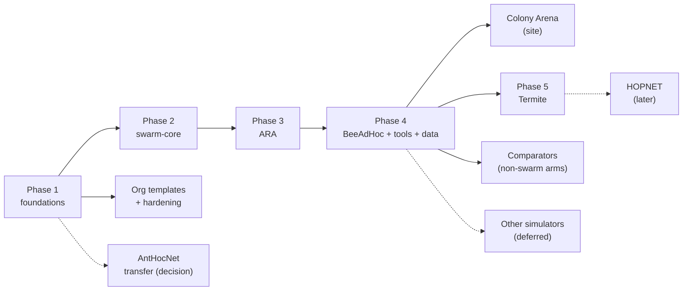

# swarm-routing roadmap

The plan for the whole org: what each phase delivers, what has to be true
before it counts as done, and what we deliberately do not do. It mirrors
[AntHocNet's `docs/roadmap.md`](https://github.com/danieljoppi/AntHocNet/blob/main/docs/roadmap.md)
(ladder, exit criteria, non-goals), the source repository's roadmap, which
keeps governing AntHocNet itself.

**How it is kept.** This file is the plan; issues are the work. Each phase has
one epic in the repository that owns it, its tasks are sub-issues (across
repositories where needed), and live status is the org's GitHub Project board
(views by phase, repository and priority). A phase moves to *done* here in the
PR that closes its epic. Changing a phase's scope or exit criteria is a PR to
this file, like any other decision.

## The ladder

| Phase | Owner repo · epic | Delivers | Status |
|---|---|---|---|
| 1 Foundations | `.github`, `ns3-containers` | org defaults, labels, reusable CI, licence gate; `ns3-dev` images; issue migration | done |
| 1+ Org templates | [.github#6](https://github.com/swarm-routing/.github/issues/6) | `tools/org-sync` + `templates/`: AGENTS/CLAUDE org sections, badges, SECURITY.md, licence files, ADR template, per-repo Makefiles with the same target names; the `org-repo` skill ([skills](https://github.com/swarm-routing/skills)) | tool merged; per-repo adoption open |
| 1+ Hardening | [.github#14](https://github.com/swarm-routing/.github/issues/14) | Scorecard, rulesets, merge policy, CI hygiene in every repo (from AntHocNet#328 and its children) | open |
| 2 swarm-core | [ns3-swarm-core#6](https://github.com/swarm-routing/ns3-swarm-core/issues/6) | the shared `swarm-core` contrib module | not started |
| 3 ARA | [ARA#3](https://github.com/swarm-routing/ARA/issues/3) | first protocol on swarm-core, through the three gates | blocked on 2 |
| 4 BeeAdHoc | [BeeAdHoc#3](https://github.com/swarm-routing/BeeAdHoc/issues/3) | second protocol; fidelity work can start now | fidelity open; code blocked on 2 |
| 4 Tools | [ns3-tools#2](https://github.com/swarm-routing/ns3-tools/issues/2), [ns3-tools#7](https://github.com/swarm-routing/ns3-tools/issues/7) | the comparison harness, probes, arenas, `ns3-tool` CLI | harness + readers moved (ns3-tools#13); AntHocNet switch-over open |
| 4 Comparators | [ns3-tools#15](https://github.com/swarm-routing/ns3-tools/issues/15) | non-swarm comparator arms (secure, learned, DTN), each its own module under `ns3-tools/ns3/arms/`; swarm-based variants with their protocol (BeeAdHoc#9, ARA#9, ARA#10) | migrated; gates pending (each arm needs its three before a number counts) |
| 4 Data | [benchmarks#3](https://github.com/swarm-routing/benchmarks/issues/3) | dataset layout, manifest schema, validator | before the first anchor lands |
| Site | [swarm-routing.github.io#3](https://github.com/swarm-routing/swarm-routing.github.io/issues/3) | Colony Arena: multi-protocol site and leaderboard | after a second `core/` and the data format |
| Transfer | [.github#2](https://github.com/swarm-routing/.github/issues/2) | AntHocNet moves into the org, or stays | technically unblocked (own images named by owner, danieljoppi/AntHocNet#845); waits on the Pages decision |
| 5 Termite | [.github#51](https://github.com/swarm-routing/.github/issues/51) (moves to the repo's own epic) | Termite as a standalone protocol: its own repo, fidelity sheet, anchor-miss analysis, `core/` on swarm-core, the three gates | repo bootstrapped ([Termite#1](https://github.com/swarm-routing/Termite/pull/1)); code blocked on 2 and 3 |
| Later: HOPNET | [.github#52](https://github.com/swarm-routing/.github/issues/52) | HOPNET (ants + zone routing) in its own repo; the thesis's fidelity sheet first | repo bootstrapped ([HOPNET#1](https://github.com/swarm-routing/HOPNET/pull/1)); not scheduled |
| Later: other simulators | [.github#48](https://github.com/swarm-routing/.github/issues/48) | `<sim>-containers` and `<sim>-tools` repos for OMNeT++/INET, Veins and CORE/EMANE, built like `ns3-containers` / `ns3-tools` | deferred: ns-3 first |

## Protocol repositories

Every swarm protocol has its own repository (maintainer decision 2026-11-03,
epic [.github#50](https://github.com/swarm-routing/.github/issues/50)): a
simulator-agnostic `core/` and an ns-3 module on `swarm-core`, bootstrapped with
`tools/org-sync/org_sync.py init <dir> --kind protocol`. Non-swarm comparator
arms are not protocols of ours and live in `ns3-tools/ns3/arms/`; swarm-based
variants (secure, trust-aware) live with the protocol they extend.

| Protocol | Repository | Phase | Status |
|---|---|---|---|
| AntHocNet (Di Caro et al. 2005) | [danieljoppi/AntHocNet](https://github.com/danieljoppi/AntHocNet) | Transfer | exists outside the org; moves in or stays per [.github#2](https://github.com/swarm-routing/.github/issues/2) |
| ARA (Güneş et al. 2002) | [swarm-routing/ARA](https://github.com/swarm-routing/ARA) | 3 | exists |
| BeeAdHoc (Wedde & Farooq 2005) | [swarm-routing/BeeAdHoc](https://github.com/swarm-routing/BeeAdHoc) | 4 | exists |
| Termite (Roth & Wicker 2003/2005) | [swarm-routing/Termite](https://github.com/swarm-routing/Termite) | 5 | exists (empty); plan [.github#51](https://github.com/swarm-routing/.github/issues/51) |
| HOPNET (Wang 2007) | [swarm-routing/HOPNET](https://github.com/swarm-routing/HOPNET) | later | exists (empty); plan [.github#52](https://github.com/swarm-routing/.github/issues/52) |

Not planned as repositories: AntNet (wired networks, AntHocNet's ancestor), and
the swarm-based variants above (BeeSec/BeeAIS in BeeAdHoc#9; trust-weighted ACO
and ACO + watchdog in ARA#9, ARA#10). The maintainer creates a repository; it may
exist early as an empty, bootstrapped placeholder (Termite and HOPNET, 2026-11-03),
but no protocol code lands in it before its phase is scheduled. The remaining swarm MANET protocols
the landscape never assessed (Ant-AODV, ANSI, PERA, ARAMA, EARA, BeeIP, APAR,
SARA) each get a verdict (repo, fold into an existing protocol, or skip) in
[.github#54](https://github.com/swarm-routing/.github/issues/54).

## Phase 1: foundations

Org-wide defaults (profile, issue forms, PR template, labels, `.clang-format`),
the reusable workflows (`reusable-ns3-ci.yml`, `reusable-licence-check.yml`,
`sync-labels.yml`), the licence-header gate, agent docs and per-directory
licensing in every repository, the `ns3-dev` images with `ns3-build-contrib` (since ns3-containers#10/#33: the release ns-3 supports, older releases on demand), and the migration of AntHocNet's issues (13 moved; danieljoppi/AntHocNet#800 closed as done).

A second wave (2026-11-02) moved the issues that are not specific to AntHocNet:
14 moved (the comparators epic and its children to ns3-tools#15–#21, benchmark
methodology to ns3-tools#22–#25, BeeSec/BeeAIS to BeeAdHoc#9, the swarm-based
secure arms to ARA#9 and ARA#10); danieljoppi/AntHocNet#770 split, its
harness package going to ns3-tools#26; danieljoppi/AntHocNet#656 closed as a
duplicate of #843. Infrastructure items under danieljoppi/AntHocNet#328 link to
the hardening epic .github#14.

**Exit criteria**

- [x] Every repository has `CLAUDE.md`, `AGENTS.md`, `LICENSING.md` and synced labels.
- [x] The image smoke builds a C++20 contrib module in 8 Ninja steps and passes `test.py` on all three profiles.
- [x] Images published to GHCR from `main`, signed, and public (run 41330598151; anonymous pull verified 2026-11-01).

## Phase 2: swarm-core

What two or more protocols share, extracted from AntHocNet's dual-licensed
`core/` and its ns-3 modules into `swarm-core`: the simulator-free primitives
and ports in `core/`, the ns-3 glue in `model/`, and the link-metric seams
migrated from AntHocNet ([ns3-swarm-core#2](https://github.com/swarm-routing/ns3-swarm-core/issues/2), [#3](https://github.com/swarm-routing/ns3-swarm-core/issues/3), [#4](https://github.com/swarm-routing/ns3-swarm-core/issues/4)).

**Exit criteria**

- [ ] `test.py -s swarm-core` green on `debug` and `sanitized`; `core/` passes the include check.
- [ ] Every wire helper has deterministic roundtrip + fuzz tests.
- [ ] A downstream module builds against it with `dependencies: swarm-core=swarm-routing/ns3-swarm-core@main`.

## Phase 3: ARA

ARA (Güneş, Sorges & Bouazizi, 2002) as a standalone protocol, and the proof
that swarm-core's API is enough: a fidelity sheet first, `core/` written fresh,
the ns-3 module `ara`, then the three comparator gates.

**Exit criteria**

- [ ] Fidelity sheet with every parameter sourced or marked *repo choice* / *unknown*.
- [ ] Module green in CI; same seed, byte-identical output.
- [ ] Anchor verdict recorded in `benchmarks` (PASS, or a written infeasibility verdict).

## Phase 4: BeeAdHoc, tools and data

BeeAdHoc (Wedde & Farooq, 2005) on the same path as ARA. It starts from
AntHocNet's arm, whose PG 460 anchor **missed** (3 of 5 pause times,
[danieljoppi/AntHocNet#841](https://github.com/danieljoppi/AntHocNet/pull/841)); its fidelity questions ([BeeAdHoc#4](https://github.com/swarm-routing/BeeAdHoc/issues/4), [BeeAdHoc#5](https://github.com/swarm-routing/BeeAdHoc/issues/5))
are settled before code moves. Alongside it, `ns3-tools` becomes the
protocol-agnostic harness, and `benchmarks` fixes its dataset format before the
first anchor writes into it.

**Exit criteria**

- [ ] BeeAdHoc's interpretations each *settled (§x)* or *unresolved* in its fidelity sheet; module green; anchor re-recorded.
- [ ] The harness runs any registered arm in the MANET and LEO arenas and emits the versioned marker lines.
- [ ] `benchmarks` validates every run's manifest in CI and refuses edits to merged data.

## Phase 5: Termite

Termite (Roth & Wicker) routes by stigmergy: routing state rides inside data
packets, with no control ants. AntHocNet's arm passed the delivery smoke but
**missed** its anchor in v2.5.0 (the trend points the right way, the CIs span
zero; danieljoppi/AntHocNet#587), so it starts with a pre-registered analysis
of that miss. It is swarm-core's pheromone primitives' next consumer after the
ant protocols, and leaves AntHocNet's `adaptive` module for its own repository,
not for `ns3-tools`.

**Exit criteria**

- [x] `swarm-routing/Termite` created and bootstrapped (Termite#1).
- [ ] Fidelity sheet with every parameter sourced or marked.
- [ ] The anchor miss explained in an issue before code (arm, scenario or power).
- [ ] Module green in CI; three gates recorded, or a written infeasibility verdict.

HOPNET (ants + zone routing, Wang 2007) follows later, thesis fidelity sheet
first; it is the one published result benchmarked against AntHocNet directly.

## Colony Arena (the site)

The org site, generalized from AntHocNet's learn site: a protocol's own
`core/` compiled to WebAssembly, rendered only, and a leaderboard generated from
`benchmarks`. Epic: swarm-routing/swarm-routing.github.io#3.

Decided 2026-11-03: the site lives **only** in `swarm-routing.github.io`. No
protocol repo deploys Pages and there are no redirect stubs (the old
`danieljoppi.github.io/AntHocNet/` stays 404). Every protocol core in the
site is built from its own repository at a pinned commit; nothing is vendored.
AntHocNet's game, docs (`/AntHocNet/docs/`) and API (`/AntHocNet/api/`) move
there; AntHocNet retires `pages.yml` and `web/` at cutover
(swarm-routing/AntHocNet#850). Its open learn-site issues (#562, #634, #602,
#590, #751, #846) migrate with the game.

**Exit criteria**

- [ ] ADR accepted: lock file of pinned protocol commits, browser ABI, where the simulator and parity gate live, URL layout (site#7).
- [ ] Scaffold served from `main` with the browser smoke and axe green (site#8).
- [ ] AntHocNet's game, docs and API served from the site, built from AntHocNet's pinned commit; AntHocNet has no Pages deploy and its `core/` PRs still run parity (site#9, #10, #11; AntHocNet#850).
- [ ] A second protocol in the browser with a byte-identical native-vs-WASM trace (site#13).
- [ ] Leaderboard regenerated from `benchmarks` data in CI (site#12).

## Later: other simulators (deferred)

The org's focus is ns-3. Other simulators are planned but not scheduled: when
one is needed, it gets the infrastructure ns-3 has today, one repository per
concern: a `<sim>-containers` repo (prebuilt, tested, signed images of
OMNeT++ + INET, Veins = OMNeT++ + INET + SUMO, or CORE + EMANE for Linux
emulation, built like `ns3-containers`), a `<sim>-tools` repo emitting the same
versioned marker lines, and a reusable CI workflow per simulator. `benchmarks`
takes that data only once its manifest and validator record which simulator
and image produced a run (today they pin an `ns3-dev` image); that schema
change is part of the epic, made before the first such run lands. Protocols need no fork: their `core/`
is simulator-agnostic, so a new simulator is a new adapter in the protocol's
repository. AntHocNet's issues for it (danieljoppi/AntHocNet#32, #65, #147–#153,
#485) stay there until this starts; #150 (the OMNeT++/INET image) is the first
item to migrate. Epic: [.github#48](https://github.com/swarm-routing/.github/issues/48).

**Trigger** (any of): phases 2–4 done and a protocol needs a result only another
simulator gives; a venue or reviewer asks for cross-simulator confirmation; an
emulation or real-stack claim is needed. Cross-simulator results stay
qualitative: they confirm an ns-3 ranking, they do not replace its numbers.

## Non-goals

- **No protocol before its foundation.** No new protocol repository starts code before swarm-core has a consumer (ARA) green against `main`.
- **No numbers without the three gates.** A comparator that cannot reproduce its own paper's trend ships as a written verdict, never as a leaderboard row.
- **No per-network presets.** A network family changes the scenario, not a protocol's defaults (AntHocNet ADR-0019).
- **No automatic CI on ns-3 releases ns-3 no longer supports.** ns-3 maintains its latest release only; automatic pipelines (images and every repo's CI) follow it, and older releases run on demand (CONTRIBUTING invariant 7).
- **No `optimized` image in CI**, and no ns-3 `optimized` profile anywhere (`-march=native`).
- **No copying from ns-3's `src/aodv` or `src/olsr`**, and no GPL code in a dual `core/`.
- **No paywalled papers in public repositories**; they live in the private `papers` repository.
- **AntHocNet's own ladder stays in AntHocNet.** Issues not migrated (95 audited, 27 moved in two waves) keep their `release:` labels there; moved issues drop them, since the org has no release ladder of its own yet. The undecided ones (danieljoppi/AntHocNet#319, #112, #405) stay until the maintainer moves them.
- **No learned arm without its gates.** The DRL comparator (ns3-tools#20) needs disjoint training and test seeds, one held-out family and a reported training budget, plus frozen, versioned weights; nothing about it is scheduled before those exist.
- **DTN only where the oracle says so.** The store-carry-forward arm (ns3-tools#21) exists because danieljoppi/AntHocNet#580's trigger fired (the oracle delivers about 81 % on the disaster scene: the rest is partition-bound); it is scoped to the disaster family, not a general comparator.
- **No second simulator for now.** ns-3 is the focus; OMNeT++/INET, Veins and CORE/EMANE are planned as their own container and tooling repositories, deferred until the trigger in [Later: other simulators](#later-other-simulators-deferred) fires (AntHocNet decision 2026-10-06, its roadmap "Why OMNeT++ (#32) is deferred"; org decision 2026-11-03, .github#48). Cross-simulator results would be qualitative only.
