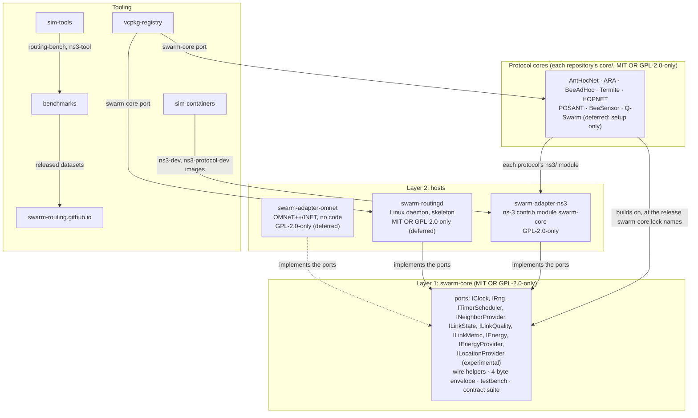

# The org's architecture

The swarm-routing repositories follow a hexagonal (ports and adapters)
layout: every protocol's simulator-free `core/` is written against the ports
of one shared library, swarm-core, and each host (a simulator or a real
computer) is an adapter that implements those ports. This page shows that
layout as it stands on every repository's `main` on 2026-11-27, and links
each statement to the file it comes from. The plan behind it and every
decision is in [ROADMAP "Architecture and migration"](../ROADMAP.md#architecture-and-migration-decided-2026-11-22)
(epic [#672](https://github.com/swarm-routing/.github/issues/672)); the
numbered *decisions* below are that section's. A part marked *deferred* is
planned, not scheduled: it starts only when the maintainer re-plans it
(decision 23).

## Layer 1: swarm-core

[swarm-core](https://github.com/swarm-routing/swarm-core) holds "the pure
C++23 ports and primitives every protocol core builds on"
([its AGENTS.md](https://github.com/swarm-routing/swarm-core/blob/main/AGENTS.md#what-this-repo-is)),
with "no OS or simulator header":

- **Ports**: `IClock`, `IRng`, `INeighborProvider`, `ITimerScheduler`,
  `ILinkState`, `ILinkQuality`, `ILinkMetric`, `IEnergy`, `IEnergyProvider`
  (with `EnergySnapshot` and `PowerSource`) and the experimental
  `ILocationProvider` (swarm-routing/swarm-core#7; decision 12: the frozen
  names stay, the location port is experimental).
- **Wire helpers**: the little-endian readers and writers every protocol
  codec uses for its leading version byte (`core/swarm-wire.h`,
  `WireWriter::version`, `WireReader::expectVersion`;
  [ADR-0006](adr/0006-one-wire-format-rule-and-a-daemon-only-envelope.md)).
- **The envelope**: the 4-byte wire envelope (`envelope_version`, `magic`,
  `protocol_id`, `flags`, then the protocol message unchanged) with its
  `protocol_id` table (`core/swarm-envelope.h`, `docs/protocol-ids.md`),
  "used only on swarm-routingd's socket, never in ns-3"
  ([ADR-0006](adr/0006-one-wire-format-rule-and-a-daemon-only-envelope.md),
  swarm-routing/swarm-core#52). Each protocol keeps its own version byte
  (golden rule 3, decision 2).
- **The testbench and the protocol contract suite**, header-only in
  `core/testbench/swarm-contract-tests.h` (swarm-routing/swarm-core#8).

It was extracted with its history from swarm-adapter-ns3's `core/`
(swarm-routing/swarm-core#6, decision 3). Its first release from its own
repository was `v2.0.0` (2026-11-23, swarm-routing/swarm-core#10, decision
11); the latest is `v2.1.0` (2026-11-25), which every listed part ships in.
The host contract is its next major, `v3.0.0`
(swarm-routing/swarm-core#62; decision 12;
[README](https://github.com/swarm-routing/swarm-core/blob/main/README.md)).

## Protocol cores

Each protocol repository has a simulator-agnostic `core/` with no simulator
header, on swarm-core's dual-licensed `core/`, and an ns-3 module in `ns3/`
(decision 13: "Each protocol keeps its `ns3/`"). For example:

- AntHocNet: "`core/` simulator-agnostic C++ (no simulator headers) + unit
  tests; links swarm-core's core/ from its vcpkg port … at the release
  swarm-core.lock names"; it installs as the CMake package `anthocnet-core`
  ([AntHocNet AGENTS.md](https://github.com/swarm-routing/AntHocNet/blob/main/AGENTS.md)).
- ARA: a `core/` "(no ns-3 headers; MIT OR GPL-2.0-only)" and the ns-3
  contrib module `ara` (GPL-2.0-only), whose adapter runs one core router
  per node on swarm-core's `SwarmRoutingBase`; `core/test/test-contract.cc`
  runs swarm-core's protocol contract suite on the router
  ([ARA AGENTS.md](https://github.com/swarm-routing/ARA/blob/main/AGENTS.md#what-this-repo-is)).

Five protocols are released: AntHocNet, ARA, BeeAdHoc, Termite and HOPNET.
Phase 3a moves them onto the extracted swarm-core with the contract tests;
four of its five chores are done, ARA's contract suite
(swarm-routing/ARA#296) is the one left
([ROADMAP, "Where to start (the migration)"](../ROADMAP.md#architecture-and-migration-decided-2026-11-22)).
POSANT, BeeSensor and Q-Swarm are *deferred* (decision 23): setup and a
building, tested skeleton only, no protocol logic until each repository's
fidelity sheet is reviewed (amended 2026-11-24,
[#881](https://github.com/swarm-routing/.github/issues/881)).

## Layer 2: hosts

A host implements swarm-core's ports for one runtime and carries out the
core's decisions ("it decides nothing itself",
[swarm-adapter-omnet AGENTS.md](https://github.com/swarm-routing/swarm-adapter-omnet/blob/main/AGENTS.md#what-this-repo-is)). Only in-process C++ simulators
get a `swarm-adapter-<sim>` repository; CORE/EMANE and Shadow get none, they
run the swarm-routingd binary (decision 24).

| Host | Repository | State on `main` | Licence |
|---|---|---|---|
| ns-3 | [swarm-adapter-ns3](https://github.com/swarm-routing/swarm-adapter-ns3) (was `ns3-swarm-core`) | the ns-3 contrib module `swarm-core` every protocol links against: the ns-3 adapter of swarm-core's ports and the cross-layer glue (`SwarmRoutingBase`, `DeferredPacketQueue`, `WifiLinkMonitor`, `EnergyMetricHook`, `IslLinkMonitor`); since swarm-routing/swarm-adapter-ns3#231 it builds on the swarm-core release `swarm-core.lock` names, `swarm::core` a `PUBLIC` dependency, and its own `core/` is gone ([AGENTS.md](https://github.com/swarm-routing/swarm-adapter-ns3/blob/main/AGENTS.md#what-this-repo-is)) | module `GPL-2.0-only`, `tools/` dual ([LICENSING.md](https://github.com/swarm-routing/swarm-adapter-ns3/blob/main/LICENSING.md)) |
| Linux | [swarm-routingd](https://github.com/swarm-routing/swarm-routingd) | *deferred*: a building, tested skeleton (`swarm-routingd --version`) on swarm-core through vcpkg; the reactor (swarm-routing/swarm-routingd#32) waits for the maintainer. Planned: a single-threaded `epoll` reactor with `timerfd` and `signalfd`, routes through rtnetlink, a TUN catch-all ([AGENTS.md](https://github.com/swarm-routing/swarm-routingd/blob/main/AGENTS.md#what-this-repo-is)); the vertical slice on it is phase 2, deferred | `MIT OR GPL-2.0-only` ([LICENSING.md](https://github.com/swarm-routing/swarm-routingd/blob/main/LICENSING.md)) |
| OMNeT++/INET | [swarm-adapter-omnet](https://github.com/swarm-routing/swarm-adapter-omnet) | *deferred*: set up, no code yet; no OMNeT++ CI image yet ([AGENTS.md](https://github.com/swarm-routing/swarm-adapter-omnet/blob/main/AGENTS.md#what-this-repo-is)); OMNeT++ and Shadow wait for ns-3 and Linux parity (decision 8) | `GPL-2.0-only` |

Results off ns-3 stay qualitative: published numbers come from ns-3 only,
and parity is judged on named scenes
([#268](https://github.com/swarm-routing/.github/issues/268); decision 14).

## Tooling

| Repository | Role |
|---|---|
| [sim-tools](https://github.com/swarm-routing/sim-tools) (was `ns3-tools`) | orchestration and statistics: the `routing-bench` comparison harness (`ns3/`), the result readers (`python/`) behind the `ns3-tool` CLI, the campaign driver `ns3-campaign` ([AGENTS.md](https://github.com/swarm-routing/sim-tools/blob/main/AGENTS.md#what-this-repo-is)); per-simulator directories hold only non-adapter glue (decision 24); it owns the telemetry schema (decision 16) |
| [sim-containers](https://github.com/swarm-routing/sim-containers) (was `ns3-containers`) | the `ghcr.io/swarm-routing/ns3-dev` image (ns-3 pre-built, so a contrib module compiles alone) and `ns3-protocol-dev` (ns3-dev by digest with swarm-core and routing-bench prebuilt) ([AGENTS.md](https://github.com/swarm-routing/sim-containers/blob/main/AGENTS.md#what-this-repo-is)) |
| [vcpkg-registry](https://github.com/swarm-routing/vcpkg-registry) | the org's vcpkg git registry: one port per simulator-free C++ core the org releases, `swarm-core` first, each on the `swarm-core` port; the `ns3` port is the base of the ns-3 module ports ([AGENTS.md](https://github.com/swarm-routing/vcpkg-registry/blob/main/AGENTS.md#what-this-repo-is)) |
| [benchmarks](https://github.com/swarm-routing/benchmarks) | immutable datasets of released versions only: the raw marker lines of every 20-seed run, paired verdicts and the reproducibility manifest ([ADR-0002](https://github.com/swarm-routing/benchmarks/blob/main/docs/adr/0002-benchmarks-records-released-versions.md)) |
| [swarm-routing.github.io](https://github.com/swarm-routing/swarm-routing.github.io) | Colony Arena, the org's only Pages site: the hub draws the org architecture as diagrams; `protocols.lock` pins each protocol by commit and tag ([AGENTS.md](https://github.com/swarm-routing/swarm-routing.github.io/blob/main/AGENTS.md#what-this-repo-is)) |
| `.github` (this repository) | the reusable workflows, the templates org-sync renders into every repository, and org-bot ([AGENTS.md](../AGENTS.md#what-this-repo-is)) |

## How versions flow

1. **A release** is cut through the org's `reusable-release.yml`, on the
   maintainer's word (decision 3; CONTRIBUTING "Cutting a release"). With
   `vcpkg-ports`, the published release opens the port bump PR in
   vcpkg-registry, rendered from the published asset
   ([`reusable-release.yml`](../.github/workflows/reusable-release.yml), #439).
   swarm-core's releases carry its own Zenodo concept DOI (decision 3).
2. **`swarm-core.lock`** in each consumer names the release it builds on:
   repository, tag, commit, version and the SHA256 of its asset (protocols,
   swarm-adapter-ns3 and swarm-routingd alike; "written by org-bot, never by
   hand", [AntHocNet AGENTS.md](https://github.com/swarm-routing/AntHocNet/blob/main/AGENTS.md)).
   A protocol's `core/` and swarm-routingd take the port from vcpkg-registry
   at a `baseline` commit, with a `vcpkg.json` override pinning the lock's
   version; swarm-adapter-ns3 fetches the release tarball by URL and hash.
3. **org-bot bumps it.** Its `swarm-core-pin` task opens one PR on
   `org-bot/swarm-core-pin` once a new release exists, moving the lock, the
   vcpkg override and the registry baseline together, and only once the
   registry's `main` holds that release; a protocol's ns-3 dependency follows
   the swarm-adapter-ns3 release that ships the same swarm-core, and the bump
   waits while none does
   ([`tools/checks/check-swarm-core-pin.py`, `tools/org-bot/org_bot.py`](tools.md)).
   `release-lock` moves every other root `<name>.lock` the same way.
   Dependency bumps are org-bot's, not Renovate's (decision 20).
4. **The org's own workflows** are pinned by commit in each caller's
   `.github/org-sync.lock`, moved by org-bot's org-sync refresh PR
   ([ADR-0004](adr/0004-callers-pin-the-org-workflows-by-commit.md)).

## The licence boundary

Licensing is per directory, as AntHocNet
([`LICENSING.md`](../LICENSING.md); AntHocNet
[ADR-0028](https://github.com/swarm-routing/AntHocNet/blob/main/docs/adr/0028-core-is-dual-licensed.md)):

- **`MIT OR GPL-2.0-only`**: swarm-core, every protocol's `core/`,
  swarm-routingd and the standalone tooling (golden rule 1).
- **`GPL-2.0-only`**: the ns-3 modules (swarm-adapter-ns3's module, each
  protocol's `ns3/`, sim-tools' `ns3/`), swarm-adapter-omnet, the site, docs
  and data.
- **One way only** (golden rule 2): GPL code may use the dual parts; a
  `core/` file includes only the C++ standard library, other `core/` files
  and the dual-licensed `core/` of a dependency pinned by commit (a
  protocol's `core/` on swarm-core's), declared as `core-deps` and checked in
  CI (`check-headers --core-dep`). Third-party code lands only in GPL paths.

The rules that keep the layout true: golden rule 2 (the boundary), rule 4
(the ns-3 module is `swarm-core`, never `core`), rule 5 (determinism: all
randomness through seeded streams or the injected RNG port) and rule 9
(nothing shipped depends on `.claude/`), with each protocol's "`core/` never
includes a simulator header".

## Not on this page yet

The porting guide for a new host (what it implements, how it is checked,
what it may claim) and the hosts × protocols table remain open on
[#260](https://github.com/swarm-routing/.github/issues/260): the guide's
second host waits for the deferred phases 2 and 3b
([ROADMAP, Migration phase 4](../ROADMAP.md#migration-phase-4-agent-tooling-docs-paper)).
