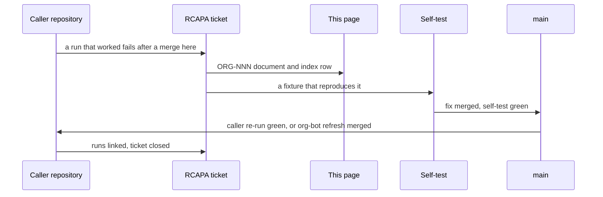

# RCAPA: regressions in a release of swarm-routing/.github

An **RCAPA** (root cause analysis with corrective and preventive actions) is
the full record of one **regression in a published release** of this
project: something that worked in a released version and broke after a
change. A bug or change that never reached a release needs none (an
ordinary `bug` issue is enough), and an upstream ns-3 bug is an `NS3-NNN` in
swarm-routing/ns3-tools. The org's rule and its decision table are in
[CONTRIBUTING.md, "RCAPA"](https://github.com/swarm-routing/.github/blob/main/CONTRIBUTING.md#rcapa)
([ADR-0003](https://github.com/swarm-routing/.github/blob/main/docs/adr/0003-rcapa-for-ns3-bugs-and-released-regressions.md)).
This page is the project's flow and its index.

## The flow for this project

This repository cuts no versioned release. What it publishes is `main`
itself: every caller pins its reusable workflows at `@main` (golden rule
10), org-bot renders `templates/` into every repository from `main`, and
GitHub reads the community defaults and issue forms from `main`. So here a
**regression in a published release** is a change merged to `main` that
broke something that worked before for a caller: a reusable workflow, a
template, a form, a label or a tool another repository runs. A defect caught
in a PR or by a self-test before it merged needs no RCAPA.

| | |
|---|---|
| Published as | `main`: the reusable workflows (`.github/workflows/reusable-*.yml`, pinned `@main` by every caller), `templates/` (org-sync, org-bot), `ISSUE_TEMPLATE/`, `labels.json`, the community files; no tags, no Zenodo record |
| ID prefix | `ORG-NNN` |
| Ticket | an issue in swarm-routing/.github, form *Regression in a release (RCAPA)*, title `[rcapa] ORG-NNN <short description>`, labels `rcapa` and `bug` |
| Verified by | the caller run that broke (linked), then the tool's `--self-test` or the workflow's self-test workflow (`*-selftest.yml`, `docs/tools.md` "Validating a change to a reusable workflow") reproducing it on a fixture |
| Corrective action | the fix PR here, merged through the merge queue; for a template, org-bot's refresh PR in each repository it reaches |
| Preventive action | a fixture in the tool's self-test or a case in the self-test workflow that fails on the regression, and, for a broken input or default, the contract of golden rule 10 |
| Closes when | the fix is on `main` **and** a run in every caller that broke is green again (each linked) |

## Index

| ID | RCAPA | RCAPA ticket | Fixed by |
|----|-------|--------------|----------|

## Adding one: the ticket first

1. Open the RCAPA ticket (the table above). `NNN` is the next free number in
   the index.
2. Copy [`_template.md`](_template.md) to `rcapa-<short-description>.md`
   (lowercase, hyphens: what breaks, not where it was found), and add its row
   to the index in the same pull request.
3. The ticket stays open until the fix is on `main` **and every caller that
   broke runs green**; record those runs in the index.

## What an RCAPA answers

1. **What broke, in which release, and who did it touch?** The symptom, the
   releases that fail and the last that passes, the users, numbers or
   downstream pins it affects.
2. **How do I see it myself?** Exact commands, the release or commit, an
   image by tag and digest when one is involved, seeds, expected against
   actual.
3. **Why did it happen, and why did our checks let it into a release?** Five
   whys, each citing its evidence: a source line at a named commit, a log, a
   run, a comment. An answer without a source is a hypothesis and says so.
4. **What does it look like?** Mermaid diagrams: the failing call chain, the
   types or components involved.
5. **What did we do about it?** Corrective actions (the fix, its PR, the
   release that carries it) and preventive actions (the test or check that
   catches a recurrence). An action not done yet is an open issue, linked.
6. **When?** A dated timeline and every link.

## Writing one

- Every issue and PR reference is fully qualified: `swarm-routing/<repo>#N`,
  also for this repository's own items; an ns-3 item is a link whose text is
  `nsnam/ns-3-dev#N` to its full gitlab.com URL. Never a bare number with a
  hash. In a mermaid block, which cannot hold a hash, name the item in words.
- Mermaid: no HTML entities inside a block; write template arguments as
  words.
- An RCAPA is never deleted. Later findings update its status and timeline.
