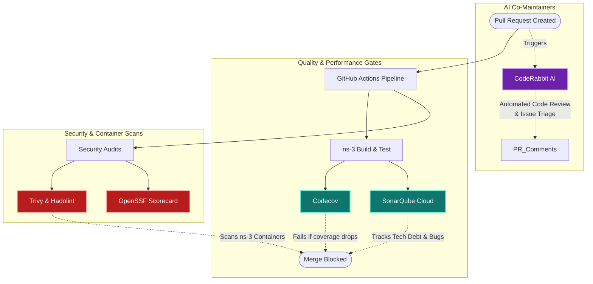

# swarm-routing

Swarm-intelligence and adaptive routing protocols for MANETs and LEO
constellations, implemented cleanly on **ns-3** and benchmarked against each
other on identical seeds.

The org grew out of [**AntHocNet**](https://github.com/swarm-routing/AntHocNet)
([Di Caro, Ducatelle & Gambardella, 2005](https://doi.org/10.1002/ett.1062)), the source repository, which now
lives here too: its shared infrastructure, comparator arms and benchmark
tooling are moving into their own repositories so each protocol can be its
own citable repository.

<!-- org-sync:begin badges -->
| Group | Badges |
| --- | --- |
| Main |   |
| Platforms |   |
| Containers |  |
| Protocols |      |
| Quality |    |
| Trust |    |
| Stack |     |
| Open Tickets |           |
| Community & docs |     |
<!-- org-sync:end badges -->

## Why this exists

I am [Daniel Joppi](https://github.com/danieljoppi) ([LinkedIn](https://www.linkedin.com/in/danieljoppi)). I have more than 20
years of experience building high-scale software, delivery pipelines and the
architecture of new systems. AntHocNet started as my college project: I began
implementing the protocol in 2008 on NS-2 and put the full code on GitHub in
[January 2016](https://github.com/swarm-routing/AntHocNet/compare/b7ac7d0...ae8900c).

<!-- coderabbit-ai-generated:v1 -->

<!-- coderabbit-ai-generated-section:v1:7140d072a32e72eededd6037433d031e2663a6cb0368af1e3540f9af2ebb4d75 -->

## The AI First Engineering Model

<!-- /coderabbit-ai-generated:v1 -->

I came back to it to put AI to a real test. Working with Claude Opus, I
restructured the code so the algorithm no longer depends on one NS-2 version
(a simulator-free `core/` behind thin adapters), moved it to ns-3, and grew it
into an organisation that implements and compares other swarm protocols on the
same footing. My main motivation is to find out how far a project can be
structured and organised using only AI, with tests, determinism checks and
paired benchmarks as the safeguard that the implementation stays correct.

That is why the work lives in tickets and roadmaps rather than in anyone's
head: every issue carries its context, acceptance criteria and links, so any
person, with any AI assistant, can take a ticket as their starting context and
begin an implementation or a new investigation.

## Ecosystem Architecture

The repositories sit in four layers, the hexagonal (ports and adapters)
layout the maintainer decided on 2026-11-22
([ROADMAP, Architecture and migration](https://github.com/swarm-routing/.github/blob/main/ROADMAP.md#architecture-and-migration-decided-2026-11-22)):
every protocol's simulator-free `core/` sits on one shared `swarm-core`, and
each runtime (ns-3 today; a Linux daemon and other simulators later) is an
adapter of its ports. Three repositories were renamed that day:
`ns3-swarm-core` is now swarm-adapter-ns3, `ns3-containers` is sim-containers
and `ns3-tools` is sim-tools. A repository marked *deferred* is planned for later,
not scheduled (ROADMAP decision 23): it starts when the maintainer re-plans it.

Every badge below is live: the latest release, each repository's SonarQube
Cloud quality gate and its Codecov line coverage on `main` (report-only,
uploaded by CI from the repository's own code). A dash means not measured:
no release yet, no SonarQube Cloud project, or no coverage upload.

### 1. Core

| Repository | What it is | Release | Quality gate | Coverage |
|---|---|---|---|---|
| [swarm-core](https://github.com/swarm-routing/swarm-core) | The simulator-free C++23 ports and primitives (`swarm::core`), the wire helpers, the testbench and the protocol contract tests; no OS or simulator header. Created 2026-11-21, empty: the code is still in swarm-adapter-ns3's `core/` and moves here with its history in phase 1 | — | — | — |

### 2. Runtimes and adapters

| Repository | What it is | Release | Quality gate | Coverage |
|---|---|---|---|---|
| [swarm-adapter-ns3](https://github.com/swarm-routing/swarm-adapter-ns3) | The ns-3 adapter of swarm-core's ports (was `ns3-swarm-core`): the `swarm-core` contrib module every protocol links against, with `SwarmRoutingBase`, the link monitors, the energy hook and the deferred queue, and for now the C++23 primitives in `core/` |  |  |  |
| [swarm-routingd](https://github.com/swarm-routing/swarm-routingd) | *deferred*: the Linux userspace routing daemon that runs the protocol cores over real sockets, rtnetlink routes and a TUN device; CORE/EMANE and Shadow run it unmodified | — | — | — |
| [swarm-adapter-omnet](https://github.com/swarm-routing/swarm-adapter-omnet) | *deferred*: the OMNeT++/INET adapter of swarm-core's ports, one `swarm-adapter-<sim>` per in-process C++ simulator (ROADMAP decision 24); no code yet | — | — | — |

### 3. The Protocols

| Repository | What it is | Release | Quality gate | Coverage |
|---|---|---|---|---|
| [AntHocNet](https://github.com/swarm-routing/AntHocNet) | The reference AntHocNet implementation, the colony the org grew out of: a simulator-free `core/`, the ns-3 adapter, the paper-faithful benchmarks |  |  |  |
| [ARA](https://github.com/swarm-routing/ARA) | Ant-Colony-Based Routing Algorithm (Güneş, Sorges & Bouazizi, 2002): `core/` and ns-3 module in progress (Phase 3) |  |  |  |
| [BeeAdHoc](https://github.com/swarm-routing/BeeAdHoc) | Honeybee routing (Wedde & Farooq, 2005), as the PG 460 Linux module specifies it: `core/` and ns-3 module in progress (Phase 4) |  |  |  |
| [Termite](https://github.com/swarm-routing/Termite) | Stigmergic routing in data packets, no control ants (Roth & Wicker, 2003/2005): `core/` and ns-3 module in progress (Phase 5) |  |  |  |
| [HOPNET](https://github.com/swarm-routing/HOPNET) | Ant routing over zones (Wang, 2007), the one published result benchmarked against AntHocNet: `core/` and ns-3 module in progress |  |  |  |
| [POSANT](https://github.com/swarm-routing/POSANT) | *deferred*: position-based ant colony routing for geographic and 3D networks (UAV swarms, FANETs), on swarm-core's location port; fidelity sheet only | — | — | — |
| [BeeSensor](https://github.com/swarm-routing/BeeSensor) | *deferred*: honeybee-inspired, energy-aware convergecast routing for wireless sensor networks; fidelity sheet only | — | — | — |
| [Q-Swarm](https://github.com/swarm-routing/Q-Swarm) | *deferred*: Q-routing with energy-aware updates and Boltzmann next-hop selection, a learned comparator for the swarm protocols; fidelity sheet only | — | — | — |

### 4. Infrastructure and tooling

| Repository | What it is | Release | Quality gate | Coverage |
|---|---|---|---|---|
| [sim-tools](https://github.com/swarm-routing/sim-tools) | Orchestration and statistics (was `ns3-tools`): the protocol-agnostic `routing-bench` comparison harness every arm registers with, the `ns3-tool` readers and paired statistics, the `ns3-campaign` driver; other simulators' launch configs and trace normalizers join it as directories |  |  |  |
| [sim-containers](https://github.com/swarm-routing/sim-containers) | `ghcr.io/swarm-routing/ns3-dev` (was `ns3-containers`): ns-3 pre-built (default, debug, sanitized, optimized) and tested by digest, so a contrib module compiles in seconds |  |  | — |
| [benchmarks](https://github.com/swarm-routing/benchmarks) | Immutable 20-seed datasets of released versions, with their reproducibility manifests and a validator |  |  | — |
| [vcpkg-registry](https://github.com/swarm-routing/vcpkg-registry) | The org's vcpkg git registry: ports of the simulator-free C++ cores (swarm-core first, then each protocol's), installed on `x64-linux` and `wasm32-emscripten` in CI | — | — | — |
| [swarm-routing.github.io](https://swarm-routing.github.io) | Colony Arena, the org site: a colony map of every project, a page per protocol, AntHocNet's game, docs and API with its C++ core in WebAssembly; leaderboard planned | — |  | — |
| [swarm-web-ui](https://github.com/swarm-routing/swarm-web-ui) | *deferred*: the web workbench: offline replay of simulation run bundles with paired-delta charts, then a local control plane to launch runs in sim-containers | — | — | — |
| [ns3-upstream-report](https://github.com/swarm-routing/ns3-upstream-report) | The bridge to ns-3's GitLab: a mirror ticket per upstream ns-3 bug report, GitLab notes and state mirrored every 6 h, reports and replies sent only after the maintainer approves | — | — | — |
| [.github](https://github.com/swarm-routing/.github) | Org-wide defaults: CONTRIBUTING, labels, issue forms, the reusable CI and release workflows, org-sync templates and the bots that keep every repository current | — |  | — |

#### AI

The org's two AI repositories, part of layer 4 (ROADMAP decision 26,
[ADR-0005](https://github.com/swarm-routing/.github/blob/main/docs/adr/0005-the-mcp-and-agent-tooling-standard.md)):
the skills and their Claude Code plugin, and the MCP server the plugin bundles.

| Repository | What it is | Release | Quality gate | Coverage |
|---|---|---|---|---|
| [skills](https://github.com/swarm-routing/skills) | The org's agent skills: one Claude Code plugin and plain Agent Skills for any agent, each a procedure over a script; the plugin bundles swarm-mcp, and will pin a swarm-mcp release (or commit) once the code has moved | — |  | — |
| [swarm-mcp](https://github.com/swarm-routing/swarm-mcp) | The org's MCP server: a local, read-only stdio server that returns the org scripts' verdicts (fidelity, invariants, release readiness, locks) as tools; versioned and released on its own. Created 2026-11-22, empty: the code is still in skills' `tools/swarm-mcp/` | — | — | — |

## Roadmap: now and later

The maintainer narrowed what is scheduled on 2026-11-22 (ROADMAP decision 23).
Every deferred item keeps its epic and its plan; none starts by itself.

- **Now:** phase 0 (the renames and settings as code), phase 1 (swarm-core
  in its own repository, then its first release there), phase 3a (the five
  released protocols on the extracted swarm-core, with the contract tests),
  the release train and the ns-3 work, and phase 4 (agent tooling, docs, the
  paper) where it needs no deferred track.
- **Later (deferred):** the Linux daemon swarm-routingd and the vertical
  slice on it (phase 2); the new protocols POSANT, BeeSensor and Q-Swarm
  (fidelity sheets may continue, no code); swarm-web-ui; and the other
  simulators: CORE/EMANE and Shadow on swarm-routingd, OMNeT++ through
  swarm-adapter-omnet (decision 24), after ns-3 and Linux parity.

The whole plan, phase by phase: [ROADMAP.md](https://github.com/swarm-routing/.github/blob/main/ROADMAP.md).

## Getting Started

**Contributors:** Pick an issue tagged with `good first issue` or `help wanted` in any protocol repository.
<!-- coderabbit-ai-generated:v1 -->

<!-- coderabbit-ai-generated-section:v1:34e710ca983fa962e69ad93ad299a2399c6dfbe3f233d0b1c8db99bc31f7e8c7 -->

**Researchers:** Visit [swarm-routing.github.io](https://swarm-routing.github.io) for currently available paper-fidelity sheets. The benchmark leaderboard is planned and not yet available.

<!-- /coderabbit-ai-generated:v1 -->
<!-- coderabbit-ai-generated:v1 -->

<!-- coderabbit-ai-generated-section:v1:58123f5b1a513933b303d8e898bf13e724c53f2ae7811cb8b18829d77beb84b2 -->

**Hardware Testers:** The Raspberry Pi testbed is planned; follow [#325](https://github.com/swarm-routing/.github/issues/325). This README does not yet link deployment guides for OpenWrt or Raspberry Pi.

<!-- /coderabbit-ai-generated:v1 -->

<!-- coderabbit-ai-generated:v1 -->

<!-- coderabbit-ai-generated-section:v1:855b46949037dca475d435c193aaa312fc68097d77e3de76428a2d4dbb29518e -->

*Standard Licensing: simulator-free protocol cores and standalone tooling are `MIT OR GPL-2.0-only`; ns-3 modules, sites, docs and data are `GPL-2.0-only` (see `LICENSING.md` in individual repos).*

<!-- /coderabbit-ai-generated:v1 -->

### Open epics: pick something up

The org is set up for people and AI agents to work side by side: every
repository has an `AGENTS.md` (its rules, how to build and verify) and every
open sub-issue of an epic carries a `priority:*` and a `model:*` label.
Choose an epic, take one of its open sub-issues, and follow the repository's
`AGENTS.md`. What is already done, per repository:
[ROADMAP.md, Epics](https://github.com/swarm-routing/.github/blob/main/ROADMAP.md#epics).

Starting a fresh session, or handing work to an AI chat? Every workstream has
a [`handoff` issue](https://github.com/search?q=org%3Aswarm-routing+label%3Ahandoff+state%3Aopen&type=issues)
written for a reader with no history: the goal, the state, the next steps in
order, the commands and the pitfalls. The ROADMAP's
[Where to start](https://github.com/swarm-routing/.github/blob/main/ROADMAP.md#where-to-start)
lists them in the order that matters.

<!-- epics:begin -->
<!-- Generated by swarm-routing/.github tools/epics/epics.py from the issues labelled `epic`; edit the issues, then re-run it. -->

| Repository | Epic | Status | Sub-issues closed |
|------------|------|--------|-------------------|
| [.github](https://github.com/swarm-routing/.github) | [#6](https://github.com/swarm-routing/.github/issues/6) org repo template — security policy, README badges and community files, applied and kept in sync by a tool and a skill | In progress | 16 / 28 |
| [.github](https://github.com/swarm-routing/.github) | [#14](https://github.com/swarm-routing/.github/issues/14) Repository hardening for every org repo: Scorecard, rulesets, merge policy, CI hygiene | In progress | 5 / 18 |
| [.github](https://github.com/swarm-routing/.github) | [#50](https://github.com/swarm-routing/.github/issues/50) One repository per swarm protocol: create the missing ones (Termite, HOPNET) | In progress | 2 / 3 |
| [.github](https://github.com/swarm-routing/.github) | [#107](https://github.com/swarm-routing/.github/issues/107) ns-3 images: every protocol release and campaign builds on sim-containers | In progress | 6 / 7 |
| [.github](https://github.com/swarm-routing/.github) | [#141](https://github.com/swarm-routing/.github/issues/141) AI files stay correct: automated review of AGENTS.md and CLAUDE.md in every repo | In progress | 2 / 17 |
| [.github](https://github.com/swarm-routing/.github) | [#150](https://github.com/swarm-routing/.github/issues/150) CI time: every job under its budget | In progress | 1 / 4 |
| [.github](https://github.com/swarm-routing/.github) | [#156](https://github.com/swarm-routing/.github/issues/156) benchmarks: each protocol repo benchmarks its changes, swarm-routing/benchmarks records every release | In progress | 8 / 16 |
| [.github](https://github.com/swarm-routing/.github) | [#370](https://github.com/swarm-routing/.github/issues/370) Container images: official `<name>`, development `<name>-dev`, a 2-day retention for development images | In progress | 4 / 11 |
| [.github](https://github.com/swarm-routing/.github) | [#436](https://github.com/swarm-routing/.github/issues/436) C++ packages through a vcpkg git registry (swarm-routing/vcpkg-registry) | In progress | 15 / 18 |
| [.github](https://github.com/swarm-routing/.github) | [#467](https://github.com/swarm-routing/.github/issues/467) release automation, less duplication, correctness guards (2026-11 improvement round) | In progress | 11 / 23 |
| [.github](https://github.com/swarm-routing/.github) | [#531](https://github.com/swarm-routing/.github/issues/531) migrate pipeline tools from Python to Go | In progress | 2 / 2 |
| [.github](https://github.com/swarm-routing/.github) | [#672](https://github.com/swarm-routing/.github/issues/672) Swarm-Routing Architecture & Migration Roadmap (Hexagonal Multi-Runtime) | In progress | 1 / 17 |
| [.github](https://github.com/swarm-routing/.github) | [#35](https://github.com/swarm-routing/.github/issues/35) code quality across the org — order of work and maintainer decisions | Planned | no sub-issues yet |
| [.github](https://github.com/swarm-routing/.github) | [#48](https://github.com/swarm-routing/.github/issues/48) Other simulators: container and tooling repos for OMNeT++/INET and Veins (deferred; ns-3 first) | Planned | 0 / 2 |
| [.github](https://github.com/swarm-routing/.github) | [#216](https://github.com/swarm-routing/.github/issues/216) every public repository releases and is archived on zenodo: sim-containers, benchmarks, skills, the site and .github too | Planned | 0 / 5 |
| [.github](https://github.com/swarm-routing/.github) | [#252](https://github.com/swarm-routing/.github/issues/252) A swarm protocol of our own, designed from what the five implementations measured | Planned | 0 / 4 |
| [.github](https://github.com/swarm-routing/.github) | [#272](https://github.com/swarm-routing/.github/issues/272) Routing security: one threat model, shared adversaries, default-off defences per protocol, secure comparators | Planned | 0 / 5 |
| [.github](https://github.com/swarm-routing/.github) | [#322](https://github.com/swarm-routing/.github/issues/322) Standalone discrete-event host: every core run without ns-3, deterministic, on the same scenes | Planned | 0 / 3 |
| [.github](https://github.com/swarm-routing/.github) | [#324](https://github.com/swarm-routing/.github/issues/324) Emulation: the daemons on CORE/EMANE, real stacks over emulated radio links | Planned | 0 / 3 |
| [.github](https://github.com/swarm-routing/.github) | [#325](https://github.com/swarm-routing/.github/issues/325) Raspberry Pi testbed: the protocols on real boards, run and judged by one command | Planned | 0 / 1 |
| [.github](https://github.com/swarm-routing/.github) | [#674](https://github.com/swarm-routing/.github/issues/674) Multi-Simulator & Unified Web UI Plan (sim-tools, swarm-web-ui) | Planned | 0 / 2 |
| [AntHocNet](https://github.com/swarm-routing/AntHocNet) | [#64](https://github.com/swarm-routing/AntHocNet/issues/64) Abstract discrete-event testbench in core/tests — trend regression without a simulator | In progress | 1 / 2 |
| [AntHocNet](https://github.com/swarm-routing/AntHocNet) | [#109](https://github.com/swarm-routing/AntHocNet/issues/109) Publish the AntHocNet implementation (reproducibility + cross-simulator paper) | In progress | 1 / 4 |
| [AntHocNet](https://github.com/swarm-routing/AntHocNet) | [#328](https://github.com/swarm-routing/AntHocNet/issues/328) 5-star open-source packaging — visibility, supply-chain trust, onboarding, docs site | In progress | 20 / 25 |
| [AntHocNet](https://github.com/swarm-routing/AntHocNet) | [#1068](https://github.com/swarm-routing/AntHocNet/issues/1068) developer experience: a newcomer can build, test and contribute from the docs alone | In progress | 1 / 1 |
| [AntHocNet](https://github.com/swarm-routing/AntHocNet) | [#32](https://github.com/swarm-routing/AntHocNet/issues/32) Add an OMNeT++/INET adapter (third simulator target) | Planned | 0 / 4 |
| [AntHocNet](https://github.com/swarm-routing/AntHocNet) | [#65](https://github.com/swarm-routing/AntHocNet/issues/65) CORE/EMANE emulation target — run the real core as a Linux daemon | Planned | 0 / 3 |
| [AntHocNet](https://github.com/swarm-routing/AntHocNet) | [#194](https://github.com/swarm-routing/AntHocNet/issues/194) Make the NS-3 adapter satellite-capable (multi-interface, timescales, non-wifi signals) | Planned | no sub-issues yet |
| [AntHocNet](https://github.com/swarm-routing/AntHocNet) | [#302](https://github.com/swarm-routing/AntHocNet/issues/302) secured AntHocNet — attribute-gated trust + authenticated ants, default-off and byte-identical to the paper-faithful path | Planned | 0 / 1 |
| [AntHocNet](https://github.com/swarm-routing/AntHocNet) | [#564](https://github.com/swarm-routing/AntHocNet/issues/564) Wider threat model (v3.3.0): wormhole, rushing, Sybil and pheromone poisoning | Planned | 0 / 4 |
| [ARA](https://github.com/swarm-routing/ARA) | [#3](https://github.com/swarm-routing/ARA/issues/3) ARA as a standalone hexagonal protocol (Phase 3) | In progress | 3 / 6 |
| [ARA](https://github.com/swarm-routing/ARA) | [#173](https://github.com/swarm-routing/ARA/issues/173) developer experience: a newcomer can build, test and contribute from the docs alone | In progress | 1 / 2 |
| [BeeAdHoc](https://github.com/swarm-routing/BeeAdHoc) | [#3](https://github.com/swarm-routing/BeeAdHoc/issues/3) BeeAdHoc as a standalone hexagonal protocol (Phase 4) | In progress | 5 / 7 |
| [BeeAdHoc](https://github.com/swarm-routing/BeeAdHoc) | [#150](https://github.com/swarm-routing/BeeAdHoc/issues/150) developer experience: a newcomer can build, test and contribute from the docs alone | In progress | 1 / 2 |
| [BeeSensor](https://github.com/swarm-routing/BeeSensor) | [#3](https://github.com/swarm-routing/BeeSensor/issues/3) Bootstrap BeeSensor protocol on swarm-core (ConvergecastScorer, fidelity, WSN battery-drain benchmarks) | Planned | 0 / 1 |
| [benchmarks](https://github.com/swarm-routing/benchmarks) | [#145](https://github.com/swarm-routing/benchmarks/issues/145) Unified telemetry schema, cross-runtime parity runs, and UAV/WSN scenario profiles | Planned | no sub-issues yet |
| [HOPNET](https://github.com/swarm-routing/HOPNET) | [#3](https://github.com/swarm-routing/HOPNET/issues/3) HOPNET as a standalone hexagonal protocol (scheduled after Termite) | In progress | 2 / 3 |
| [HOPNET](https://github.com/swarm-routing/HOPNET) | [#149](https://github.com/swarm-routing/HOPNET/issues/149) developer experience: a newcomer can build, test and contribute from the docs alone | In progress | 1 / 2 |
| [ns3-upstream-report](https://github.com/swarm-routing/ns3-upstream-report) | [#2](https://github.com/swarm-routing/ns3-upstream-report/issues/2) zero-manual upstream reporting: draft, verify, publish, track, reply, maintain, release | Planned | 0 / 1 |
| [POSANT](https://github.com/swarm-routing/POSANT) | [#3](https://github.com/swarm-routing/POSANT/issues/3) Bootstrap POSANT protocol on swarm-core (DirectionalZoning 2D/3D, fidelity, 3D UAV benchmarks) | Planned | 0 / 1 |
| [Q-Swarm](https://github.com/swarm-routing/Q-Swarm) | [#3](https://github.com/swarm-routing/Q-Swarm/issues/3) Bootstrap Q-Swarm protocol on swarm-core (QEnergyUpdater, fidelity, contract tests) | Planned | 0 / 1 |
| [sim-containers](https://github.com/swarm-routing/sim-containers) | [#19](https://github.com/swarm-routing/sim-containers/issues/19) OS and compiler coverage — the platforms ns-3 supports and researchers use | In progress | 2 / 6 |
| [sim-containers](https://github.com/swarm-routing/sim-containers) | [#36](https://github.com/swarm-routing/sim-containers/issues/36) image test pipeline — every image built is tested by digest (security, structure, unit, profile, integration, regression, downstream) before any tag moves | In progress | 5 / 9 |
| [sim-containers](https://github.com/swarm-routing/sim-containers) | [#172](https://github.com/swarm-routing/sim-containers/issues/172) developer experience: a newcomer can build, test and contribute from the docs alone | In progress | 1 / 1 |
| [sim-containers](https://github.com/swarm-routing/sim-containers) | [#11](https://github.com/swarm-routing/sim-containers/issues/11) multi-platform ns3-dev images (linux/amd64 + linux/arm64) with docker buildx | Planned | 0 / 1 |
| [sim-containers](https://github.com/swarm-routing/sim-containers) | [#12](https://github.com/swarm-routing/sim-containers/issues/12) developer documentation for the ns3-dev images (usage, per-image pages, debugging, CI/CD) kept current by AI review | Planned | 0 / 7 |
| [sim-containers](https://github.com/swarm-routing/sim-containers) | [#27](https://github.com/swarm-routing/sim-containers/issues/27) security refresh — keep the supported ns-3 release's images patched (scheduled base refresh + scan-triggered rebuilds; older releases on demand) | Planned | 0 / 4 |
| [sim-containers](https://github.com/swarm-routing/sim-containers) | [#210](https://github.com/swarm-routing/sim-containers/issues/210) Post-rename stabilization, path-filtered layout (ns3/ + emane/), and canary trim | Planned | 0 / 3 |
| [sim-tools](https://github.com/swarm-routing/sim-tools) | [#2](https://github.com/swarm-routing/sim-tools/issues/2) A protocol-agnostic comparison harness, packaged on its own | In progress | 3 / 8 |
| [sim-tools](https://github.com/swarm-routing/sim-tools) | [#224](https://github.com/swarm-routing/sim-tools/issues/224) developer experience: a newcomer can build, test and contribute from the docs alone | In progress | 1 / 2 |
| [sim-tools](https://github.com/swarm-routing/sim-tools) | [#7](https://github.com/swarm-routing/sim-tools/issues/7) metrics 2026 — age of information, delay percentile/CDF export, energy-per-bit, route lifetime/convergence as CSV metrics | Planned | 0 / 1 |
| [sim-tools](https://github.com/swarm-routing/sim-tools) | [#15](https://github.com/swarm-routing/sim-tools/issues/15) Comparators: swarm, learned and secure protocols under identical conditions | Planned | 0 / 13 |
| [sim-tools](https://github.com/swarm-routing/sim-tools) | [#34](https://github.com/swarm-routing/sim-tools/issues/34) promote AntHocNet's vendored comparator modules into ns3/arms/: aomdv, gpsr, qrouting, oracle | Planned | 0 / 2 |
| [sim-tools](https://github.com/swarm-routing/sim-tools) | [#43](https://github.com/swarm-routing/sim-tools/issues/43) Network substrates: the ns-3 pieces new network types need, for every arm | Planned | 0 / 11 |
| [sim-tools](https://github.com/swarm-routing/sim-tools) | [#227](https://github.com/swarm-routing/sim-tools/issues/227) per-protocol resource metrics: state footprint, energy, overhead and simulator cost, without disturbing results | Planned | 0 / 9 |
| [sim-tools](https://github.com/swarm-routing/sim-tools) | [#277](https://github.com/swarm-routing/sim-tools/issues/277) Agnostic orchestration split (sim-tools) & Scenario IR / probes.v1.jsonl adapter alignment | Planned | 0 / 1 |
| [sim-tools](https://github.com/swarm-routing/sim-tools) | [#279](https://github.com/swarm-routing/sim-tools/issues/279) Standardized Input & Output Contracts (Scenario IR & Probe Stream) | Planned | no sub-issues yet |
| [skills](https://github.com/swarm-routing/skills) | [#9](https://github.com/swarm-routing/skills/issues/9) Protocol-development and org-ops skills: fidelity sheets, invariant review, module scaffolds, anchors, handoffs | In progress | 3 / 13 |
| [swarm-adapter-ns3](https://github.com/swarm-routing/swarm-adapter-ns3) | [#177](https://github.com/swarm-routing/swarm-adapter-ns3/issues/177) developer experience: a newcomer can build, test and contribute from the docs alone | In progress | 1 / 2 |
| [swarm-adapter-ns3](https://github.com/swarm-routing/swarm-adapter-ns3) | [#228](https://github.com/swarm-routing/swarm-adapter-ns3/issues/228) Post-rename stabilization & v2.0.0 migration to swarm-core PUBLIC dependency | In progress | 1 / 4 |
| [swarm-adapter-ns3](https://github.com/swarm-routing/swarm-adapter-ns3) | [#82](https://github.com/swarm-routing/swarm-adapter-ns3/issues/82) swarm-core 2.0.0: the host contract, so a protocol core runs on any host | Planned | 0 / 5 |
| [swarm-adapter-omnet](https://github.com/swarm-routing/swarm-adapter-omnet) | [#2](https://github.com/swarm-routing/swarm-adapter-omnet/issues/2) OMNeT++/INET adapter of swarm-core's ports (deferred: decisions 23, 24) | Planned | no sub-issues yet |
| [swarm-core](https://github.com/swarm-routing/swarm-core) | [#3](https://github.com/swarm-routing/swarm-core/issues/3) Extract swarm-core (C++23 ports, 4-byte wire framing, ProtocolContractTest) & release v1.0.0 | In progress | 1 / 8 |
| [swarm-routing.github.io](https://github.com/swarm-routing/swarm-routing.github.io) | [#3](https://github.com/swarm-routing/swarm-routing.github.io/issues/3) Colony Arena: the one org site, built from the protocol repos | In progress | 5 / 7 |
| [swarm-routing.github.io](https://github.com/swarm-routing/swarm-routing.github.io) | [#92](https://github.com/swarm-routing/swarm-routing.github.io/issues/92) Colony Arena for researchers: a game that is good to play and leads to evidence | In progress | 1 / 19 |
| [swarm-routing.github.io](https://github.com/swarm-routing/swarm-routing.github.io) | [#120](https://github.com/swarm-routing/swarm-routing.github.io/issues/120) release sync: every org release reaches the site, by a bot PR when it is mechanical and by a ticket an agent works with a skill when it is not | In progress | 4 / 5 |
| [swarm-routing.github.io](https://github.com/swarm-routing/swarm-routing.github.io) | [#165](https://github.com/swarm-routing/swarm-routing.github.io/issues/165) developer experience: a newcomer can build, test and contribute from the docs alone | In progress | 1 / 2 |
| [swarm-routing.github.io](https://github.com/swarm-routing/swarm-routing.github.io) | [#21](https://github.com/swarm-routing/swarm-routing.github.io/issues/21) Campaign mode: one chapter per network type, with a game UI | Planned | 0 / 2 |
| [swarm-routing.github.io](https://github.com/swarm-routing/swarm-routing.github.io) | [#27](https://github.com/swarm-routing/swarm-routing.github.io/issues/27) Colony Arena polish: navigation, SEO, usability, search | Planned | 0 / 10 |
| [swarm-routingd](https://github.com/swarm-routing/swarm-routingd) | [#3](https://github.com/swarm-routing/swarm-routingd/issues/3) Bootstrap swarm-routingd Linux daemon (epoll reactor, RtNetlinkSync, TUN, swarm-core ports) | Planned | 0 / 5 |
| [swarm-web-ui](https://github.com/swarm-routing/swarm-web-ui) | [#1](https://github.com/swarm-routing/swarm-web-ui/issues/1) swarm-web-ui MVP — Offline Replay & Benchmark Explorer | In progress | 1 / 10 |
| [swarm-web-ui](https://github.com/swarm-routing/swarm-web-ui) | [#2](https://github.com/swarm-routing/swarm-web-ui/issues/2) Local & Remote Execution Control Plane (swarm-web-ui/daemon) | Planned | 0 / 8 |
| [Termite](https://github.com/swarm-routing/Termite) | [#3](https://github.com/swarm-routing/Termite/issues/3) Termite as a standalone hexagonal protocol (Phase 5) | In progress | 1 / 4 |
| [Termite](https://github.com/swarm-routing/Termite) | [#141](https://github.com/swarm-routing/Termite/issues/141) developer experience: a newcomer can build, test and contribute from the docs alone | In progress | 1 / 2 |
| [vcpkg-registry](https://github.com/swarm-routing/vcpkg-registry) | [#10](https://github.com/swarm-routing/vcpkg-registry/issues/10) developer experience: a newcomer can build, test and contribute from the docs alone | In progress | 1 / 2 |

<!-- epics:end -->

Every implemented protocol is deterministic for a fixed seed and compared by
paired per-seed deltas over ≥ 20 seeds. Licensing follows AntHocNet: each
simulator-free `core/` and the standalone tooling are `MIT OR GPL-2.0-only`;
ns-3 modules, sites, docs and data are `GPL-2.0-only`. Plan: [ROADMAP.md](https://github.com/swarm-routing/.github/blob/main/ROADMAP.md).
Conventions:
[CONTRIBUTING.md](https://github.com/swarm-routing/.github/blob/main/CONTRIBUTING.md).
### Contribution & CI/CD Lifecycle

Every commit and Pull Request in this organization runs through a rigorous, automated gauntlet of AI review and security analysis before it merges into our protocol cores.

## Thanks

Support the work: [sponsor @danieljoppi](https://github.com/sponsors/danieljoppi)
(it keeps the ns-3 images, CI and benchmark campaigns running), or cite
the work: every repository with an archived release has a Zenodo concept DOI (its README's DOI
badge; the list is in [CONTRIBUTING, Archived releases](https://github.com/swarm-routing/.github/blob/main/CONTRIBUTING.md#archived-releases)),
AntHocNet's is [10.5281/zenodo.20981979](https://doi.org/10.5281/zenodo.20981979).
